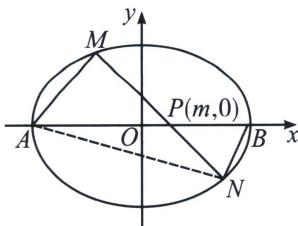

# 椭圆顶点弦斜率比的定值性质

## 2026版高中《mst老唐说题》圆锥曲线专题（数学）

## 二、隐藏的斜率之比

若 A、B 为椭圆长轴顶点，直线 MN 交椭圆于 M、N 两点，交长轴于点 $P(m,0)$ ，则 $\frac{k_{AM}}{k_{BN}}$ 为定值，反之， $\frac{k_{AM}}{k_{BN}}$ 为定值，则 MN 过长轴上定点 $P(m,0)$ ;

## 相关原子

- [椭圆的定义与标准方程](%E6%A4%AD%E5%9C%86%E7%9A%84%E5%AE%9A%E4%B9%89%E4%B8%8E%E6%A0%87%E5%87%86%E6%96%B9%E7%A8%8B.md)
- [直线的倾斜角与斜率](%E7%9B%B4%E7%BA%BF%E7%9A%84%E5%80%BE%E6%96%9C%E8%A7%92%E4%B8%8E%E6%96%9C%E7%8E%87.md)

## 所属组织

- [二、隐藏的斜率之比](../%E9%A2%98%E5%9E%8B/%E6%8C%89%E9%A2%98%E5%9E%8B%E5%88%86%E7%B1%BB/%E5%9C%86%E9%94%A5%E6%9B%B2%E7%BA%BF/%E5%9C%86%E9%94%A5%E6%9B%B2%E7%BA%BF%E5%B8%B8%E8%A7%84%E6%95%B0%E6%8D%AE%E5%A4%84%E7%90%86%E6%96%B9%E6%B3%95/%E7%AC%AC%E4%BA%8C%E8%8A%82_%E9%9A%90%E8%97%8F%E7%9A%84%E6%96%9C%E7%8E%87%E5%92%8C%E7%A7%AF%E9%97%AE%E9%A2%98/%E4%BA%8C_%E9%9A%90%E8%97%8F%E7%9A%84%E6%96%9C%E7%8E%87%E4%B9%8B%E6%AF%94.md)

## 题型训练 · 2026版高中《mst老唐说题》圆锥曲线专题（数学）

### 圆锥曲线常规数据处理方法 / 第二节 隐藏的斜率和积问题

> [!example]- 二、隐藏的斜率之比
> 
