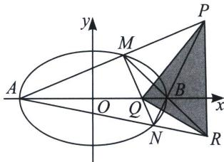

# 椭圆顶点弦的斜率比与定点

## 2026版高中《mst老唐说题》圆锥曲线专题（数学）

## 四、第三定义转化为斜率比

如图，A、B 分别为椭圆 $\frac{x^{2}}{a^{2}} + \frac{y^{2}}{b^{2}} = 1 (a > b > 0)$ 的左右顶点，M、N 为椭圆上任意两点，MN 与 x 轴交于点 Q，AM 与 BN 交于点 P，根据极点极线理论可知，假设 AN 与 BM 交于 R，利用圆锥曲线的可轮换性，如果 M 与 N 两点位置互换，则 P 与 R 两点位置互换，PQR 形成自极三角形（参考后面大题章节）此时一定有 $\frac{x_{P}x_{Q}}{a^{2}} + \frac{y_{P}y_{Q}}{b^{2}} = 1$ ，即 $x_{P}x_{Q} = a^{2}$ .

故一定有： $\frac{k_{PA}}{k_{PB}}=\frac{x_{P}-a}{x_{P}+a}=\frac{\frac{a^{2}}{x_{Q}}-a}{\frac{a^{2}}{x_{Q}}+a}=\frac{a-x_{Q}}{a+x_{Q}}$ ， $k_{BM}k_{BN}=k_{BM}k_{PB}=-\frac{b^{2}}{a^{2}k_{PA}}k_{PB}=-\frac{b^{2}}{a^{2}}\frac{a+x_{Q}}{a-x_{Q}}=$ 定值

## 相关原子

- [椭圆的定义与标准方程](%E6%A4%AD%E5%9C%86%E7%9A%84%E5%AE%9A%E4%B9%89%E4%B8%8E%E6%A0%87%E5%87%86%E6%96%B9%E7%A8%8B.md)
- [直线的倾斜角与斜率](%E7%9B%B4%E7%BA%BF%E7%9A%84%E5%80%BE%E6%96%9C%E8%A7%92%E4%B8%8E%E6%96%9C%E7%8E%87.md)

## 所属组织

- [四、第三定义转化为斜率比](../%E7%9F%A5%E8%AF%86%E4%B8%B2%E8%81%94/mst%E8%80%81%E5%94%90%E8%AF%B4%E9%A2%98-%E5%9C%86%E9%94%A5%E6%9B%B2%E7%BA%BF-2026/%E4%B8%8A%E5%86%8C/%E7%AC%AC01%E7%AB%A0_%E5%9C%86%E9%94%A5%E6%9B%B2%E7%BA%BF%E5%9B%9B%E5%AE%9A%E4%B9%89/%E7%AC%AC%E4%B8%89%E8%8A%82_%E6%A4%AD%E5%9C%86%E5%8F%8C%E6%9B%B2%E7%9A%84%E6%96%9C%E7%8E%87%E8%BD%AC%E5%8C%96_%E7%AC%AC%E4%B8%89%E5%AE%9A%E4%B9%89/%E5%9B%9B_%E7%AC%AC%E4%B8%89%E5%AE%9A%E4%B9%89%E8%BD%AC%E5%8C%96%E4%B8%BA%E6%96%9C%E7%8E%87%E6%AF%94/%E5%9B%9B_%E7%AC%AC%E4%B8%89%E5%AE%9A%E4%B9%89%E8%BD%AC%E5%8C%96%E4%B8%BA%E6%96%9C%E7%8E%87%E6%AF%94.md)

## 题型训练 · 2026版高中《mst老唐说题》圆锥曲线专题（数学）

### 圆锥曲线四定义 / 第三节 椭圆双曲的斜率转化（第三定义）

> [!example]- 四、第三定义转化为斜率比
> 
