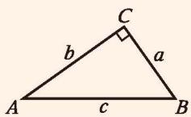
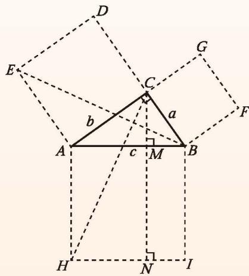

# 欧几里得《原本》对勾股定理的证明

## 情境引入与思考

## 知识讲解

### 北师大版初中数学·八年级下册

阅读·欣赏

利用教科书给出的基本事实和已有定理，我们可以证明勾股定理。

如图 1-25（1），在 $\triangle ABC$ 中， $\angle C=90^{\circ}$ ，BC=a，AC=b，AB=c。

如图 1-25 (2), 分别以 Rt△ABC 的三边为边作正方形 AHIB, ACDE, CBFG。连接 EB, CH。过点 C 作 AB 的垂线, 分别交 AB 和 HI 于点 M, N。正方形 ACDE、长方形 AHNM、长方形 MNIB, 以及 △EAB 和 △CAH 的面积分别记作 $S_{\text{正方形 }ACDE}$ , $S_{\text{长方形 }AHNM}$ , $S_{\text{长方形 }MNIB}$ , $S_{\triangle EAB}$ , $S_{\triangle CAH^{\circ}}$

(1)

图1-25

(2)

$$
\begin{array}{r l} & \because \quad E A = C A, \angle E A B = \angle C A H = 90 ^ {\circ} + \angle C A B, A B = A H, \\ & \therefore \quad \triangle E A B \cong \triangle C A H (\mathrm{SAS}) _ {\circ} \end{array}
$$

又∵ $S_{正方形ACDE}=2S_{\triangle EAB},\quad S_{长方形AHNM}=2S_{\triangle CAH},$

$$
b ^ {2} = S _ {\mathrm{长方形} A H N M ^ {\circ}}
$$

同理 $a^2 = S_{\text{长方形} MNIB}\circ$

$$
\pmb {c} ^ {2} = \pmb {a} ^ {2} + \pmb {b} ^ {2} 。
$$

以上是欧几里得在《原本》中证明勾股定理的大致过程。

勾股定理是数学史上非常重要的定理之一。两千多年来，人们对它进行了大量的研究，给出了多达数百种的证明方法。如果你有兴趣，可查阅有关资料，了解勾股定理的其他证明方法。

## 本节例题与练习

- [1.3 随堂练习第1题](../%E4%B9%A0%E9%A2%98/Q070000002831.md)
- [1.3 随堂练习第2题](../%E4%B9%A0%E9%A2%98/Q070000002832.md)
- [1.3 随堂练习第3题](../%E4%B9%A0%E9%A2%98/Q070000002833.md)

## 所属组织

- [直角三角形的性质、判定与互逆命题](../%E7%9F%A5%E8%AF%86%E4%B8%B2%E8%81%94/%E5%8C%97%E5%B8%88%E5%A4%A7-%E5%85%AB%E5%B9%B4%E7%BA%A7%E4%B8%8B%E5%86%8C/%E7%AC%AC%E4%B8%80%E7%AB%A0%20%E4%B8%89%E8%A7%92%E5%BD%A2%E7%9A%84%E8%AF%81%E6%98%8E%E5%8F%8A%E5%85%B6%E5%BA%94%E7%94%A8/3%20%E7%9B%B4%E8%A7%92%E4%B8%89%E8%A7%92%E5%BD%A2/%E7%9B%B4%E8%A7%92%E4%B8%89%E8%A7%92%E5%BD%A2%E7%9A%84%E6%80%A7%E8%B4%A8%E3%80%81%E5%88%A4%E5%AE%9A%E4%B8%8E%E4%BA%92%E9%80%86%E5%91%BD%E9%A2%98.md)

## 相关练习组织（范围关联）

- [直角三角形的性质、判定与互逆命题](../%E9%A2%98%E5%9E%8B/%E6%8C%89%E7%AB%A0%E8%8A%82%E5%88%86%E7%B1%BB/%E5%8C%97%E5%B8%88%E5%A4%A7-%E5%85%AB%E5%B9%B4%E7%BA%A7%E4%B8%8B%E5%86%8C/%E7%AC%AC%E4%B8%80%E7%AB%A0%20%E4%B8%89%E8%A7%92%E5%BD%A2%E7%9A%84%E8%AF%81%E6%98%8E%E5%8F%8A%E5%85%B6%E5%BA%94%E7%94%A8/%E7%9B%B4%E8%A7%92%E4%B8%89%E8%A7%92%E5%BD%A2.md)
