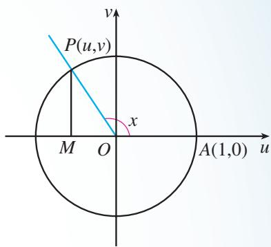

# 正弦函数、余弦函数的最大值与最小值

## 知识讲解

根据三角函数的定义可知，“单位圆上点的坐标就是三角函数”。因此，单位圆的性质与三角函数的性质有天然的联系，单位圆是研究三角函数性质的好工具。例如，借助单位圆的对称性可以方便地得到诱导公式。借助单位圆研究三角函数的性质体现了数形结合的思想方法，有利于从整体上把握三角函数。

如图1，在直角坐标系 $uOv$ 中，角 $x$ 的顶点与原点重合，始边与 $Ou$ 轴重合，终边与单位圆交于点 $P(\cos x, \sin x)$ 。容易发现，当角 $x$ 的终边绕原点从 $Ou$ 轴的正半轴开始，按照逆时针方向旋转时，点 $P$ 的横坐标按照

$$
1 \rightarrow 0 \rightarrow - 1 \rightarrow 0 \rightarrow 1 \dots
$$

的规律连续地、周而复始地变化；同时，纵坐标按照

  
图1

$$
0 \rightarrow 1 \rightarrow 0 \rightarrow - 1 \rightarrow 0 \dots
$$

的规律连续地、周而复始地变化.  
由上述变化规律，可得余弦函数、正弦函数的各种性质（下述表格中的 $k \in \mathbf{Z}$ ）.

余弦函数的最大值、最小值：

<table><tr><td>角x</td><td>π+2kπ</td><td>2kπ</td></tr><tr><td>P点的横坐标</td><td>-1</td><td>1</td></tr><tr><td>cos x</td><td>最小值</td><td>最大值</td></tr></table>

正弦函数的最大值、最小值：

<table><tr><td>角x</td><td>-π/2+2kπ</td><td>π/2+2kπ</td></tr><tr><td>P点的纵坐标</td><td>-1</td><td>1</td></tr><tr><td>sin x</td><td>最小值</td><td>最大值</td></tr></table>

## 本节例题与练习

- [例 2 求下列函数的周期:](../%E4%B9%A0%E9%A2%98/Q18016319404633408691.md)
- [练习 1](../%E4%B9%A0%E9%A2%98/Q11056022635090233139.md)
- [练习 2](../%E4%B9%A0%E9%A2%98/Q17883184013675499361.md)
- [练习 3](../%E4%B9%A0%E9%A2%98/Q15722793583125653403.md)
- [练习 4](../%E4%B9%A0%E9%A2%98/Q9405018804410720998.md)

## 所属组织

- [5.4.2 正弦函数、余弦函数的性质](../%E7%9F%A5%E8%AF%86%E4%B8%B2%E8%81%94/%E4%BA%BA%E6%95%99A-%E5%BF%85%E4%BF%AE%E7%AC%AC%E4%B8%80%E5%86%8C/%E7%AC%AC%E4%BA%94%E7%AB%A0%20%E4%B8%89%E8%A7%92%E5%87%BD%E6%95%B0/5.4%20%E4%B8%89%E8%A7%92%E5%87%BD%E6%95%B0%E7%9A%84%E5%9B%BE%E8%B1%A1%E4%B8%8E%E6%80%A7%E8%B4%A8/5.4.2%20%E6%AD%A3%E5%BC%A6%E5%87%BD%E6%95%B0%E3%80%81%E4%BD%99%E5%BC%A6%E5%87%BD%E6%95%B0%E7%9A%84%E6%80%A7%E8%B4%A8.md)

## 相关练习组织（范围关联）

- [5.4.2 正弦函数、余弦函数的性质](../%E9%A2%98%E5%9E%8B/%E4%BA%BA%E6%95%99A-%E5%BF%85%E4%BF%AE%E7%AC%AC%E4%B8%80%E5%86%8C/%E7%AC%AC%E4%BA%94%E7%AB%A0%20%E4%B8%89%E8%A7%92%E5%87%BD%E6%95%B0/5.4%20%E4%B8%89%E8%A7%92%E5%87%BD%E6%95%B0%E7%9A%84%E5%9B%BE%E8%B1%A1%E4%B8%8E%E6%80%A7%E8%B4%A8/5.4.2%20%E6%AD%A3%E5%BC%A6%E5%87%BD%E6%95%B0%E3%80%81%E4%BD%99%E5%BC%A6%E5%87%BD%E6%95%B0%E7%9A%84%E6%80%A7%E8%B4%A8.md)
