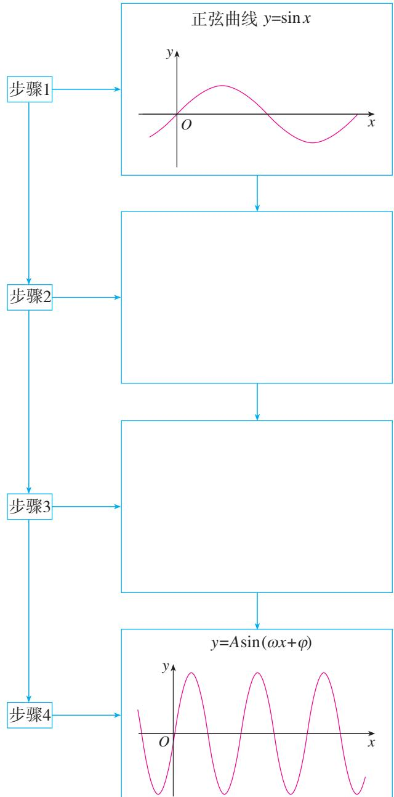

# 正弦型函数图象的综合变换

## 知识讲解

你能总结一下从正弦函数图象出发，通过图象变换得到 $y = A \sin(\omega x + \varphi)$ (A > 0, $\omega > 0$ ) 图象的过程与方法吗？

把正弦曲线上的所有点向左（当 $\varphi>0$ 时）或向右（当 $\varphi<0$ 时）平移 $|\varphi|$ 个单位长度，就得到函数 $y=\sin(x+\varphi)$ 的图象.

一般地，函数 $y = A\sin (\omega x + \varphi)(A > 0, \omega > 0)$ 的图象，可以用下面的方法得到：先画出函数 $y = \sin x$ 的图象；再把正弦曲线向左（或右）平移 $|\varphi|$ 个单位长度，得到函数 $y = \sin (x + \varphi)$ 的图象；然后把曲线上各点的横坐标变为原来的 $\frac{1}{\omega}$ 倍（纵坐标不变），得到函数 $y = \sin (\omega x + \varphi)$ 的图象；最后把曲线上各点的纵坐标变为原来的 $A$ 倍（横坐标不变），这时的曲线就是函数 $y = A\sin (\omega x + \varphi)$ 的图象.

这一过程的步骤如下：

补全步骤 2 和 3 的函数及图象.

从上述步骤可以清楚地看到，参数 $A$ ， $\omega$ ， $\varphi$ 是如何对函数图象产生影响的.

## 本节例题与练习

- [例 1 画出函数 $y=2\sin\l](../%E4%B9%A0%E9%A2%98/Q9752165728141238118.md)
- [例 2 摩天轮是一种大型转轮状的机械建](../%E4%B9%A0%E9%A2%98/Q16312207781551141542.md)
- [练习 1](../%E4%B9%A0%E9%A2%98/Q4689965883648963200.md)
- [练习 2](../%E4%B9%A0%E9%A2%98/Q11609037927414491904.md)
- [练习 3](../%E4%B9%A0%E9%A2%98/Q1212451033772777214.md)
- [练习 4](../%E4%B9%A0%E9%A2%98/Q14011488364175347908.md)

## 所属组织

- [5.6.2 函数 $y=A\sin(\omega x+\varphi)$ 的图象](../%E7%9F%A5%E8%AF%86%E4%B8%B2%E8%81%94/%E4%BA%BA%E6%95%99A-%E5%BF%85%E4%BF%AE%E7%AC%AC%E4%B8%80%E5%86%8C/%E7%AC%AC%E4%BA%94%E7%AB%A0%20%E4%B8%89%E8%A7%92%E5%87%BD%E6%95%B0/5.6%20%E5%87%BD%E6%95%B0%20y%20%3D%20A%20sin%28%CF%89x%20%2B%20%CF%86%29/5.6.2%20%E5%87%BD%E6%95%B0%20%24y%3DA%EF%BC%8Dsin%28%EF%BC%8Domega%20x%2B%EF%BC%8Dvarphi%29%24%20%E7%9A%84%E5%9B%BE%E8%B1%A1.md)

## 相关练习组织（范围关联）

- [5.6.2 函数 $y=A\sin(\omega x+\varphi)$ 的图象](../%E9%A2%98%E5%9E%8B/%E4%BA%BA%E6%95%99A-%E5%BF%85%E4%BF%AE%E7%AC%AC%E4%B8%80%E5%86%8C/%E7%AC%AC%E4%BA%94%E7%AB%A0%20%E4%B8%89%E8%A7%92%E5%87%BD%E6%95%B0/5.6%20%E5%87%BD%E6%95%B0%20y%20%3D%20A%20sin%28%CF%89x%20%2B%20%CF%86%29/5.6.2%20%E5%87%BD%E6%95%B0%20%24y%3DA%EF%BC%8Dsin%28%EF%BC%8Domega%20x%2B%EF%BC%8Dvarphi%29%24%20%E7%9A%84%E5%9B%BE%E8%B1%A1.md)
