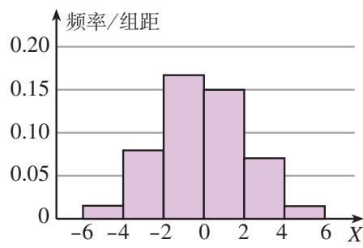
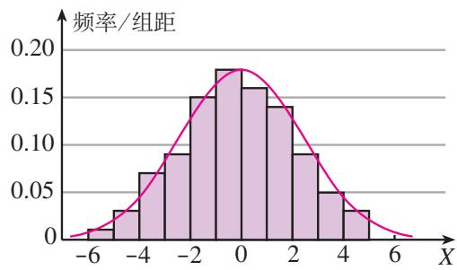
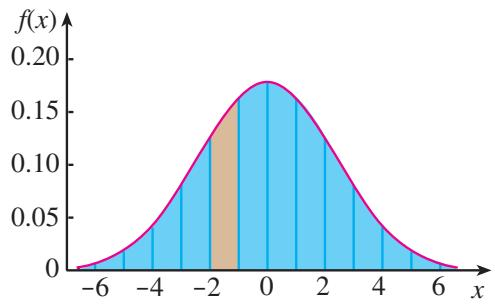
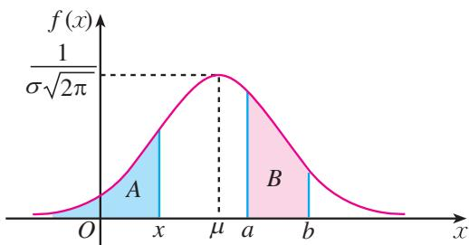

现实中，除了离散型随机变量外，还有大量问题中的随机变量不是离散型的，它们的取值往往充满某个区间甚至整个实轴，但取一点的概率为 0，我们称这类随机变量为连续型随机变量（continuous random variable）。

例如，自动流水线包装的每袋标准质量为 $400\ \mathrm{g}$ 的食盐，由于不可控因素，每袋实际质量与标准质量之差 $X$（单位： $\mathrm{g}$ ）就是一个连续型随机变量。在一次产品检验中随机抽取 100 袋食盐测得其误差 $X$ 的观测值，可用频率分布直方图描述这组误差数据的分布，如图 7.5-1 所示。频率分布直方图中每个小矩形的面积表示误差落在相应区间内的频率，所有小矩形的面积之和为 1。

观察图形可知：误差观测值有正有负，并大致对称地分布在 $X=0$ 的两侧，而且小误差比大误差出现得更频繁.

  
图7.5-1

随着样本数据量越来越大，让分组越来越多，组距越来越小，由频率的稳定性可知，频率分布直方图的轮廓就越来越稳定，接近一条光滑的钟形曲线，如图 7.5-2 所示.

  
图7.5-2

  
图7.5-3

根据频率与概率的关系，可用图 7.5-3 中的钟形曲线（曲线与水平轴之间的区域的面积为 1）来描述袋装食盐质量误差的概率分布。例如，任意抽取一袋食盐，误差落在 $[-2, -1]$ 内的概率，可用图中黄色阴影部分的面积表示。

图 7.5-3 中的钟形曲线对应一个有解析式的函数。刻画这类随机误差分布的函数解析式为

$$
f (x) = \frac {1}{\sigma \sqrt {2 \pi}} \mathrm{e} ^ {- \frac {(x - \mu) ^ {2}}{2 \sigma^ {2}}}, \quad x \in \mathbf {R},
$$

其中 $\mu \in \mathbf{R}$ ， $\sigma >0$ 为参数.

显然，对任意的 $x \in \mathbf{R}$ ， $f(x) > 0$ ，它的图象在 $x$ 轴的上方。可以证明 $x$ 轴和曲线之间的区域的面积为 1。我们称 $f(x)$ 为正态密度函数，称它的图象为正态密度曲线，简称正态曲线，如图 7.5-4 所示。若随机变量 $X$ 的概率分布密度函数为 $f(x)$ ，则称随机变量 $X$ 服从正态分布（normal distribution），记为 $X \sim N(\mu, \sigma^{2})$ 。特别地，当 $\mu = 0, \sigma = 1$ 时，称随机变量 $X$ 服从标准正态分布。

  
图7.5-4

若 $X \sim N(\mu, \sigma^2)$ ，则如图 7.5-4 所示， $X$ 取值不超过 $x$ 的概率 $P(X \leqslant x)$ 为图中区域 $A$ 的面积，而 $P(a \leqslant X \leqslant b)$ 为图中区域 $B$ 的面积.

早在 1733 年，法国数学家棣莫弗（A. De Moivre，1667—1754）在研究二项概率的近似计算时，已提出了正态密度函数的形式，但当时只是作为一个数学表达式。直到德国数学家高斯（C. F. Gauss，1777—1855）提出“正态误差”的理论后，正态密度函数才取得“概率分布”的身份。因此，人们也称正态分布为高斯分布。

$P(X \leqslant x)$ 只能通过数值积分近似计算. 可以查正态分布表或利用计算机软件计算. Excel 中对应的函数为 NORM.DIST.

正态分布在概率和统计中占有重要地位，它广泛存在于自然现象、生产和生活实践之中。在现实生活中，很多随机变量都服从或近似服从正态分布。例如，某些物理量的测量误差，某一地区同年龄人群的身高、体重、肺活量等，一定条件下生长的小麦的株高、穗长、单位面积产量，自动流水线生产的各种产品的质量指标（如零件的尺寸、纤维的纤度、电容器的电容），某地每年 7 月的平均气温、平均湿度、降水量等，一般都近似服从正态分布。
