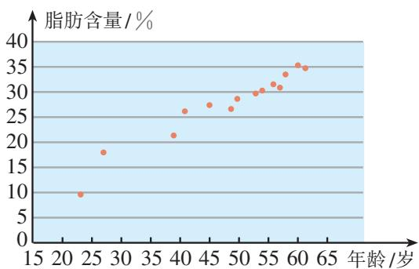

# 正相关与负相关的散点图特征

## 高中选择性必修 第三册·人教A版数学

探究

在对人体的脂肪含量和年龄之间关系的研究中，科研人员获得了一些年龄和脂肪含量的简单随机样本数据，如表8.1-1所示。表中每个编号下的年龄和脂肪含量数据都是对同一个体的观测结果，它们构成了成对数据。

表8.1-1

<table><tr><td>编号</td><td>1</td><td>2</td><td>3</td><td>4</td><td>5</td><td>6</td><td>7</td></tr><tr><td>年龄/岁</td><td>23</td><td>27</td><td>39</td><td>41</td><td>45</td><td>49</td><td>50</td></tr><tr><td>脂肪含量/%</td><td>9.5</td><td>17.8</td><td>21.2</td><td>25.9</td><td>27.5</td><td>26.3</td><td>28.2</td></tr><tr><td>编号</td><td>8</td><td>9</td><td>10</td><td>11</td><td>12</td><td>13</td><td>14</td></tr><tr><td>年龄/岁</td><td>53</td><td>54</td><td>56</td><td>57</td><td>58</td><td>60</td><td>61</td></tr><tr><td>脂肪含量/%</td><td>29.6</td><td>30.2</td><td>31.4</td><td>30.8</td><td>33.5</td><td>35.2</td><td>34.6</td></tr></table>

根据以上数据，你能推断人体的脂肪含量与年龄之间存在怎样的关系吗？

为了更加直观地描述上述成对样本数据中脂肪含量与年龄之间的关系，类似于用直方图描述单个变量样本数据的分布特征，我们用图形展示成对样本数据的变化特征。用横轴表示年龄，纵轴表示脂肪含量，则表8.1-1中每个编号下的成对样本数据都可用直角坐标系中的点表示出来，由这些点组成了如图8.1-1所示的统计图。我们把这样的统计图叫做散点图（scatter plot）。

  
图8.1-1

利用统计软件画散点图，有些电子表格软件可以通过插入图表，从图表类型中选取散点图；R 软件可以用函数 plot.

观察图8.1-1，可以发现，这些散点大致落在一条从左下角到右上角的直线附近，表明随年龄值的增加，相应的脂肪含量值呈现增加的趋势。这样，由成对样本数据的分布规律，我们可以推断脂肪含量变量和年龄变量之间存在着相关关系。

第八章 成对数据的统计分析

从整体上看，当一个变量的值增加时，另一个变量的相应值也呈现增加的趋势，我们就称这两个变量正相关（positive correlation）；当一个变量的值增加时，另一个变量的相应值呈现减小的趋势，则称这两个变量负相关（negative correlation）。

由图 8.1-1，能够推断脂肪含量与年龄这两个变量正相关.
