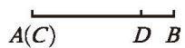

# 比较两条线段长短的度量法与叠合法

## 北师大版初中数学·七年级上册

如果直接观察难以判断，我们可以有两种方法进行比较：

一种方法是用刻度尺量出它们的长度，再进行比较；

另一种方法是把其中的一条线段移到另一条线段上去，将其中的一个端点重合在一起加以比较（如图 4-12）。

线段 $AB$ 等于线段 $CD$ , 记作 $AB = CD$

线段 $AB$ 大于线段 $CD$ , 记作 $AB > CD$

线段 $AB$ 小于线段 $CD$ , 记作 $AB < CD$

图4-12
