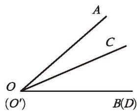
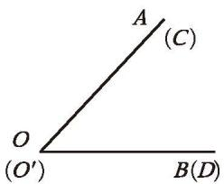
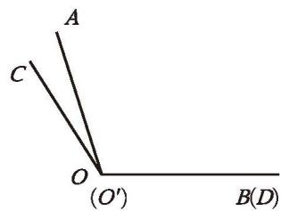

# 比较角的大小的度量法与叠合法

## 北师大版初中数学·七年级上册

与比较线段的长短类似，如果直接观察难以判断，我们可以有两种方法对角进行比较：

一种方法是用量角器量出它们的度数，再进行比较；

另一种方法是将两个角的顶点及一条边重合，另一条边放在重合边的同侧比较大小（如图 4-24）。

$\angle AOB$ 大于 $\angle CO'D,$ 记作 $\angle AOB > \angle CO'D$ (1)

$\angle AOB$ 等于 $\angle CO'D$ 记作 $\angle AOB = \angle CO'D$ (2)

图4-24

$\angle AOB$ 小于 $\angle CO'D,$ 记作 $\angle AOB <   \angle CO'D$ (3)
