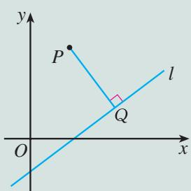

# 点到直线距离公式的代数推导

## 高中选择性必修 第一册·人教A版数学

探究

如图2.3-5，已知点 $P(x_0, y_0)$ ，直线 $l: Ax + By + C = 0$ ，如何求点 $P$ 到直线 $l$ 的距离？

  
图2.3-5

点 $P$ 到直线 $l$ 的距离，就是从点 $P$ 到直线 $l$ 的垂线段 $PQ$ 的长度，其中 $Q$ 是垂足（图2.3-5）。因此，求出垂足 $Q$ 的坐标，利用两点间的距离公式求出 $|PQ|$ ，就可以得到

点 P 到直线 l 的距离.

设 $A \neq 0, B \neq 0$ 。由 $PQ \perp l$ ，以及直线 $l$ 的斜率为 $-\frac{A}{B}$ ，可得 $l$ 的垂线 $PQ$ 的斜率为 $\frac{B}{A}$ ，因此，垂线 $PQ$ 的方程为 $y - y_0 = \frac{B}{A} (x - x_0)$ ，即 $Bx - Ay = Bx_0 - Ay_0$ 。

解方程组

$$
\left\{ \begin{array}{l} A x + B y + C = 0, \\ B x - A y = B x _ {0} - A y _ {0}, \end{array} \right.\tag{①}
$$

得直线 $l$ 与 $PQ$ 的交点坐标，即垂足 $Q$ 的坐标为

$$
\left(\frac {B ^ {2} x _ {0} - A B y _ {0} - A C}{A ^ {2} + B ^ {2}}, \frac {- A B x _ {0} + A ^ {2} y _ {0} - B C}{A ^ {2} + B ^ {2}}\right).
$$

于是

$$
\begin{array}{r l} \mid P Q \mid & = \sqrt {\left(\frac {B ^ {2} x _ {0} - A B y _ {0} - A C}{A ^ {2} + B ^ {2}} - x _ {0}\right) ^ {2} + \left(\frac {- A B x _ {0} + A ^ {2} y _ {0} - B C}{A ^ {2} + B ^ {2}} - y _ {0}\right) ^ {2}} \\ & = \sqrt {\frac {(A x _ {0} + B y _ {0} + C) ^ {2}}{A ^ {2} + B ^ {2}}} = \frac {\mid A x _ {0} + B y _ {0} + C \mid}{\sqrt {A ^ {2} + B ^ {2}}}. \end{array}
$$

因此，点 $P(x_{0}, y_{0})$ 到直线 l: $Ax + By + C = 0$ 的距离

$$
d = \frac {\mid A x _ {0} + B y _ {0} + C \mid}{\sqrt {A ^ {2} + B ^ {2}}}.
$$

可以验证，当 A=0，或 B=0 时，上述公式仍然成立.

思考

上述方法中，我们根据点到直线距离的定义，将点到直线的距离转化为两点之间的距离，思路自然但运算量较大。反思求解过程，你发现引起复杂运算的原因了吗？由此能否给出简化运算的方法？

在上述方法中，若设垂足 Q 的坐标为 $(x, y)$ ，则

$$
\left| P Q \right| = \sqrt {\left(x - x _ {0}\right) ^ {2} + \left(y - y _ {0}\right) ^ {2}}.\tag{②}
$$

对于②式，你能给出它的几何意义吗？结合方程组①，能否直接求出 $(x - x_0)^2 + (y - y_0)^2$ ，进而求出 $|PQ|$ 呢？请你试一试！
