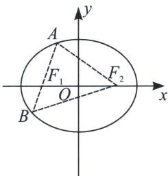
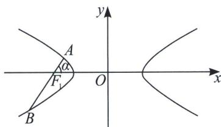
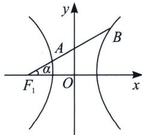
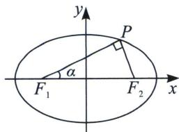
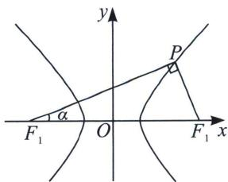

# 焦点三角形直角条件与离心率

## 2026版高中《mst老唐说题》圆锥曲线专题（数学）

## 上下文补充（来源原文）

## 第一节 弦长体系下的焦长模型与焦比定理

## 1. 椭圆的焦比定理

A 是椭圆 $\frac{x^{2}}{a^{2}} + \frac{y^{2}}{b^{2}} = 1 (a > b > 0)$ 上一点， $F_{1}$ 、 $F_{2}$ 是左、右焦点， $\angle AF_{1}F_{2}$ 为 $\alpha$ ，AB 过 $F_{1}$ ，c 是椭圆半焦距，如图，则 $\left|AF_{1}\right| = \frac{b^{2}}{a - c\cos\alpha}$ ①； $\left|BF_{1}\right| = \frac{b^{2}}{a + c\cos\alpha}$ ②； $\left|AB\right| = \frac{2ab^{2}}{a^{2} - c^{2}\cos^{2}\alpha} = \frac{2ab^{2}}{b^{2} + c^{2}\sin^{2}\alpha}$ ③.

焦比定理：过椭圆 $\frac{x^{2}}{a^{2}}+\frac{y^{2}}{b^{2}}=1$ 的左焦点 $F_{1}$ 的弦，令 $|AF_{1}|=\lambda|F_{1}B|$ ， $\frac{b^{2}}{a-c\cos\alpha}=\frac{\lambda b^{2}}{a+c\cos\alpha}\Rightarrow e\cos\alpha=\frac{\lambda-1}{\lambda+1}$ ④，代入焦长公式①可得 $|AF_{1}|=\frac{(\lambda+1)b^{2}}{2a}$ ， $|BF_{1}|=\frac{(\lambda+1)b^{2}}{2\lambda a}$ ⑤.

这样组合①②③④⑤，焦点弦问题才能形成闭环.

## 2. 双曲线焦比定理之交一支类型

A、B 是双曲线 $\frac{x^{2}}{a^{2}} - \frac{y^{2}}{b^{2}} = 1$ 左支上两点， $F_{1}$ 是左焦点， $\angle AF_{1}O$ 为 $\alpha$ ，AB 过 $F_{1}$ ，c 是双曲线半焦距，如图，则 $\left|AF_{1}\right| = \frac{b^{2}}{a + c\cos\alpha}$ ①； $\left|BF_{1}\right| = \frac{b^{2}}{a - c\cos\alpha}$ ②；（根据长减短加判断符号） $\left|AB\right| = \frac{2ab^{2}}{a^{2} - c^{2}\cos^{2}\alpha}$ ③。

令 $\left|AF_{1}\right| = \lambda \left|F_{1}B\right|$ ，即 $\frac{b^{2}}{a + c\cos\alpha} = \frac{\lambda b^{2}}{a - c\cos\alpha} \Rightarrow e\cos\alpha = \frac{1 - \lambda}{\lambda + 1} (0 < \lambda < 1)$ ④（如果 $\lambda > 1$ ，有 $e\cos\alpha = \frac{\lambda - 1}{\lambda + 1}$ ），代入弦长公式可得 $\left|AF_{1}\right| = \frac{(\lambda + 1)b^{2}}{2a}$ ， $\left|BF_{1}\right| = \frac{(\lambda + 1)b^{2}}{2\lambda a}$ ⑤（与椭圆一致）。

## 3. 双曲线焦比定理之交两支类型

A 是双曲线 $\frac{x^{2}}{a^{2}} - \frac{y^{2}}{b^{2}} = 1$ 左支上一点，B 是双曲线右支上一点， $F_{1}$ 是左焦点， $\angle AF_{1}O$ 为 $\alpha$ ，AB 过 $F_{1}$ ，c 是双曲线半焦距，如图，由于交两支时，有 $|k| < \frac{b}{a}$ ，平方得： $\tan^{2}\alpha < \frac{b^{2}}{a^{2}}$ ，即 $\cos\alpha > \frac{a}{c}$ ，故 $a - c\cos\alpha < 0$ $|AF_{1}| = \frac{b^{2}}{a + c\cos\alpha}$ ①； $|BF_{1}| = \frac{b^{2}}{c\cos\alpha - a}$ ②；（根据长减短加判断符号） $|AB| = \frac{2ab^{2}}{c^{2}\cos^{2}\alpha - a^{2}}$ ③。

令 $|BF_{1}| = \lambda |AF_{1}|$ ，即 $\frac{b^{2}}{c\cos\alpha - a} = \frac{\lambda b^{2}}{a + c\cos\alpha} \Rightarrow e\cos\alpha = \frac{\lambda + 1}{\lambda - 1} (\lambda > 1)$ ④

代入弦长公式可得 $|BF_{1}| = \frac{(\lambda - 1)b^{2}}{2a}$ ， $|AF_{1}| = \frac{(\lambda - 1)b^{2}}{2\lambda a}$ ⑤。

## 二、直角 $\angle F_{1}PF_{2}$ 的约束

椭圆篇： $\left|PF_{2}\right|=2c\sin\alpha,\quad\left|PF_{1}\right|=2c\cos\alpha$ ，有 $\left|PF_{1}\right|+\left|PF_{2}\right|=2a$ ，带入可得 $2c\sin\alpha+2c\cos\alpha=2a$ ，求得 $e=\frac{1}{\sin\alpha+\cos\alpha}=\frac{1}{\sqrt{2}\sin\left(\alpha+\frac{\pi}{4}\right)}$ ，根据 $\alpha$ 范围求解值域.

双曲线篇：双曲线同样存在类似定理，如上右图 $|PF_{2}| = 2c\sin \alpha$ ， $|PF_{1}| = 2c\cos \alpha$ ，有 $|PF_{1}| - |PF_{2}| = 2a$ ，带入可得 $2c\cos \alpha - 2c\sin \alpha = 2a$ ，求得 $e = \frac{1}{\cos \alpha - \sin \alpha} = \frac{1}{\sqrt{2}\cos\left(\alpha + \frac{\pi}{4}\right)}$

## 相关原子

- [双曲线的定义与标准方程](%E5%8F%8C%E6%9B%B2%E7%BA%BF%E7%9A%84%E5%AE%9A%E4%B9%89%E4%B8%8E%E6%A0%87%E5%87%86%E6%96%B9%E7%A8%8B.md)
- [双曲线的离心率](%E5%8F%8C%E6%9B%B2%E7%BA%BF%E7%9A%84%E7%A6%BB%E5%BF%83%E7%8E%87.md)
- [椭圆的定义与标准方程](%E6%A4%AD%E5%9C%86%E7%9A%84%E5%AE%9A%E4%B9%89%E4%B8%8E%E6%A0%87%E5%87%86%E6%96%B9%E7%A8%8B.md)
- [椭圆的离心率](%E6%A4%AD%E5%9C%86%E7%9A%84%E7%A6%BB%E5%BF%83%E7%8E%87.md)

## 题型训练 · 2026版高中《mst老唐说题》圆锥曲线专题（数学）

### 离心率 / 第三节 长度与角度下的离心率范围约束

> [!example]- 二、直角 $\angle F_{1}PF_{2}$ 的约束
> 
