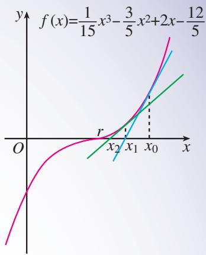

# 牛顿法求方程的近似解

## 情境引入与思考

## 知识讲解

### 高中选择性必修 第二册·人教A版数学

从函数的观点看，方程 $\frac{1}{15} x^3 -\frac{3}{5} x^2 +2x - \frac{12}{5} = 0$ 的根就是函数 $f(x) = \frac{1}{15} x^3 -$ $\frac{3}{5} x^{2} + 2x - \frac{12}{5}$ 的零点．从图形上看，一个函数的零点 $r$ 就是函数 $f(x)$ 的图象与 $x$ 轴的交点的横坐标（图1）．那么，如何求 $r$ 的值呢？

如果可以找到一步一步逼近 r 的 $x_{0}, x_{1}, \cdots, x_{n}$ ，使得当 n 很大时， $|x_{n}-r|$ 很小，那么，我们就可以把 $x_{n}$ 的值作为 r 的近似值，即把 $x_{n}$ 作为方程 $f(x)=0$ 的近似解.

牛顿用 “作切线” 的方法找到了这一串 $x_{0}$ ， $x_{1}$ ，…， $x_{n}$ 。当然，要有一个起始点，比如，我们从 $x_{0}=6$ 开始。 $^{①}$

如图1，在横坐标为 $x_0$ 的点处作 $f(x)$ 的切线，切线与 $x$ 轴交点的横坐标就是 $x_1$ ；用 $x_1$ 代替 $x_0$ 重复上面的过程得到 $x_2$ ；一直继续下去，得到 $x_0, x_1, \cdots, x_n$ 。从图形上我们可以看到， $x_1$ 较 $x_0$ 接近 $r, x_2$ 较 $x_1$ 接近 $r$ ，等等。它们越来越逼近 $r$ 。接下来的任务是计算 $x_n$ 。我们知道， $f(x)$ 在点 $(x_0, f(x_0))$ 处切线的斜率是 $f'(x_0)$ ，因此切线方程为

$$
y - f \left(x _ {0}\right) = f ^ {\prime} \left(x _ {0}\right) \left(x - x _ {0}\right).
$$

如果 $f^{\prime}(x_0)\neq 0$ ，那么切线与 $x$ 轴交点的横坐标是

$$
x _ {1} = x _ {0} - \frac {f (x _ {0})}{f ^ {\prime} (x _ {0})}.
$$

继续这个过程，就可以推导出如下求方程根的牛顿法公式：

如果 $f^{\prime}(x_{n - 1})\neq 0$ ，那么

$$
x _ {n} = x _ {n - 1} - \frac {f (x _ {n - 1})}{f ^ {\prime} (x _ {n - 1})}. \tag {②}
$$

对于一个给定的精确度，你能根据上述公式，求出方程 $\frac{1}{15} x^3 -\frac{3}{5} x^2 +2x - \frac{12}{5} = 0$ 的近似解吗？

进一步思考以下问题：

1. 不同的初始值对求方程的近似解有影响吗？如果有，影响在什么地方？

2. 你还知道其他求方程近似解的方法吗？你认为牛顿法的优点和缺点是什么？

  
图1

② 请同学们自己推导.

① 起始点当然是越接近零点越好，我们可以事先对零点作一个估计。如果使用信息技术工具，这种估计是比较容易的。

## 先修知识

- [导数的几何意义与以直代曲](%E5%AF%BC%E6%95%B0%E7%9A%84%E5%87%A0%E4%BD%95%E6%84%8F%E4%B9%89%E4%B8%8E%E4%BB%A5%E7%9B%B4%E4%BB%A3%E6%9B%B2.md)

## 所属组织

- [探究与发现 牛顿法——用导数方法求方程的近似解](../%E7%9F%A5%E8%AF%86%E4%B8%B2%E8%81%94/%E4%BA%BA%E6%95%99A-%E9%80%89%E6%8B%A9%E6%80%A7%E5%BF%85%E4%BF%AE%E7%AC%AC%E4%BA%8C%E5%86%8C/%E7%AC%AC%E4%BA%94%E7%AB%A0%20%E4%B8%80%E5%85%83%E5%87%BD%E6%95%B0%E7%9A%84%E5%AF%BC%E6%95%B0%E5%8F%8A%E5%85%B6%E5%BA%94%E7%94%A8/%E6%8E%A2%E7%A9%B6%E4%B8%8E%E5%8F%91%E7%8E%B0%20%E7%89%9B%E9%A1%BF%E6%B3%95%E2%80%94%E2%80%94%E7%94%A8%E5%AF%BC%E6%95%B0%E6%96%B9%E6%B3%95%E6%B1%82%E6%96%B9%E7%A8%8B%E7%9A%84%E8%BF%91%E4%BC%BC%E8%A7%A3.md)

## 相关练习组织（范围关联）

- [第五章 一元函数的导数及其应用](../%E9%A2%98%E5%9E%8B/%E6%8C%89%E7%AB%A0%E8%8A%82%E5%88%86%E7%B1%BB/%E4%BA%BA%E6%95%99A-%E9%80%89%E6%8B%A9%E6%80%A7%E5%BF%85%E4%BF%AE%E7%AC%AC%E4%BA%8C%E5%86%8C/%E7%AC%AC%E4%BA%94%E7%AB%A0%20%E4%B8%80%E5%85%83%E5%87%BD%E6%95%B0%E7%9A%84%E5%AF%BC%E6%95%B0%E5%8F%8A%E5%85%B6%E5%BA%94%E7%94%A8/%E7%AC%AC%E4%BA%94%E7%AB%A0%20%E4%B8%80%E5%85%83%E5%87%BD%E6%95%B0%E7%9A%84%E5%AF%BC%E6%95%B0%E5%8F%8A%E5%85%B6%E5%BA%94%E7%94%A8.md)
