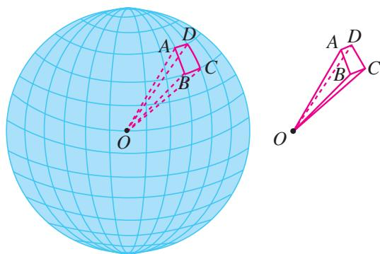

# 球的表面积与体积公式

## 高中必修 第二册·人教A版数学

设球的半径为 R，它的表面积只与半径 R 有关，是以 R 为自变量的函数.

事实上，如果球的半径为 $R$ ，那么它的表面积是

$$
S _ {\text {球}} = 4 \pi R ^ {2}.
$$

思考

在小学，我们学习了圆的面积公式，你还记得是如何求得的吗？类比这种方法，你能由球的表面积公式推导出球的体积公式吗？

类比利用圆周长求圆面积的方法，我们可以利用球的表面积求球的体积．如图8.3-5，把球 O 的表面分成 n 个小网格，连接球心 O 和每个小网格的顶点，整个球体就被分割成 n 个“小锥体”.

  
图8.3-5

当 $n$ 越大，每个小网格越小时，每个“小锥体”的底面就越平，“小锥体”就越近似于棱锥，其高越近似于球半径 $R$ 。设 $O - ABCD$ 是其中一个“小锥体”，它的体积

$$
V _ {O - A B C D} \approx \frac {1}{3} S _ {A B C D} R.
$$

由于球的体积就是这 $n$ 个“小锥体”的体积之和，而这 $n$ 个“小锥体”的底面积之和就是球的表面积。因此，球的体积

$$
V _ {\text {球}} = \frac {1}{3} S _ {\text {球}} R = \frac {1}{3} \times 4 \pi R ^ {2} \cdot R = \frac {4}{3} \pi R ^ {3}.
$$

由此，我们得到球的体积公式

$$
V _ {\text {球}} = \frac {4}{3} \pi R ^ {3}.
$$
