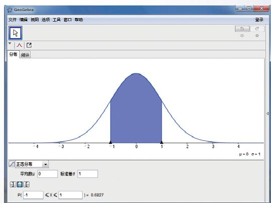

# 用GeoGebra计算正态分布概率

## 高中选择性必修 第三册·人教A版数学

选择正态分布，输入均值 $\mu=0$ ，标准差 $\sigma=1$ ，即 $N(0,1)$ 。如图3，绘图区显示正态密度曲线图。输入随机变量的取值范围，窗口底部显示随机变量落在该范围的概率，例如

$$
\begin{array}{l} P (- 1 \leqslant X \leqslant 1) = 0. 6 8 2 7, \\ P (- 2 \leqslant X \leqslant 2) = 0. 9 5 4 5, \\ P (- 3 \leqslant X \leqslant 3) = 0. 9 9 7 3. \end{array}
$$

  
图3

通过窗口左下角的按钮，还可以求变量落在单边区间内的概率，例如

$$
P (X \leqslant 1. 5) = 0. 9 3 3 2.
$$

请你再选择一些正态分布 $N(\mu, \sigma^2)$ ，分别计算 $P(\mu - \sigma \leqslant X \leqslant \mu + \sigma)$ ， $P(\mu - 2\sigma \leqslant X \leqslant \mu + 2\sigma)$ ， $P(\mu - 3\sigma \leqslant X \leqslant \mu + 3\sigma)$ 的值，并总结这些值的规律.
