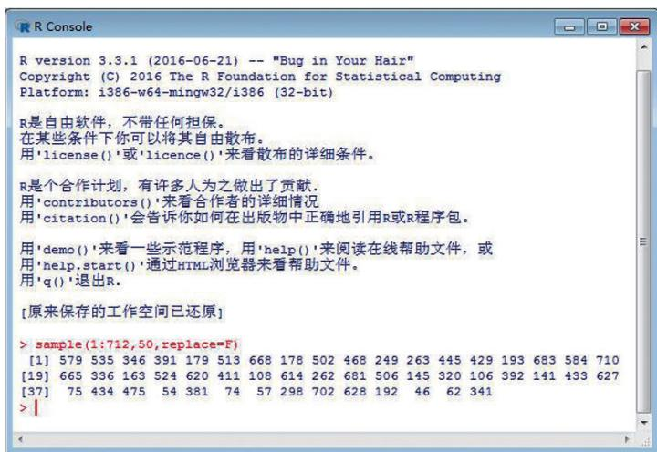

# 用R软件生成随机数

## 高中必修 第二册·人教A版数学

在 R 软件的控制台中，输入 “sample（1：712，50，replace=F）”，按回车键，就可以得到 50 个 1～712 范围内的不重复的整数随机数（图 9.1-2）.

  
图9.1-2

R 软件是免费的统计软件，该软件具有比较强大的数据处理、绘图和分析等统计功能，在统计学研究和学习中被广泛使用.

随着信息技术的发展，人们越来越多地利用计算器、数学软件、统计软件等工具来生成随机数。尤其是一些统计软件，可以非常方便地按要求生成各种随机数。用信息技术工具产生随机数最大的优点是方便、快捷。

## 本节例题与练习

- [练习 1](../%E4%B9%A0%E9%A2%98/Q070000000819.md)
- [练习 1](../%E4%B9%A0%E9%A2%98/Q070000000824.md)
- [练习 2](../%E4%B9%A0%E9%A2%98/Q070000000820.md)
- [练习 2](../%E4%B9%A0%E9%A2%98/Q070000000825.md)
- [练习 3](../%E4%B9%A0%E9%A2%98/Q070000000826.md)
- [练习 3](../%E4%B9%A0%E9%A2%98/Q070000000821.md)
- [练习 4](../%E4%B9%A0%E9%A2%98/Q070000000822.md)
- [练习 5](../%E4%B9%A0%E9%A2%98/Q070000000823.md)

## 所属组织

- [9.1.1 简单随机抽样](../%E7%9F%A5%E8%AF%86%E4%B8%B2%E8%81%94/%E4%BA%BA%E6%95%99A-%E5%BF%85%E4%BF%AE%E7%AC%AC%E4%BA%8C%E5%86%8C/%E7%AC%AC%E4%B9%9D%E7%AB%A0%20%E7%BB%9F%E8%AE%A1/9.1%20%E9%9A%8F%E6%9C%BA%E6%8A%BD%E6%A0%B7/9.1.1%20%E7%AE%80%E5%8D%95%E9%9A%8F%E6%9C%BA%E6%8A%BD%E6%A0%B7.md)

## 相关练习组织（范围关联）

- [9.1.1 简单随机抽样](../%E9%A2%98%E5%9E%8B/%E6%8C%89%E7%AB%A0%E8%8A%82%E5%88%86%E7%B1%BB/%E4%BA%BA%E6%95%99A-%E5%BF%85%E4%BF%AE%E7%AC%AC%E4%BA%8C%E5%86%8C/%E7%AC%AC%E4%B9%9D%E7%AB%A0%20%E7%BB%9F%E8%AE%A1/9.1%20%E9%9A%8F%E6%9C%BA%E6%8A%BD%E6%A0%B7.md)
