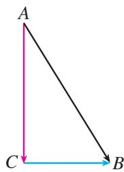
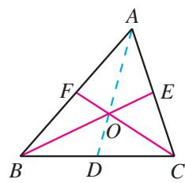

# 用向量法研究三角形的性质

## 高中必修 第二册·人教A版数学

在前面的学习中我们看到，“有了运算，向量的力量无限”。实际上，通过向量运算证明某些几何图形的性质，比平面几何的“从图形的已知性质推出待证的性质”简便多了。例如，平面几何中证明勾股定理时，需要添加辅助线、构造正方形等，不仅复杂，而且不容易想到。但用向量法，我们有：

如图1，在 $\mathrm{Rt}\triangle ABC$ 中， $\angle C = 90^{\circ}$ .根据向量的加法法则，有

$$
\overrightarrow {A B} = \overrightarrow {A C} + \overrightarrow {C B}.
$$

所以 $\overrightarrow{AB}^2 = \overrightarrow{AC}^2 +\overrightarrow{CB}^2 +2\overrightarrow{AC}\cdot \overrightarrow{CB}.$

因为 $\overrightarrow{CB} \perp \overrightarrow{AC}$ ,

所以 $\overrightarrow{AC} \cdot \overrightarrow{CB} = 0.$

因此 $\overrightarrow{AB}^2 = \overrightarrow{AC}^2 +\overrightarrow{CB}^2.$

  
图1

这个证明仅仅用到了“三角形回路（向量加法）”和数量积运算，而且证明过程是程序化的，充分体现了向量运算的作用，确实简单多了.

下面请同学们以向量为工具，展开一次数学探究之旅吧.

三角形是简单而重要的平面图形，它是平面几何研究的主角。初中我们对三角形进行了较深入的研究，获得了许多性质。在数学研究中，常常用新的工具、新的方法对已研究过的对象进行再研究，这不仅可以站在新的高度重新审视研究对象，加深对数学对象的认识，而且可以有所发现。因此，以向量为工具对三角形进行再研究是非常有意义的。

1. 回顾初中研究三角形的过程，从研究的思路、内容、方法等角度进行梳理，并列出已经得到的结论.

2. 用向量方法对已证的结论进行证明，总结用向量方法处理几何问题的基本程序，并与平面几何中的推理论证过程进行比较，阐述各自的特点.

数学探究 用向量法研究三角形的性质

3. 用向量方法证明以往未加证明或你自己新发现的结论.

例如，在八年级，我们曾经学过三角形的中线，知道“三角形的三条中线相交于一点，这个交点叫做三角形的重心”。而物理学知识告诉我们，重心是物体各部分所受重力的合力的作用点，形状规则且密度均匀的物体的重心就是它的几何中心。“重心”是几何学和物理学的共同研究对象，应该是很重要的，但我们对它知之甚少。那么，它到底有哪些神秘的性质呢？

其实，从严谨性的角度看，三角形的两条中线相交于一点是肯定的，但第三条中线是否经过这个交点是需要证明的。下面我们就用向量方法来探究它是否成立。

如图2，在 $\triangle ABC$ 中， $D$ ， $E$ ， $F$ 分别是 $BC$ ， $CA$ ， $AB$ 的中点，设 $BE$ ， $CF$ 交于一点 $O$ ，连接 $AO$ ， $OD$

取 $\overrightarrow{OB}$ ， $\overrightarrow{OC}$ 为基底，并设 $\overrightarrow{EO}=t_{1}\overrightarrow{OB}$ ， $\overrightarrow{FO}=t_{2}\overrightarrow{OC}$ ，则

$$
\overrightarrow {E C} = \overrightarrow {E O} + \overrightarrow {O C} = t _ {1} \overrightarrow {O B} + \overrightarrow {O C};
$$

$$
\overrightarrow {F B} = \overrightarrow {F O} + \overrightarrow {O B} = t _ {2} \overrightarrow {O C} + \overrightarrow {O B}.
$$

图2

所以

$$
\begin{array}{r l} \overrightarrow {B C} & = \overrightarrow {A C} - \overrightarrow {A B} = 2 \overrightarrow {E C} - 2 \overrightarrow {F B} \\ & = 2 (t _ {1} \overrightarrow {O B} + \overrightarrow {O C}) - 2 (t _ {2} \overrightarrow {O C} + \overrightarrow {O B}) \\ & = 2 (t _ {1} - 1) \overrightarrow {O B} - 2 (t _ {2} - 1) \overrightarrow {O C}. \end{array}
$$

又因为 $\overrightarrow{BC} = \overrightarrow{OC} -\overrightarrow{OB}$ ，所以由平面向量基本定理，得

基底可以有不同的选择，你可以选择其他基底试一试.

$$
\left\{ \begin{array}{l} 2 (t _ {1} - 1) = - 1, \\ 2 (t _ {2} - 1) = - 1. \end{array} \right.
$$

解得

$$
t _ {1} = \frac {1}{2}, t _ {2} = \frac {1}{2}.
$$

所以

$$
\overrightarrow {E O} = \frac {1}{2} \overrightarrow {O B}, \overrightarrow {F O} = \frac {1}{2} \overrightarrow {O C}.
$$

因此

$$
\begin{array}{r l} \overrightarrow {A O} & = \overrightarrow {F O} - \overrightarrow {F A} = \overrightarrow {F O} + \overrightarrow {F B} \\ & = \overrightarrow {F O} + \overrightarrow {F O} + \overrightarrow {O B} = \overrightarrow {O C} + \overrightarrow {O B}, \end{array}
$$

$$
\begin{array}{r l} \overrightarrow {O D} & = \overrightarrow {B D} - \overrightarrow {B O} = \frac {1}{2} \overrightarrow {B C} + \overrightarrow {O B} \\ & = \frac {1}{2} (\overrightarrow {O C} - \overrightarrow {O B}) + \overrightarrow {O B} = \frac {1}{2} (\overrightarrow {O C} + \overrightarrow {O B}). \end{array}
$$

于是

$$
\overrightarrow {A O} = 2 \overrightarrow {O D}.
$$

这样， $\overrightarrow{AO}$ 与 $\overrightarrow{OD}$ 共线，即 $AD$ 是 $\triangle ABC$ 的 $BC$ 边上的中线，且过 $BE$ ， $CF$ 的交点 $O$ 。所以，“三角形的三条中线交于一点”成立。

另外，你有没有发现， $\overrightarrow{EO} = \frac{1}{2}\overrightarrow{OB}$ ， $\overrightarrow{FO} = \frac{1}{2}\overrightarrow{OC}$ ， $\overrightarrow{DO} = \frac{1}{2}\overrightarrow{OA}$ 。这表明：三角形的重心分每条中线为 $1:2$ 的两条线段，即三角形的重心是中线的三等分点。这样，我们在证明三角形的三条中线交于一点的过程中，“顺便”得到了三角形的一个重要性质。是不是很有趣？

如果把眼光聚焦在三角形的边、外心、中线、重心、角平分线、内心、高、垂心等，你还可以发现更多的性质.

以独立探究和小组合作相结合的方式开展探究活动.

建议按如下步骤完成：

1. 小组集体讨论探究方案，确定研究思路；

2. 小组成员各自开展独立探究，并以专题作业的形式撰写研究报告；

3. 小组内进行交流讨论，完善研究成果，并形成一份小组研究报告；

4. 全班进行成果交流、评价.
