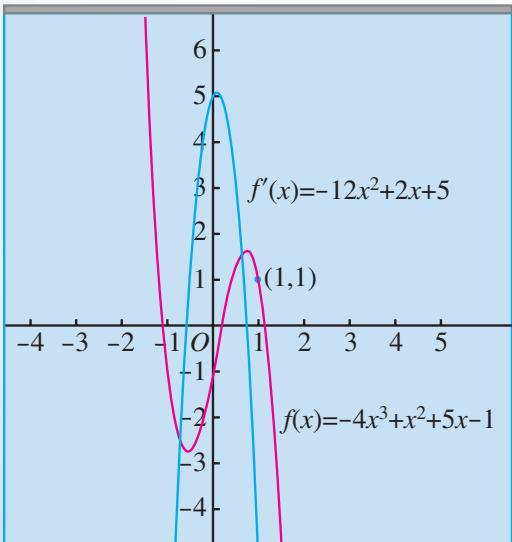
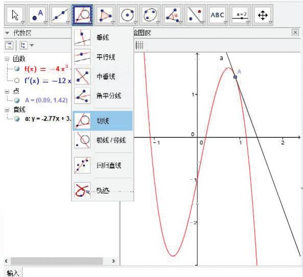

# 用图形技术研究函数性质

## 高中选择性必修 第二册·人教A版数学

1. 由函数 $f(x)$ 的解析式直接画出其图象；

2. 移动光标，显示函数 $f(x)$ 图象上任一点的坐标；

3. 由函数 $f(x)$ 的解析式及其图象求出其导函数 $f'(x)$ ，并画出其图象；

4. 显示并求出经过函数 $f(x)$ 图象上某点切线的斜率和切线的方程；

5. 求出并显示函数 $f(x)$ 的零点和极值点；

6. 对函数 $f(x)$ 图象的局部进行放大和缩小；

7. 求出函数 $f(x)$ 在定义域内某个闭区间上的最大值与最小值.

图 1、图 2 展示了上述部分功能.

  
图1

  
图2

图形计算器和计算机软件提供的函数作图和分析功能，对我们把握函数的性质有重要的帮助：一方面，通过画出函数的图象，对图象进行观察和分析，并作出猜想和发现，从而探讨函数的性质；另一方面，用导数研究函数的性质后，可用图形技术进行直观验证，两者相辅相成。
