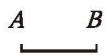

用尺规作图①的方法可以将一条线段移到另一条线段上。

例如图 4-13, 已知线段 $AB$ , 用尺规作一条线段等于已知线段 $AB$ 。

作法：1. 作射线 $A^{\prime} C^{\prime}$ (如图4-14)。

2. 用圆规在射线 $A^{\prime} C^{\prime}$ 上截取 $A^{\prime} B^{\prime} = A B$ 。

线段 $A'B'$ 就是所要作的线段。

图4-13

图4-14
