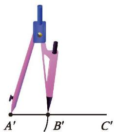

# 用尺规作一条线段等于已知线段的作法

## 情境引入与思考

## 知识讲解

### 北师大版初中数学·七年级上册

用尺规作图①的方法可以将一条线段移到另一条线段上。

例如图 4-13, 已知线段 $AB$ , 用尺规作一条线段等于已知线段 $AB$ 。

作法：1. 作射线 $A^{\prime} C^{\prime}$ (如图4-14)。

2. 用圆规在射线 $A^{\prime} C^{\prime}$ 上截取 $A^{\prime} B^{\prime} = A B$ 。

线段 $A'B'$ 就是所要作的线段。

图4-13

图4-14

## 本节例题与练习

- [随堂练习 4.1.2-1](../%E4%B9%A0%E9%A2%98/Q070000002165.md)
- [随堂练习 4.1.2-2](../%E4%B9%A0%E9%A2%98/Q070000002166.md)
- [随堂练习 4.1.2-3](../%E4%B9%A0%E9%A2%98/Q070000002167.md)

## 所属组织

- [4.1.2 比较线段的长短、线段中点与尺规作图](../%E7%9F%A5%E8%AF%86%E4%B8%B2%E8%81%94/%E5%8C%97%E5%B8%88%E5%A4%A7-%E4%B8%83%E5%B9%B4%E7%BA%A7%E4%B8%8A%E5%86%8C/%E7%AC%AC%E5%9B%9B%E7%AB%A0%20%E5%9F%BA%E6%9C%AC%E5%B9%B3%E9%9D%A2%E5%9B%BE%E5%BD%A2/1%20%E7%BA%BF%E6%AE%B5%E3%80%81%E5%B0%84%E7%BA%BF%E3%80%81%E7%9B%B4%E7%BA%BF/4.1.2%20%E6%AF%94%E8%BE%83%E7%BA%BF%E6%AE%B5%E7%9A%84%E9%95%BF%E7%9F%AD%E3%80%81%E7%BA%BF%E6%AE%B5%E4%B8%AD%E7%82%B9%E4%B8%8E%E5%B0%BA%E8%A7%84%E4%BD%9C%E5%9B%BE.md)

## 相关练习组织（范围关联）

- [4.1.2 比较线段的长短、线段中点与尺规作图](../%E9%A2%98%E5%9E%8B/%E6%8C%89%E7%AB%A0%E8%8A%82%E5%88%86%E7%B1%BB/%E5%8C%97%E5%B8%88%E5%A4%A7-%E4%B8%83%E5%B9%B4%E7%BA%A7%E4%B8%8A%E5%86%8C/%E7%AC%AC%E5%9B%9B%E7%AB%A0%20%E5%9F%BA%E6%9C%AC%E5%B9%B3%E9%9D%A2%E5%9B%BE%E5%BD%A2/%E7%BA%BF%E6%AE%B5%E3%80%81%E5%B0%84%E7%BA%BF%E3%80%81%E7%9B%B4%E7%BA%BF.md)
