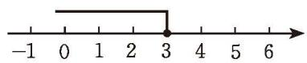

# 用数轴表示不等式的解集

## 情境引入与思考

## 知识讲解

### 北师大版初中数学·八年级下册

不等式 $6 + x > 10$ 的解集 $x > 4$ 可以用数轴上表示4的点右边的部分来表示（如图2-2），在数轴上表示4的点的位置上画空心圆圈，表示4不在这个解集内。

图2-2

图2-3

不等式 $x - 1 \leqslant 2$ 的解集 $x \leqslant 3$ 可以用数轴上表示 3 的点及其左边的部分来表示（如图 2-3），在数轴上表示 3 的点的位置上画实心圆点，表示 3 在这个解集内。

## 本节例题与练习

- [2.1 随堂练习第3题](../%E4%B9%A0%E9%A2%98/Q070000002905.md)
- [2.1 随堂练习第4题](../%E4%B9%A0%E9%A2%98/Q070000002906.md)

## 所属组织

- [不等式的解与解集](../%E7%9F%A5%E8%AF%86%E4%B8%B2%E8%81%94/%E5%8C%97%E5%B8%88%E5%A4%A7-%E5%85%AB%E5%B9%B4%E7%BA%A7%E4%B8%8B%E5%86%8C/%E7%AC%AC%E4%BA%8C%E7%AB%A0%20%E4%B8%8D%E7%AD%89%E5%BC%8F%E4%B8%8E%E4%B8%8D%E7%AD%89%E5%BC%8F%E7%BB%84/1%20%E4%B8%8D%E7%AD%89%E5%BC%8F%E5%8F%8A%E5%85%B6%E5%9F%BA%E6%9C%AC%E6%80%A7%E8%B4%A8/%E4%B8%8D%E7%AD%89%E5%BC%8F%E7%9A%84%E8%A7%A3%E4%B8%8E%E8%A7%A3%E9%9B%86.md)

## 相关练习组织（范围关联）

- [不等式的解与解集](../%E9%A2%98%E5%9E%8B/%E6%8C%89%E7%AB%A0%E8%8A%82%E5%88%86%E7%B1%BB/%E5%8C%97%E5%B8%88%E5%A4%A7-%E5%85%AB%E5%B9%B4%E7%BA%A7%E4%B8%8B%E5%86%8C/%E7%AC%AC%E4%BA%8C%E7%AB%A0%20%E4%B8%8D%E7%AD%89%E5%BC%8F%E4%B8%8E%E4%B8%8D%E7%AD%89%E5%BC%8F%E7%BB%84/%E4%B8%8D%E7%AD%89%E5%BC%8F%E5%8F%8A%E5%85%B6%E5%9F%BA%E6%9C%AC%E6%80%A7%E8%B4%A8.md)
