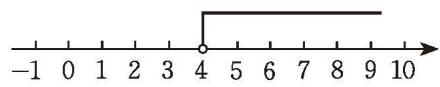

# 用数轴表示不等式的解集

## 北师大版初中数学·八年级下册

不等式 $6 + x > 10$ 的解集 $x > 4$ 可以用数轴上表示4的点右边的部分来表示（如图2-2），在数轴上表示4的点的位置上画空心圆圈，表示4不在这个解集内。

图2-2

图2-3

不等式 $x - 1 \leqslant 2$ 的解集 $x \leqslant 3$ 可以用数轴上表示 3 的点及其左边的部分来表示（如图 2-3），在数轴上表示 3 的点的位置上画实心圆点，表示 3 在这个解集内。
