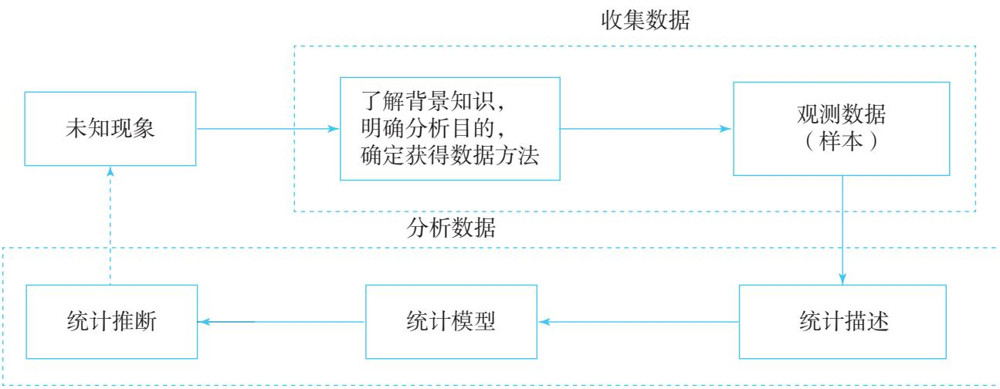
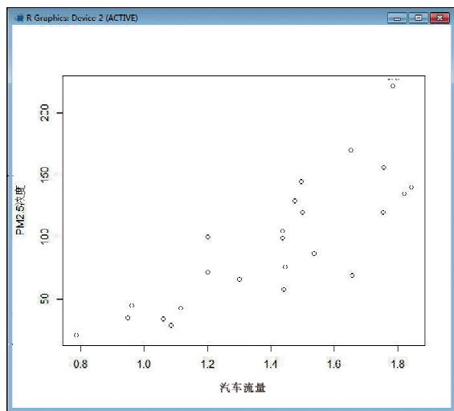
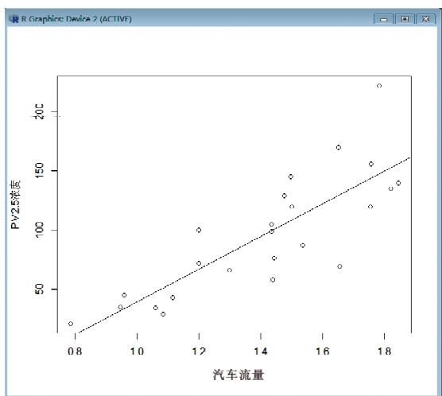
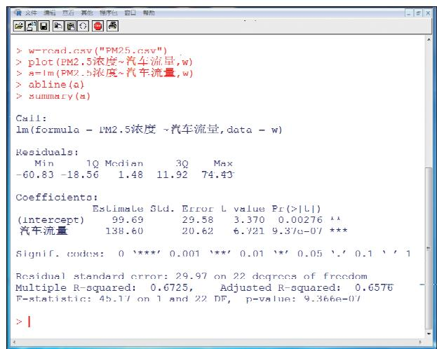

# 用汽车流量预测PM2.5浓度的统计建模

## 高中选择性必修 第三册·人教A版数学

在现实世界中有许多随机现象需要研究。已有的学习告诉我们，研究随机现象，就是要在明确研究对象和问题的基础上，通过收集数据、整理数据、提取信息、构建数学模型，再利用模型进行推断，得出结论。通过这样的研究所得出的结论，可以为我们作出决策提供有力的依据。

下面我们看一个通过建立统计模型进行随机现象的分析和决策的实际事例.

背景 大气污染物 $PM_{2.5}$ （大气中直径小于或等于 $2.5 \mu m$ 的颗粒物）的浓度超过一定的限度会影响人的身体健康。为了研究 $PM_{2.5}$ 的浓度是否受到汽车流量、气候状况等因素的影响，研究人员选择了 24 个社会经济发展水平相近的城市，在每个城市选择一个交通点建立监测点，统计每个监测点 24 h 内过往的汽车流量（单位：千辆），同时在低空相同的高度测定每个监测点该时间段的平均气温（单位：℃）、风速（单位：m/s）、空气湿度（绝对湿度，单位： $g/m^{3}$ ）以及空气中 $PM_{2.5}$ 的平均浓度（单位： $\mu g/m^{3}$ ），得到的数据如表 1 所示。

表 1 24 个城市交通点空气中 ${\mathrm{{PM}}}_{2.5}$ 浓度监测数据

<table><tr><td>城市编号</td><td>汽车流量</td><td>平均气温</td><td>空气湿度</td><td>风速</td><td> $PM_{2.5}$ 浓度</td><td>城市编号</td><td>汽车流量</td><td>平均气温</td><td>空气湿度</td><td>风速</td><td> $PM_{2.5}$ 浓度</td></tr><tr><td>1</td><td>1.300</td><td>20.0</td><td>80</td><td>0.45</td><td>66</td><td>13</td><td>0.948</td><td>22.5</td><td>69</td><td>2.00</td><td>35</td></tr><tr><td>2</td><td>1.444</td><td>23.0</td><td>57</td><td>0.50</td><td>76</td><td>14</td><td>1.440</td><td>21.5</td><td>79</td><td>2.40</td><td>58</td></tr><tr><td>3</td><td>0.786</td><td>26.5</td><td>64</td><td>1.50</td><td>21</td><td>15</td><td>1.084</td><td>28.5</td><td>59</td><td>3.00</td><td>29</td></tr><tr><td>4</td><td>1.652</td><td>23.0</td><td>84</td><td>0.40</td><td>170</td><td>16</td><td>1.844</td><td>26.0</td><td>73</td><td>1.00</td><td>140</td></tr><tr><td>5</td><td>1.756</td><td>29.5</td><td>72</td><td>0.90</td><td>156</td><td>17</td><td>1.116</td><td>35.0</td><td>92</td><td>2.80</td><td>43</td></tr><tr><td>6</td><td>1.754</td><td>30.0</td><td>76</td><td>0.80</td><td>120</td><td>18</td><td>1.656</td><td>20.0</td><td>83</td><td>1.45</td><td>69</td></tr><tr><td>7</td><td>1.200</td><td>22.5</td><td>69</td><td>1.80</td><td>72</td><td>19</td><td>1.536</td><td>23.0</td><td>57</td><td>1.50</td><td>87</td></tr><tr><td>8</td><td>1.500</td><td>21.8</td><td>77</td><td>0.60</td><td>120</td><td>20</td><td>0.960</td><td>24.8</td><td>67</td><td>1.50</td><td>45</td></tr><tr><td>9</td><td>1.200</td><td>27.0</td><td>58</td><td>1.70</td><td>100</td><td>21</td><td>1.784</td><td>23.3</td><td>83</td><td>0.90</td><td>222</td></tr><tr><td>10</td><td>1.476</td><td>27.0</td><td>65</td><td>0.65</td><td>129</td><td>22</td><td>1.496</td><td>27.0</td><td>65</td><td>0.65</td><td>145</td></tr><tr><td>11</td><td>1.820</td><td>22.0</td><td>83</td><td>0.40</td><td>135</td><td>23</td><td>1.060</td><td>26.0</td><td>58</td><td>1.83</td><td>34</td></tr><tr><td>12</td><td>1.436</td><td>28.0</td><td>68</td><td>2.00</td><td>99</td><td>24</td><td>1.436</td><td>28.0</td><td>68</td><td>2.00</td><td>105</td></tr></table>

数学建模 建立统计模型进行预测

我们希望通过这些数据，定量探究与 $\mathrm{PM}_{2.5}$ 浓度相关的影响因素，为作出控制空气污染的决策提供依据.

建立统计模型进行预测的一般流程如图 1 所示. 我们按照这个流程, 对上述问题进行研究.

  
图1

影响 $\mathrm{PM}_{2.5}$ 浓度的因素很多，原因也比较复杂，我们甚至不能确切地了解 $\mathrm{PM}_{2.5}$ 产生的原因，但我们可以先从简单的问题入手开展研究。

例如，如果只考虑 $\mathrm{PM}_{2.5}$ 浓度与汽车流量的关系，我们可以以汽车流量为自变量， $\mathrm{PM}_{2.5}$ 浓度为因变量，采用回归分析的方法进行研究.

这时，我们需要考虑以下三个方面的问题：

1. 统计描述，即直观描述成对样本数据的统计相关性。例如， $\mathrm{PM}_{2.5}$ 浓度是否随汽车流量的增加而增加？ $\mathrm{PM}_{2.5}$ 浓度与汽车流量的关系是线性关系还是非线性关系？如果汽车流量每增加100辆， $\mathrm{PM}_{2.5}$ 浓度平均增加多少？等等。

2. 统计建模与推断，即建立回归模型，检验并估计模型参数。例如， $\mathrm{PM}_{2.5}$ 浓度是否随汽车流量的变化而变化？汽车流量对 $\mathrm{PM}_{2.5}$ 浓度的影响有多大？汽车流量对 $\mathrm{PM}_{2.5}$ 浓度的影响是否具有统计学意义？等等。

3. 统计应用，即利用模型进行统计预测或控制。例如，如何由汽车流量预测大气中 $\mathrm{PM}_{2.5}$ 的浓度？如何通过控制汽车流量达到控制空气中 $\mathrm{PM}_{2.5}$ 浓度的目的？等等。

绘制散点图是进行回归分析的第一步，可以直观地考察两个变量之间的关系，为我们分析两个变量之间的关系类型提供帮助.

以汽车流量为横轴、 $\mathrm{PM}_{2.5}$ 浓度为纵轴绘制散点图。为了研究方便，我们使用 R 软件。首先将表 1 中的数据建立一个“csv”文件，例如建立“pm25.csv”文件（图 2）。然后在工作区域中输入 “w=read.csv(“pm25.csv”)”，读入数据。再用 “plot（PM2.5 浓度～汽车流量，w）” 函数，画出散点图（图 3）。


<table><tr><td></td><td>A</td><td>B</td><td>C</td><td>D</td><td>E</td><td>F</td></tr><tr><td>1</td><td>城市编号</td><td>汽车流量</td><td>气温</td><td>湿度</td><td>风速</td><td>PM2.5浓度</td></tr><tr><td>2</td><td>1</td><td>1.3</td><td>20</td><td>80</td><td>0.45</td><td>66</td></tr><tr><td>3</td><td>2</td><td>1.444</td><td>23</td><td>57</td><td>0.5</td><td>76</td></tr><tr><td>4</td><td>3</td><td>0.786</td><td>26.5</td><td>64</td><td>1.5</td><td>21</td></tr><tr><td>5</td><td>4</td><td>1.652</td><td>23</td><td>84</td><td>0.4</td><td>170</td></tr><tr><td>6</td><td>5</td><td>1.756</td><td>29.5</td><td>72</td><td>0.9</td><td>156</td></tr><tr><td>7</td><td>6</td><td>1.754</td><td>30</td><td>76</td><td>0.8</td><td>120</td></tr><tr><td>8</td><td>7</td><td>1.2</td><td>22.5</td><td>69</td><td>1.8</td><td>72</td></tr><tr><td>9</td><td>8</td><td>1.5</td><td>21.8</td><td>77</td><td>0.6</td><td>120</td></tr><tr><td>10</td><td>9</td><td>1.2</td><td>27</td><td>58</td><td>1.7</td><td>100</td></tr><tr><td>11</td><td>10</td><td>1.476</td><td>27</td><td>65</td><td>0.65</td><td>129</td></tr><tr><td>12</td><td>11</td><td>1.82</td><td>22</td><td>83</td><td>0.4</td><td>135</td></tr><tr><td>13</td><td>12</td><td>1.436</td><td>28</td><td>68</td><td>2</td><td>99</td></tr><tr><td>14</td><td>13</td><td>0.948</td><td>22.5</td><td>69</td><td>2</td><td>35</td></tr><tr><td>15</td><td>14</td><td>1.44</td><td>21.5</td><td>79</td><td>2.4</td><td>58</td></tr><tr><td>16</td><td>15</td><td>1.084</td><td>28.5</td><td>59</td><td>3</td><td>29</td></tr><tr><td>17</td><td>16</td><td>1.844</td><td>26</td><td>73</td><td>1</td><td>140</td></tr><tr><td>18</td><td>17</td><td>1.116</td><td>35</td><td>92</td><td>2.8</td><td>43</td></tr><tr><td>19</td><td>18</td><td>1.656</td><td>20</td><td>83</td><td>1.45</td><td>69</td></tr><tr><td>20</td><td>19</td><td>1.536</td><td>23</td><td>57</td><td>1.5</td><td>87</td></tr><tr><td>21</td><td>20</td><td>0.96</td><td>24.8</td><td>67</td><td>1.5</td><td>45</td></tr><tr><td>22</td><td>21</td><td>1.784</td><td>23.3</td><td>83</td><td>0.9</td><td>222</td></tr><tr><td>23</td><td>22</td><td>1.496</td><td>27</td><td>65</td><td>0.65</td><td>145</td></tr><tr><td>24</td><td>23</td><td>1.06</td><td>26</td><td>58</td><td>1.83</td><td>34</td></tr><tr><td>25</td><td>24</td><td>1.436</td><td>28</td><td>68</td><td>2</td><td>105</td></tr></table>

图2

  
图3

由图 3 可以发现， $PM_{2.5}$ 浓度随着汽车流量的增加呈线性增长趋势，但在汽车流量相近时， $PM_{2.5}$ 的浓度有时相差很大，说明 $PM_{2.5}$ 浓度除了受汽车流量的影响外，可能还受到其他一些已知或未知的因素（如风速、空气温度、空气湿度等）影响。因此 $PM_{2.5}$ 浓度与汽车流量之间是一种相关关系。

一元线性回归模型为 $\left\{ \begin{array}{l} Y = bx + a + e, \\ E(e) = 0, D(e) = \sigma^2, \end{array} \right.$ 根据样本数据，利用最小二乘法对模型参数 $a$ ， $b$ 进行估计，得到经验回归模型 $\hat{y} = \hat{b}x + \hat{a}$ .

在 R 软件的工作区域输入 “a=lm(PM2.5 浓度～汽车流量，w)”，建立 $PM_{2.5}$ 浓度与汽车流量之间的回归方程并进行相关的分析。我们可以用 “abline(a)” 画出回归直线（图 4），用 “summary(a)” 输出回归结果（图 5）。这样，我们得到了 $PM_{2.5}$ 浓度关于汽车流量的回归方程

$$
\hat {y} = 1 3 8. 6 0 x - 9 9. 6 9.\tag{①}
$$

  
图4

  
图5

<table><tr><td colspan="5">Coefficients:</td></tr><tr><td></td><td>Estimate</td><td>Std. Error</td><td>t value</td><td>Pr(&gt;|t|)</td></tr><tr><td>(Intercept)</td><td>-99.69</td><td>29.58</td><td>-3.370</td><td>0.00276</td></tr><tr><td>汽车流量</td><td>138.60</td><td>20.62</td><td>6.721</td><td>9.37e-07</td></tr></table>

在输出结果中，估计量（Estimate）对应的列是回归系数 $a$ 和 $b$ 的估计值，即 $\hat{a} = -99.69$ ， $\hat{b} = 138.60$ 。由 $\hat{b} = 138.60$ ，说明 $\mathrm{PM}_{2.5}$ 浓度随着汽车流量的增加而增加，汽车流量每增加100辆（0.1千辆），空气中的 $\mathrm{PM}_{2.5}$ 浓度平均可能增加 $13.86~\mu \mathrm{g / m^3}$ 。

汽车流量对应的 $t$ 值（ $t$ value）是检验回归系数 $b$ 是否为0的指标。结果显示： $t$ 统计量的值为6.721，自由度 $n - 2 = 22$ 。给定显著性水平 $\alpha = 0.05$ ，临界值 $t_{0.025}(22) = 2.074$ 。由于 $t = 6.721 > t_{0.025}(22)$ ，表明 $b$ 显著地不为0，说明汽车流量是影响 $\mathrm{PM}_{2.5}$ 浓度的一个显著性因素。或者根据 $p$ 值 $(Pr(>|t|))9.37 \times 10^{-7} < 0.05$ ，也说明汽车流量是影响 $\mathrm{PM}_{2.5}$ 浓度的一个显著性因素。

```txt
Residual standard error: 29.97 on 22 degrees of freedom  
F-statistic: 45.17 on 1 and 22 DF, p-value: 9.366e-07
```

在输出结果中，F 统计量（F-statistics）是检验两变量线性关系显著性的指标。结果显示：F 统计量的值为 45.17，分子自由度 df=1，分母自由度 df=n-2=22。给定显著性水平 $\alpha=0.05$ ，临界值 $F_{0.05}(1,22)=4.301$ ，由于 $F=45.17>F_{0.05}(1,22)$ ，或 p 值 (p-value) $9.366\times10^{-7}<0.05$ ，表明 $PM_{2.5}$ 浓度与汽车流量的线性关系是显著的。可以认为 $PM_{2.5}$ 浓度与汽车流量之间的回归方程①具有统计学意义。

```txt
Multiple R-squared: 0.6725, Adjusted R-squared: 0.6576
```

决定系数 $R^2$ 是回归分析中重要的统计量， $R^2$ 数值的大小反映了自变量对回归的贡献，也就是在因变量的总变异中回归关系所能解释的百分比。决定系数也反映了回归模型的拟合效果。当自变量与因变量均为随机变量时，决定系数等于样本相关系数 $r$ 的平方。其中调整的决定系数 $R' = 0.6576 = 65.76\%$ ，说明 $\mathrm{PM}_{2.5}$ 浓度总变异的 $65.76\%$ 与汽车流量有关。

回归模型的重要应用之一是预测，在给定 x 值时，根据回归方程，计算 Y 的预测值 $\hat{y}$ . 我国规定空气中 $PM_{2.5}$ 浓度的安全标准为年平均浓度 $35 \mu g/m^{3}$ ，24 h 平均浓度 $75 \mu g/m^{3}$ . 当汽车流量为 1300 辆，即 x=1.3 时， $\hat{y}=80.49$ ，说明 $PM_{2.5}$ 浓度在安全标


准附近；当汽车流量为 2300 辆，即 x=2.3 时， $\hat{y}=219.09$ ，说明 $PM_{2.5}$ 浓度严重超标，需要预警和采取措施进行干预。

某城市为使 $PM_{2.5}$ 浓度的平均值在 60～120，拟对汽车流量作适当控制，可以利用回归方程得到汽车流量。当 $\hat{y}_{1}=60$ 时， $x_{1}=1.152$ ；当 $\hat{y}_{2}=120$ 时， $x_{2}=1.585$ 。因此要使该城市的 $PM_{2.5}$ 浓度的平均值控制在 60～120，24 h 的汽车流量就要控制在 1152～1585 辆。

## 所属组织

- [数学建模 建立统计模型进行预测](../%E7%9F%A5%E8%AF%86%E4%B8%B2%E8%81%94/%E4%BA%BA%E6%95%99A-%E9%80%89%E6%8B%A9%E6%80%A7%E5%BF%85%E4%BF%AE%E7%AC%AC%E4%B8%89%E5%86%8C/%E6%95%B0%E5%AD%A6%E5%BB%BA%E6%A8%A1%20%E5%BB%BA%E7%AB%8B%E7%BB%9F%E8%AE%A1%E6%A8%A1%E5%9E%8B%E8%BF%9B%E8%A1%8C%E9%A2%84%E6%B5%8B.md)

## 相关练习组织（范围关联）

- [普通高中教科书 数学 选择性必修 第三册](../%E9%A2%98%E5%9E%8B/%E6%8C%89%E7%AB%A0%E8%8A%82%E5%88%86%E7%B1%BB/%E4%BA%BA%E6%95%99A-%E9%80%89%E6%8B%A9%E6%80%A7%E5%BF%85%E4%BF%AE%E7%AC%AC%E4%B8%89%E5%86%8C/%E4%BA%BA%E6%95%99A-%E9%80%89%E6%8B%A9%E6%80%A7%E5%BF%85%E4%BF%AE%E7%AC%AC%E4%B8%89%E5%86%8C.md)
