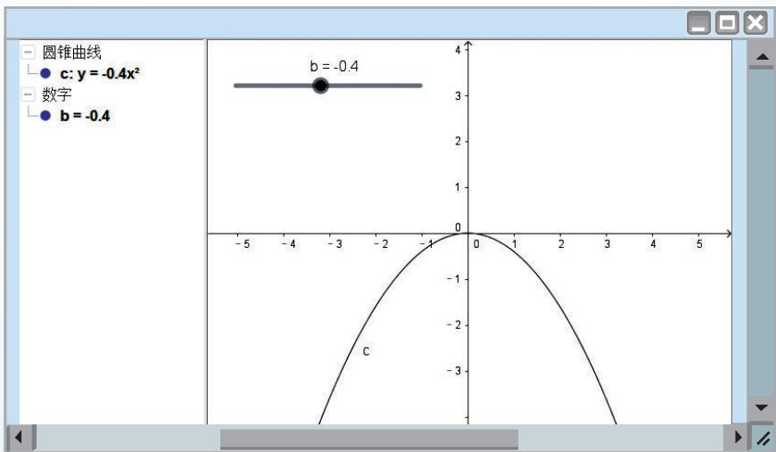

# 用滑动条研究二次函数的图象

(1) 打开软件《GeoGebra》，在输入框内输入参数 “b”，回车，创建滑动条 b，选择 b 的 “属性”，依图 2 提示可自由设置其最小值、最大值、增量等后关闭.

（2）在输入框内直接输入函数“ $y = b*x^2$ ”，回车，在绘图区直接显示出当时参数 $b$ 的值对应的函数 $y = bx^2$ 的图象（图2）.

当你左右移动滑动条中点 b 的位置时，函数 $y = bx^{2}$ 的图象就会 “动” 起来，如图 2.

  
图2

如果有条件，请你绘制函数 $y = ax^{2} + bx + c (a \neq 0)$ 的图象，并探究系数 $a, b, c$ 对函数图象的影响.

## 所属组织

- [信息技术应用 用计算机绘制函数图象](../%E7%9F%A5%E8%AF%86%E4%B8%B2%E8%81%94/%E4%BA%BA%E6%95%99A-%E5%BF%85%E4%BF%AE%E7%AC%AC%E4%B8%80%E5%86%8C/%E7%AC%AC%E4%B8%89%E7%AB%A0%20%E5%87%BD%E6%95%B0%E7%9A%84%E6%A6%82%E5%BF%B5%E4%B8%8E%E6%80%A7%E8%B4%A8/%E4%BF%A1%E6%81%AF%E6%8A%80%E6%9C%AF%E5%BA%94%E7%94%A8%20%E7%94%A8%E8%AE%A1%E7%AE%97%E6%9C%BA%E7%BB%98%E5%88%B6%E5%87%BD%E6%95%B0%E5%9B%BE%E8%B1%A1.md)

## 相关练习组织（范围关联）

- [第三章 函数的概念与性质](../%E9%A2%98%E5%9E%8B/%E4%BA%BA%E6%95%99A-%E5%BF%85%E4%BF%AE%E7%AC%AC%E4%B8%80%E5%86%8C/%E7%AC%AC%E4%B8%89%E7%AB%A0%20%E5%87%BD%E6%95%B0%E7%9A%84%E6%A6%82%E5%BF%B5%E4%B8%8E%E6%80%A7%E8%B4%A8/%E7%AC%AC%E4%B8%89%E7%AB%A0%20%E5%87%BD%E6%95%B0%E7%9A%84%E6%A6%82%E5%BF%B5%E4%B8%8E%E6%80%A7%E8%B4%A8.md)
