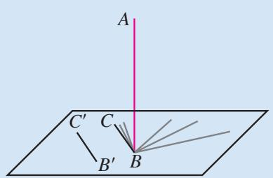
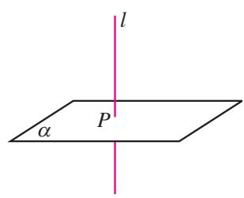
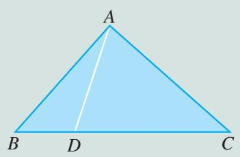
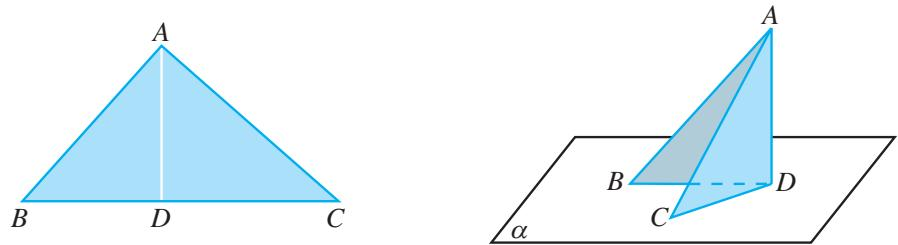

# 直线与平面垂直的判定及性质

## 情境引入与思考

## 知识讲解

### 高中必修 第二册·人教A版数学

在日常生活中，我们对直线与平面垂直有很多感性认识。比如，旗杆与地面的位置关系（图8.6-7），教室里相邻墙面的交线与地面的位置关系等，都给我们以直线与平面垂直的形象。

  
图8.6-7

观察

如图8.6-8，在阳光下观察直立于地面的旗杆 $AB$ 及它在地面的影子 $BC$ 。随着时间的变化，影子 $BC$ 的位置在不断地变化，旗杆所在直线 $AB$ 与其影子 $BC$ 所在直线是否保持垂直？

  
图8.6-8

事实上，随着时间的变化，尽管影子 BC 的位置在不断地变化，但是旗杆 AB 所在直线始终与影子 BC 所在直线垂直。也就是说，旗杆 AB 所在直线与地面上任意一条过点 B 的直线垂直。对于地面上不过点 B 的任意一条直线 $B^{\prime}C^{\prime}$ ，总能在地面上找到过点 B 的一条直线与之平行，根据异面直线垂直的定义，可知旗杆 AB 所在直线与直线 $B^{\prime}C^{\prime}$ 也垂直。因此，旗杆 AB 所在直线与地面上任意一条直线都垂直。

一般地，如果直线 $l$ 与平面 $\alpha$ 内的任意一条直线都垂直，我们就说直线 $l$ 与平面 $\alpha$ 互相垂直，记作 $l \perp \alpha$ 。直线 $l$ 叫做平面 $\alpha$ 的垂线，平面 $\alpha$ 叫做直线 $l$ 的垂面。直线与平面垂直时，它们唯一的公共点 $P$ 叫做垂足。

画直线与平面垂直时，通常把直线画成与表示平面的平行四边形的一边垂直，如图 8.6-9 所示.

  
图8.6-9

思考

在同一平面内，过一点有且只有一条直线与已知直线垂直。将这一结论推广到空间，过一点垂直于已知平面的直线有几条？为什么？

可以发现，过一点垂直于已知平面的直线有且只有一条.

过一点作垂直于已知平面的直线，则该点与垂足间的线段，叫做这个点到该平面的垂线段，垂线段的长度叫做这个点到该平面的距离.

下面我们来研究直线与平面垂直的判定，即探究直线与平面垂直的充分条件.

根据定义可以进行判断，但无法验证一条直线与一个平面内的所有直线都垂直。那么，有没有可行的方法？

在棱锥的体积公式中，棱锥的高就是棱锥的顶点到底面的距离.

探究

如图 8.6-10，准备一块三角形的纸片 ABC，过 $\triangle ABC$ 的顶点 A 翻折纸片，得到折痕 AD，将翻折后的纸片竖起放置在桌面上（BD，DC 与桌面接触）.

(1) 折痕 $AD$ 与桌面垂直吗?

(2) 如何翻折才能使折痕 $AD$ 与桌面垂直？为什么？

  
图8.6-10

容易发现，AD 所在直线与桌面所在平面 $\alpha$ 垂直（图 8.6-11）的充要条件是折痕 AD 是 BC 边上的高。这时，由于翻折之后垂直关系不变，所以直线 AD 与平面 $\alpha$ 内的两条相交直线 BD，DC 都垂直。

  
图8.6-11

事实上，由基本事实的推论2，平面 $\alpha$ 可以看作由两条相交直线 $BD$ ， $DC$ 所唯一确定的，所以当直线 $AD$ 垂直于这两条相交直线时，就能保证直线 $AD$ 与 $\alpha$ 内所有直线都垂直.

一般地，我们有如下判定直线与平面垂直的定理.

定理 如果一条直线与一个平面内的两条相交直线垂直，那么该直线与此平面垂直.

它可以用符号表示为：

$$
m \subset \alpha , n \subset \alpha , m \cap n = P, l \perp m, l \perp n \Rightarrow l \perp \alpha .
$$

定理体现了“直线与平面垂直”和“直线与直线垂直”的互相转化.

## 后续知识

- [平面与平面垂直的判定及性质](%E5%B9%B3%E9%9D%A2%E4%B8%8E%E5%B9%B3%E9%9D%A2%E5%9E%82%E7%9B%B4%E7%9A%84%E5%88%A4%E5%AE%9A%E5%8F%8A%E6%80%A7%E8%B4%A8.md)

## 本节例题与练习

- [例 3 求证：如果两条平行直线中的一条](../%E4%B9%A0%E9%A2%98/Q070000000757.md)
- [练习 1](../%E4%B9%A0%E9%A2%98/Q070000000762.md)
- [练习 1](../%E4%B9%A0%E9%A2%98/Q070000000758.md)
- [练习 2](../%E4%B9%A0%E9%A2%98/Q070000000763.md)
- [练习 2](../%E4%B9%A0%E9%A2%98/Q070000000759.md)
- [练习 3](../%E4%B9%A0%E9%A2%98/Q070000000760.md)
- [练习 3](../%E4%B9%A0%E9%A2%98/Q070000000764.md)
- [练习 4](../%E4%B9%A0%E9%A2%98/Q070000000761.md)
- [练习 4](../%E4%B9%A0%E9%A2%98/Q070000000765.md)

## 所属组织

- [8.6.2 直线与平面垂直](../%E7%9F%A5%E8%AF%86%E4%B8%B2%E8%81%94/%E4%BA%BA%E6%95%99A-%E5%BF%85%E4%BF%AE%E7%AC%AC%E4%BA%8C%E5%86%8C/%E7%AC%AC%E5%85%AB%E7%AB%A0%20%E7%AB%8B%E4%BD%93%E5%87%A0%E4%BD%95%E5%88%9D%E6%AD%A5/8.6%20%E7%A9%BA%E9%97%B4%E7%9B%B4%E7%BA%BF%E3%80%81%E5%B9%B3%E9%9D%A2%E7%9A%84%E5%9E%82%E7%9B%B4/8.6.2%20%E7%9B%B4%E7%BA%BF%E4%B8%8E%E5%B9%B3%E9%9D%A2%E5%9E%82%E7%9B%B4.md)

## 相关练习组织（范围关联）

- [8.6.2 直线与平面垂直](../%E9%A2%98%E5%9E%8B/%E6%8C%89%E7%AB%A0%E8%8A%82%E5%88%86%E7%B1%BB/%E4%BA%BA%E6%95%99A-%E5%BF%85%E4%BF%AE%E7%AC%AC%E4%BA%8C%E5%86%8C/%E7%AC%AC%E5%85%AB%E7%AB%A0%20%E7%AB%8B%E4%BD%93%E5%87%A0%E4%BD%95%E5%88%9D%E6%AD%A5/8.6%20%E7%A9%BA%E9%97%B4%E7%9B%B4%E7%BA%BF%E3%80%81%E5%B9%B3%E9%9D%A2%E7%9A%84%E5%9E%82%E7%9B%B4.md)
