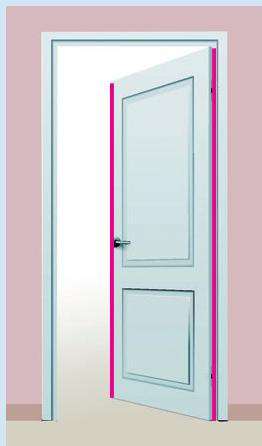
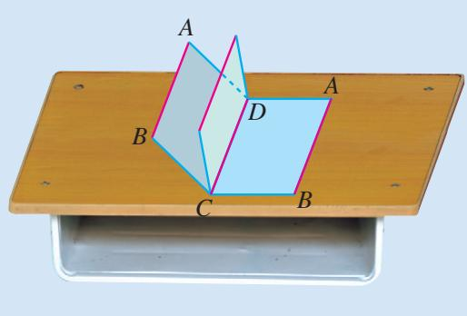

在直线与平面的位置关系中，平行是一种非常重要的关系。它不仅应用广泛，而且是学习平面与平面平行的基础。根据定义，判定直线与平面是否平行，只需判定直线与平面有没有公共点；由于直线是无限延伸的、平面是无限延展的，直接按定义验证并不方便，可以借助实例总结一般判定方法。

如图 8.5-6(1)，门扇的两边是平行的，当门扇绕着固定的一边转动时；如图 8.5-6(2)，将一块矩形硬纸板 $ABCD$ 平放在桌面上并绕边 $DC$ 转动（ $AB$ 离开桌面）时。

  
(1)

  
(2)  
图8.5-6

可以发现，无论门扇转动到什么位置，因为转动的一边与固定的一边总是平行的，所以它与墙面是平行的；硬纸板的边 $AB$ 与 $DC$ 平行，只要边 $DC$ 紧贴着桌面，边 $AB$ 转动时就不可能与桌面有公共点，所以它与桌面平行.

一般地，我们有直线与平面平行的判定定理：

定理 如果平面外一条直线与此平面内的一条直线平行，那么该直线与此平面平行.

它可以用符号表示：

$$
a \not \subset \alpha , b \subset \alpha , \text {且} a / / b \Rightarrow a / / \alpha .
$$

这一定理在现实生活中有许多应用。例如，安装矩形镜子时，为了使镜子的上边框与天花板平行，只需镜子的上边框与天花板和墙面的交线平行，就是应用了这个判定定理。

定理告诉我们，可以通过直线间的平行，得到直线与平面平行。这是处理空间位置关系的一种常用方法，即将直线与平面的平行关系（空间问题）转化为直线间的平行关系（平面问题）。
