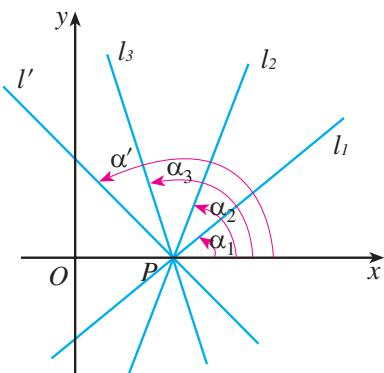
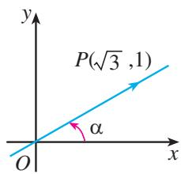
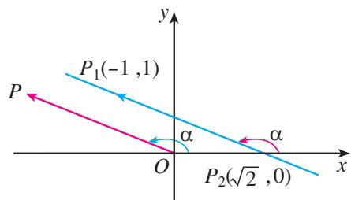
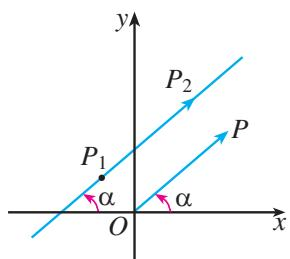
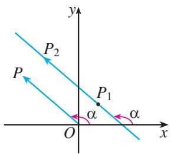
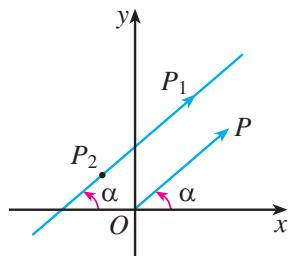
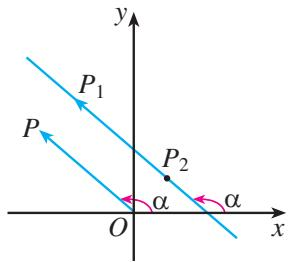

为了用代数方法研究直线的有关问题，首先需要在平面直角坐标系中明确确定直线位置的几何要素，并用代数方法把这些几何要素表示出来。

我们知道，两点确定一条直线，一点和一个方向也可以确定一条直线．设 $A, B$ 为直线上的两点，则 $\overrightarrow{AB}$ 就是这条直线的方向向量．所以，两点确定一条直线可以归结为一点和一个方向确定一条直线。在平面直角坐标系中，经过一点 $P$ 可以作无数条直线 $l_{1}$ ， $l_{2}$ ， $l_{3}$ ，…，它们组成一个直线束（图 2.1-2），这些直线的区别是它们的方向不同。

在平面直角坐标系中，我们规定水平直线的方向向右，其他直线向上的方向为这条直线的方向。这些直线相对于 $x$ 轴的倾斜程度不同，也就是它们与 $x$ 轴所成的角不同，因此我们可以利用这样的角来表示这些直线的方向。

  
图2.1-2

当直线 $l$ 与 $x$ 轴相交时，我们以 $x$ 轴为基准， $x$ 轴正向与直线 $l$ 向上的方向之间所成的角 $\alpha$ 叫做直线 $l$ 的倾斜角（angle of inclination）。图2.1-2中直线 $l_{1}$ 的倾斜角 $\alpha_{1}$ 为锐角，直线 $l'$ 的倾斜角 $\alpha'$ 为钝角。当直线 $l$ 与 $x$ 轴平行或重合时，我们规定它的倾斜角为 $0^{\circ}$ 。因此，直线的倾斜角 $\alpha$ 的取值范围为

$$
0 ^ {\circ} \leqslant \alpha <   1 8 0 ^ {\circ}.
$$

这样，在平面直角坐标系中，每一条直线都有一个确定的倾斜角，而且方向相同的直线，其倾斜程度相同，倾斜角相等；方向不同的直线，其倾斜程度不同，倾斜角不相等．因此，我们可以用倾斜角表示平面直角坐标系中一条直线的倾斜程度，也就表示了直线的方向.

下面我们进一步研究刻画直线倾斜程度的方法.

设 $P_{1}(x_{1},y_{1})$ ， $P_{2}(x_{2},y_{2})$ （其中 $x_{1}\neq x_{2}$ ）是直线 $l$ 上的两点．由两点确定一条直线可知，直线 $l$ 由点 $P_{1}$ ， $P_{2}$ 唯一确定．所以，可以推断，直线 $l$ 的倾斜角一定与 $P_{1}$ ， $P_{2}$ 两点的坐标有内在联系.

在平面直角坐标系中，设直线 $l$ 的倾斜角为 $\alpha$ 。下面利用向量法，由特殊到一般推导 $\alpha$ 与直线上两点坐标的关系：

（1）若直线 $l$ 经过 $O(0, 0)$ ， $P(\sqrt{3}, 1)$ ，如图2.1-3（1），向量 $\overrightarrow{OP} = (\sqrt{3}, 1)$ ，且直线 $OP$ 的倾斜角为 $\alpha$ 。由正切函数的定义，有

$$
\tan \alpha = \frac {1}{\sqrt {3}} = \frac {\sqrt {3}}{3}.
$$

  
(1)

  
(2)  
图2.1-3

（2）若直线 $l$ 经过 $P_{1}(-1, 1)$ ， $P_{2}(\sqrt{2}, 0)$ ，如图2.1-3（2）， $\overrightarrow{P_2P_1} = (-1 - \sqrt{2}, 1 - 0) = (-1 - \sqrt{2}, 1)$ 。平移向量 $\overrightarrow{P_2P_1}$ 到 $\overrightarrow{OP}$ ，则点 $P$ 的坐标为 $(-1 - \sqrt{2}, 1)$ ，且直线 $OP$ 的倾斜角也是 $\alpha$ 。由正切函数的定义，有

$$
\tan \alpha = \frac {1}{- 1 - \sqrt {2}} = 1 - \sqrt {2}.
$$

（3）一般地，若直线 $l$ 经过两点 $P_{1}(x_{1}, y_{1})$ ， $P_{2}(x_{2}, y_{2})$ （ $x_{1} \neq x_{2}$ ），如图2.1-4，当向量 $\overrightarrow{P_1P_2}$ 的方向向上时， $\overrightarrow{P_1P_2} = (x_2 - x_1, y_2 - y_1)$ 。平移向量 $\overrightarrow{P_1P_2}$ 到 $\overrightarrow{OP}$ ，则点 $P$ 的坐标为 $(x_2 - x_1, y_2 - y_1)$ ，且直线 $OP$ 的倾斜角也是 $\alpha$ ，由正切函数的定义，有

$$
\tan \alpha = \frac {y _ {2} - y _ {1}}{x _ {2} - x _ {1}}.
$$

  
图2.1-4

同样，当向量 $\overrightarrow{P_2P_1}$ 的方向向上时，如图2.1-5， $\overrightarrow{P_2P_1} = (x_1 - x_2, y_1 - y_2)$ ，也有

$$
\tan \alpha = \frac {y _ {1} - y _ {2}}{x _ {1} - x _ {2}} = \frac {y _ {2} - y _ {1}}{x _ {2} - x _ {1}}.
$$

  
图2.1-5

综上可知，直线 l 的倾斜角 $\alpha$ 与直线 l 上的两点 $P_{1}(x_{1}, y_{1})$ ， $P_{2}(x_{2}, y_{2}) (x_{1} \neq x_{2})$ 的坐标有如下关系：

$$
\tan \alpha = \frac {y _ {2} - y _ {1}}{x _ {2} - x _ {1}}.\tag{①}
$$

我们把一条直线的倾斜角 $\alpha$ 的正切值叫做这条直线的斜率（slope）。斜率常用小写字母 $k$ 表示，即

$$
\boxed {k = \tan \alpha .}\tag{②}
$$

日常生活中常用“坡度”表示倾斜面的倾斜程度：坡度= $\frac{铅直高度}{水平宽度}$ . 当直线的倾斜角为锐角时，直线的斜率与坡度是类似的.

倾斜角是 $90^{\circ}$ 的直线没有斜率，倾斜角不是 $90^{\circ}$ 的直线都有斜率。例如，倾斜角 $\alpha = 30^{\circ}$ 时，这条直线的斜率

$$
k = \tan 3 0 ^ {\circ} = \frac {\sqrt {3}}{3};
$$

倾斜角 $\alpha = 120^{\circ}$ 时，这条直线的斜率

$$
k = \tan 1 2 0 ^ {\circ} = - \tan 6 0 ^ {\circ} = - \sqrt {3}.
$$

由正切函数的单调性，倾斜角不同的直线，其斜率也不同。因此，我们可以用斜率表示倾斜角不等于 $90^{\circ}$ 的直线相对于 $x$ 轴的倾斜程度，进而表示直线的方向。

如果直线经过两点 $P_{1}(x_{1},y_{1})$ ， $P_{2}(x_{2},y_{2})$ （ $x_{1}\neq x_{2}$ ），那么由①②可得如下的斜率公式：

$$
k = \frac {y _ {2} - y _ {1}}{x _ {2} - x _ {1}}.
$$

我们发现，在平面直角坐标系中，倾斜角和斜率分别从形和数两个角度刻画了直线相对于 $x$ 轴的倾斜程度.

我们知道，直线 $P_{1}P_{2}$ 上的向量 $\overrightarrow{P_1P_2}$ 以及与它平行的非零向量都是直线的方向向量。直线 $P_{1}P_{2}$ 的方向向量 $\overrightarrow{P_1P_2}$ 的坐标为

$$
\left(x _ {2} - x _ {1}, y _ {2} - y _ {1}\right).
$$

当直线 $P_{1}P_{2}$ 与 x 轴不垂直时， $x_{1}\neq x_{2}$ . 此时向量 $\frac{1}{x_{2}-x_{1}}\overrightarrow{P_{1}P_{2}}$ 也是直线 $P_{1}P_{2}$ 的方向向量，且它的坐标为 $\frac{1}{x_{2}-x_{1}}(x_{2}-x_{1}, y_{2}-y_{1})$ ，即 $(1, \frac{y_{2}-y_{1}}{x_{2}-x_{1}})=(1, k)$ ，其中 k 是直线 $P_{1}P_{2}$ 的斜率. 因此，若直线 l 的斜率为 k，它的一个方向向量的坐标为 $(x, y)$ ，则 $k=\frac{y}{x}$ .
