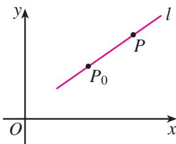

如图2.2-1，直线 $l$ 经过点 $P_0(x_0, y_0)$ ，且斜率为 $k$ 。设 $P(x, y)$ 是直线 $l$ 上不同于点 $P_0$ 的任意一点，因为直线 $l$ 的斜率为 $k$ ，由斜率公式得

$$
k = \frac {y - y _ {0}}{x - x _ {0}},
$$

  
图2.2-1

即

$$
y - y _ {0} = k \left(x - x _ {0}\right).
$$

由上述推导过程可知（易验证点 $P_{0}$ 的坐标 $(x_{0}, y_{0})$ 也满足关系式 $y - y_{0} = k(x - x_{0})$ ）：

（1）直线 $l$ 上每一个点的坐标 $(x, y)$ 都满足关系式 $y - y_0 = k(x - x_0)$ ；反过来，我们还可以验证

（2）坐标满足关系式 $y - y_0 = k(x - x_0)$ 的每一个点都在直线 $l$ 上.

事实上，若点 $P_{1}(x_{1},y_{1})$ 的坐标 $x_{1}$ ， $y_{1}$ 满足关系式 $y - y_0 = k(x - x_0)$ ，则

$$
y _ {1} - y _ {0} = k \left(x _ {1} - x _ {0}\right).
$$

当 $x_{1}=x_{0}$ 时， $y_{1}=y_{0}$ ，这时点 $P_{1}$ 与 $P_{0}$ 重合，显然有点 $P_{1}$ 在直线 l 上；

当 $x_{1} \neq x_{0}$ 时，有 $k = \frac{y_1 - y_0}{x_1 - x_0}$ ，这表明过点 $P_{1}, P_{0}$ 的直线 $l_{1}$ 的斜率为 $k$ 。因为直线 $l, l_{1}$ 的斜率都为 $k$ ，且都过点 $P_{0}$ ，所以它们重合．所以，点 $P_{1}$ 在直线 $l$ 上.

建立直线的方程，就是利用确定直线位置的几何要素，建立直线上任意一点的横坐标 $x$ ，纵坐标 $y$ 所满足的关系式.

由（1）（2）可得：坐标满足关系式 $y - y_0 = k(x - x_0)$ 的点一定在直线 $l$ 上；直线 $l$ 上任意一点的坐标一定满足关系式 $y - y_0 = k(x - x_0)$ 。我们把方程

$$
y - y _ {0} = k \left(x - x _ {0}\right)
$$

称为过点 $P_{0}(x_{0}, y_{0})$ ，斜率为 k 的直线 l 的方程.

方程 $y - y_{0} = k(x - x_{0})$ 由直线上一个定点 $(x_{0}, y_{0})$ 及该直线的斜率 k 确定，我们把它叫做直线的点斜式方程，简称点斜式（point slope form）.

对于倾斜角为 $0^{\circ}$ 和 $90^{\circ}$ 这两种特殊位置的直线，其方程如下：

当直线 $l$ 的倾斜角为 $0^{\circ}$ 时（图2.2-2）， $\tan 0^{\circ} = 0$ ，即 $k = 0$ ，这时直线 $l$ 与 $x$ 轴平行或重合，直线 $l$ 的方程是

$$
y - y _ {0} = 0, \text {即} y = y _ {0}.
$$

  
图2.2-2

  
图2.2-3

当直线 $l$ 的倾斜角为 $90^{\circ}$ 时（图2.2-3），由于 $\tan 90^{\circ}$ 无意义，直线没有斜率，这时直线 $l$ 与 $y$ 轴平行或重合，它的方程不能用点斜式表示。又因为这时直线 $l$ 上每一点的横坐标都等于 $x_0$ ，所以它的方程是

$$
x - x _ {0} = 0, \text {即} x = x _ {0}.
$$
