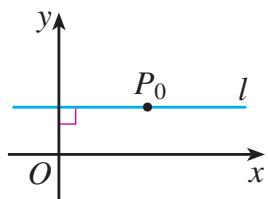
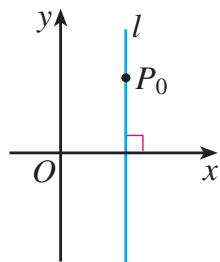

# 直线的点斜式与斜截式方程

## 情境引入与思考

## 知识讲解

### 高中选择性必修 第一册·人教A版数学

如图2.2-1，直线 $l$ 经过点 $P_0(x_0, y_0)$ ，且斜率为 $k$ 。设 $P(x, y)$ 是直线 $l$ 上不同于点 $P_0$ 的任意一点，因为直线 $l$ 的斜率为 $k$ ，由斜率公式得

$$
k = \frac {y - y _ {0}}{x - x _ {0}},
$$

  
图2.2-1

即

$$
y - y _ {0} = k \left(x - x _ {0}\right).
$$

?

由上述推导过程可知：

（1）直线 $l$ 上每一个点的坐标 $(x, y)$ 都满足关系式 $y - y_0 = k(x - x_0)$ ；反过来，我们还可以验证

点 $P_{0}$ 的坐标 $(x_0, y_0)$ 满足关系式 $y - y_0 = k(x - x_0)$ 吗？

（2）坐标满足关系式 $y - y_0 = k(x - x_0)$ 的每一个点都在直线 $l$ 上.

事实上，若点 $P_{1}(x_{1},y_{1})$ 的坐标 $x_{1}$ ， $y_{1}$ 满足关系式 $y - y_0 = k(x - x_0)$ ，则

$$
y _ {1} - y _ {0} = k \left(x _ {1} - x _ {0}\right).
$$

当 $x_{1}=x_{0}$ 时， $y_{1}=y_{0}$ ，这时点 $P_{1}$ 与 $P_{0}$ 重合，显然有点 $P_{1}$ 在直线 l 上；

当 $x_{1} \neq x_{0}$ 时，有 $k = \frac{y_1 - y_0}{x_1 - x_0}$ ，这表明过点 $P_{1}, P_{0}$ 的直线 $l_{1}$ 的斜率为 $k$ 。因为直线 $l, l_{1}$ 的斜率都为 $k$ ，且都过

建立直线的方程，就是利用确定直线位置的几何要素，建立直线上任意一点的横坐标 $x$ ，纵坐标 $y$ 所满足的关系式.

点 $P_{0}$ ，所以它们重合．所以，点 $P_{1}$ 在直线 $l$ 上.

由（1）（2）可得：坐标满足关系式 $y - y_0 = k(x - x_0)$ 的点一定在直线 $l$ 上；直线 $l$ 上任意一点的坐标一定满足关系式 $y - y_0 = k(x - x_0)$ 。我们把方程

$$
y - y _ {0} = k \left(x - x _ {0}\right)
$$

称为过点 $P_{0}(x_{0}, y_{0})$ ，斜率为 k 的直线 l 的方程.

方程 $y - y_{0} = k(x - x_{0})$ 由直线上一个定点 $(x_{0}, y_{0})$ 及该直线的斜率 k 确定，我们把它叫做直线的点斜式方程，简称点斜式（point slope form）.

思考

（1）当直线 $l$ 的倾斜角为 $0^{\circ}$ 时，直线 $l$ 的方程是什么？为什么？

(2) 当直线 $l$ 的倾斜角为 $90^{\circ}$ 时, 直线 $l$ 的方程如何表示? 为什么?

当直线 $l$ 的倾斜角为 $0^{\circ}$ 时（图2.2-2）， $\tan 0^{\circ} = 0$ ，即 $k = 0$ ，这时直线 $l$ 与 $x$ 轴平行或重合，直线 $l$ 的方程是

$$
y - y _ {0} = 0, \text {即} y = y _ {0}.
$$

  
图2.2-2

  
图2.2-3

当直线 $l$ 的倾斜角为 $90^{\circ}$ 时（图2.2-3），由于 $\tan 90^{\circ}$ 无意义，直线没有斜率，这时直线 $l$ 与 $y$ 轴平行或重合，它的方程不能用点斜式表示。又因为这时直线 $l$ 上每一点的横坐标都等于 $x_0$ ，所以它的方程是

$$
x - x _ {0} = 0, \text {即} x = x _ {0}.
$$

## 先修知识

- [直线的倾斜角与斜率](%E7%9B%B4%E7%BA%BF%E7%9A%84%E5%80%BE%E6%96%9C%E8%A7%92%E4%B8%8E%E6%96%9C%E7%8E%87.md)

## 本节例题与练习

- [例 1 直线 l 经过点 $P_{0}](../%E4%B9%A0%E9%A2%98/Q070000001120.md)
- [例 2 已知直线 $l_{1}: y](../%E4%B9%A0%E9%A2%98/Q070000001121.md)
- [练习 1](../%E4%B9%A0%E9%A2%98/Q070000001122.md)
- [练习 2](../%E4%B9%A0%E9%A2%98/Q070000001123.md)
- [练习 3](../%E4%B9%A0%E9%A2%98/Q070000001124.md)
- [练习 4](../%E4%B9%A0%E9%A2%98/Q070000001125.md)

## 所属组织

- [2.2.1 直线的点斜式方程](../%E7%9F%A5%E8%AF%86%E4%B8%B2%E8%81%94/%E4%BA%BA%E6%95%99A-%E9%80%89%E6%8B%A9%E6%80%A7%E5%BF%85%E4%BF%AE%E7%AC%AC%E4%B8%80%E5%86%8C/%E7%AC%AC%E4%BA%8C%E7%AB%A0%20%E7%9B%B4%E7%BA%BF%E5%92%8C%E5%9C%86%E7%9A%84%E6%96%B9%E7%A8%8B/2.2%20%E7%9B%B4%E7%BA%BF%E7%9A%84%E6%96%B9%E7%A8%8B/2.2.1%20%E7%9B%B4%E7%BA%BF%E7%9A%84%E7%82%B9%E6%96%9C%E5%BC%8F%E6%96%B9%E7%A8%8B.md)

## 相关练习组织（范围关联）

- [2.2.1 直线的点斜式方程](../%E9%A2%98%E5%9E%8B/%E6%8C%89%E7%AB%A0%E8%8A%82%E5%88%86%E7%B1%BB/%E4%BA%BA%E6%95%99A-%E9%80%89%E6%8B%A9%E6%80%A7%E5%BF%85%E4%BF%AE%E7%AC%AC%E4%B8%80%E5%86%8C/%E7%AC%AC%E4%BA%8C%E7%AB%A0%20%E7%9B%B4%E7%BA%BF%E5%92%8C%E5%9C%86%E7%9A%84%E6%96%B9%E7%A8%8B/2.2%20%E7%9B%B4%E7%BA%BF%E7%9A%84%E6%96%B9%E7%A8%8B.md)

<!-- BEGIN mathmap-knowledge-contribution:mst-conics-2026 -->
## 题型训练 · 2026版高中《mst老唐说题》圆锥曲线专题（数学）

### 小题新题型与多选的综合题方法篇 / 第一节 切线与切点弦

- [一、切线与切点弦的极点极线方程](../%E9%A2%98%E5%9E%8B/%E6%8C%89%E9%A2%98%E5%9E%8B%E5%88%86%E7%B1%BB/%E5%9C%86%E9%94%A5%E6%9B%B2%E7%BA%BF/%E5%B0%8F%E9%A2%98%E6%96%B0%E9%A2%98%E5%9E%8B%E4%B8%8E%E5%A4%9A%E9%80%89%E7%9A%84%E7%BB%BC%E5%90%88%E9%A2%98%E6%96%B9%E6%B3%95%E7%AF%87/%E7%AC%AC%E4%B8%80%E8%8A%82_%E5%88%87%E7%BA%BF%E4%B8%8E%E5%88%87%E7%82%B9%E5%BC%A6/%E4%B8%80_%E5%88%87%E7%BA%BF%E4%B8%8E%E5%88%87%E7%82%B9%E5%BC%A6%E7%9A%84%E6%9E%81%E7%82%B9%E6%9E%81%E7%BA%BF%E6%96%B9%E7%A8%8B.md)（关联题型）

- [二、切线方程和切点弦方程求法的书写过程](../%E9%A2%98%E5%9E%8B/%E6%8C%89%E9%A2%98%E5%9E%8B%E5%88%86%E7%B1%BB/%E5%9C%86%E9%94%A5%E6%9B%B2%E7%BA%BF/%E5%B0%8F%E9%A2%98%E6%96%B0%E9%A2%98%E5%9E%8B%E4%B8%8E%E5%A4%9A%E9%80%89%E7%9A%84%E7%BB%BC%E5%90%88%E9%A2%98%E6%96%B9%E6%B3%95%E7%AF%87/%E7%AC%AC%E4%B8%80%E8%8A%82_%E5%88%87%E7%BA%BF%E4%B8%8E%E5%88%87%E7%82%B9%E5%BC%A6/%E4%BA%8C_%E5%88%87%E7%BA%BF%E6%96%B9%E7%A8%8B%E5%92%8C%E5%88%87%E7%82%B9%E5%BC%A6%E6%96%B9%E7%A8%8B%E6%B1%82%E6%B3%95%E7%9A%84%E4%B9%A6%E5%86%99%E8%BF%87%E7%A8%8B.md)（关联题型）

### 小题新题型与多选的综合题方法篇 / 第二节 坐标旋转与曲线转换

- [二、等轴双曲线与反比例函数转化](../%E9%A2%98%E5%9E%8B/%E6%8C%89%E9%A2%98%E5%9E%8B%E5%88%86%E7%B1%BB/%E5%9C%86%E9%94%A5%E6%9B%B2%E7%BA%BF/%E5%B0%8F%E9%A2%98%E6%96%B0%E9%A2%98%E5%9E%8B%E4%B8%8E%E5%A4%9A%E9%80%89%E7%9A%84%E7%BB%BC%E5%90%88%E9%A2%98%E6%96%B9%E6%B3%95%E7%AF%87/%E7%AC%AC%E4%BA%8C%E8%8A%82_%E5%9D%90%E6%A0%87%E6%97%8B%E8%BD%AC%E4%B8%8E%E6%9B%B2%E7%BA%BF%E8%BD%AC%E6%8D%A2/%E4%BA%8C_%E7%AD%89%E8%BD%B4%E5%8F%8C%E6%9B%B2%E7%BA%BF%E4%B8%8E%E5%8F%8D%E6%AF%94%E4%BE%8B%E5%87%BD%E6%95%B0%E8%BD%AC%E5%8C%96.md)（关联题型）

### 常规韦达联立 / 第一节 正反设直线的方案选择

- [一、椭圆的正设与反设](../%E9%A2%98%E5%9E%8B/%E6%8C%89%E9%A2%98%E5%9E%8B%E5%88%86%E7%B1%BB/%E5%9C%86%E9%94%A5%E6%9B%B2%E7%BA%BF/%E5%B8%B8%E8%A7%84%E9%9F%A6%E8%BE%BE%E8%81%94%E7%AB%8B/%E7%AC%AC%E4%B8%80%E8%8A%82_%E6%AD%A3%E5%8F%8D%E8%AE%BE%E7%9B%B4%E7%BA%BF%E7%9A%84%E6%96%B9%E6%A1%88%E9%80%89%E6%8B%A9/%E4%B8%80_%E6%A4%AD%E5%9C%86%E7%9A%84%E6%AD%A3%E8%AE%BE%E4%B8%8E%E5%8F%8D%E8%AE%BE.md)（关联题型）

- [二、双曲线的正设与反设](../%E9%A2%98%E5%9E%8B/%E6%8C%89%E9%A2%98%E5%9E%8B%E5%88%86%E7%B1%BB/%E5%9C%86%E9%94%A5%E6%9B%B2%E7%BA%BF/%E5%B8%B8%E8%A7%84%E9%9F%A6%E8%BE%BE%E8%81%94%E7%AB%8B/%E7%AC%AC%E4%B8%80%E8%8A%82_%E6%AD%A3%E5%8F%8D%E8%AE%BE%E7%9B%B4%E7%BA%BF%E7%9A%84%E6%96%B9%E6%A1%88%E9%80%89%E6%8B%A9/%E4%BA%8C_%E5%8F%8C%E6%9B%B2%E7%BA%BF%E7%9A%84%E6%AD%A3%E8%AE%BE%E4%B8%8E%E5%8F%8D%E8%AE%BE.md)（关联题型）

### 常规韦达联立 / 第三节 运算技巧下的韦达定理拓展

- [一、轴点弦的和积互换](../%E9%A2%98%E5%9E%8B/%E6%8C%89%E9%A2%98%E5%9E%8B%E5%88%86%E7%B1%BB/%E5%9C%86%E9%94%A5%E6%9B%B2%E7%BA%BF/%E5%B8%B8%E8%A7%84%E9%9F%A6%E8%BE%BE%E8%81%94%E7%AB%8B/%E7%AC%AC%E4%B8%89%E8%8A%82_%E8%BF%90%E7%AE%97%E6%8A%80%E5%B7%A7%E4%B8%8B%E7%9A%84%E9%9F%A6%E8%BE%BE%E5%AE%9A%E7%90%86%E6%8B%93%E5%B1%95/%E4%B8%80_%E8%BD%B4%E7%82%B9%E5%BC%A6%E7%9A%84%E5%92%8C%E7%A7%AF%E4%BA%92%E6%8D%A2.md)（关联题型）

- [二、非对称韦达定理](../%E9%A2%98%E5%9E%8B/%E6%8C%89%E9%A2%98%E5%9E%8B%E5%88%86%E7%B1%BB/%E5%9C%86%E9%94%A5%E6%9B%B2%E7%BA%BF/%E5%B8%B8%E8%A7%84%E9%9F%A6%E8%BE%BE%E8%81%94%E7%AB%8B/%E7%AC%AC%E4%B8%89%E8%8A%82_%E8%BF%90%E7%AE%97%E6%8A%80%E5%B7%A7%E4%B8%8B%E7%9A%84%E9%9F%A6%E8%BE%BE%E5%AE%9A%E7%90%86%E6%8B%93%E5%B1%95/%E4%BA%8C_%E9%9D%9E%E5%AF%B9%E7%A7%B0%E9%9F%A6%E8%BE%BE%E5%AE%9A%E7%90%86.md)（关联题型）

### 联立之同构方程 / 第一节 抛物线两点联立式方程

- [一、抛物线两点联立式同构与定点定值](../%E9%A2%98%E5%9E%8B/%E6%8C%89%E9%A2%98%E5%9E%8B%E5%88%86%E7%B1%BB/%E5%9C%86%E9%94%A5%E6%9B%B2%E7%BA%BF/%E8%81%94%E7%AB%8B%E4%B9%8B%E5%90%8C%E6%9E%84%E6%96%B9%E7%A8%8B/%E7%AC%AC%E4%B8%80%E8%8A%82_%E6%8A%9B%E7%89%A9%E7%BA%BF%E4%B8%A4%E7%82%B9%E8%81%94%E7%AB%8B%E5%BC%8F%E6%96%B9%E7%A8%8B/%E4%B8%80_%E6%8A%9B%E7%89%A9%E7%BA%BF%E4%B8%A4%E7%82%B9%E8%81%94%E7%AB%8B%E5%BC%8F%E5%90%8C%E6%9E%84%E4%B8%8E%E5%AE%9A%E7%82%B9%E5%AE%9A%E5%80%BC.md)（关联题型）

- [二、两点联立式下的双切圆](../%E9%A2%98%E5%9E%8B/%E6%8C%89%E9%A2%98%E5%9E%8B%E5%88%86%E7%B1%BB/%E5%9C%86%E9%94%A5%E6%9B%B2%E7%BA%BF/%E8%81%94%E7%AB%8B%E4%B9%8B%E5%90%8C%E6%9E%84%E6%96%B9%E7%A8%8B/%E7%AC%AC%E4%B8%80%E8%8A%82_%E6%8A%9B%E7%89%A9%E7%BA%BF%E4%B8%A4%E7%82%B9%E8%81%94%E7%AB%8B%E5%BC%8F%E6%96%B9%E7%A8%8B/%E4%BA%8C_%E4%B8%A4%E7%82%B9%E8%81%94%E7%AB%8B%E5%BC%8F%E4%B8%8B%E7%9A%84%E5%8F%8C%E5%88%87%E5%9C%86.md)（关联题型）

- [三、两点联立式下的彭塞列闭合](../%E9%A2%98%E5%9E%8B/%E6%8C%89%E9%A2%98%E5%9E%8B%E5%88%86%E7%B1%BB/%E5%9C%86%E9%94%A5%E6%9B%B2%E7%BA%BF/%E8%81%94%E7%AB%8B%E4%B9%8B%E5%90%8C%E6%9E%84%E6%96%B9%E7%A8%8B/%E7%AC%AC%E4%B8%80%E8%8A%82_%E6%8A%9B%E7%89%A9%E7%BA%BF%E4%B8%A4%E7%82%B9%E8%81%94%E7%AB%8B%E5%BC%8F%E6%96%B9%E7%A8%8B/%E4%B8%89_%E4%B8%A4%E7%82%B9%E8%81%94%E7%AB%8B%E5%BC%8F%E4%B8%8B%E7%9A%84%E5%BD%AD%E5%A1%9E%E5%88%97%E9%97%AD%E5%90%88.md)（关联题型）

- [五、两点联立式下的平行弦同构](../%E9%A2%98%E5%9E%8B/%E6%8C%89%E9%A2%98%E5%9E%8B%E5%88%86%E7%B1%BB/%E5%9C%86%E9%94%A5%E6%9B%B2%E7%BA%BF/%E8%81%94%E7%AB%8B%E4%B9%8B%E5%90%8C%E6%9E%84%E6%96%B9%E7%A8%8B/%E7%AC%AC%E4%B8%80%E8%8A%82_%E6%8A%9B%E7%89%A9%E7%BA%BF%E4%B8%A4%E7%82%B9%E8%81%94%E7%AB%8B%E5%BC%8F%E6%96%B9%E7%A8%8B/%E4%BA%94_%E4%B8%A4%E7%82%B9%E8%81%94%E7%AB%8B%E5%BC%8F%E4%B8%8B%E7%9A%84%E5%B9%B3%E8%A1%8C%E5%BC%A6%E5%90%8C%E6%9E%84.md)（关联题型）

### 联立之同构方程 / 第二节 斜率同构式与坐标同构式的应用

- [六、斜率和积为定值的同构](../%E9%A2%98%E5%9E%8B/%E6%8C%89%E9%A2%98%E5%9E%8B%E5%88%86%E7%B1%BB/%E5%9C%86%E9%94%A5%E6%9B%B2%E7%BA%BF/%E8%81%94%E7%AB%8B%E4%B9%8B%E5%90%8C%E6%9E%84%E6%96%B9%E7%A8%8B/%E7%AC%AC%E4%BA%8C%E8%8A%82_%E6%96%9C%E7%8E%87%E5%90%8C%E6%9E%84%E5%BC%8F%E4%B8%8E%E5%9D%90%E6%A0%87%E5%90%8C%E6%9E%84%E5%BC%8F%E7%9A%84%E5%BA%94%E7%94%A8/%E5%85%AD_%E6%96%9C%E7%8E%87%E5%92%8C%E7%A7%AF%E4%B8%BA%E5%AE%9A%E5%80%BC%E7%9A%84%E5%90%8C%E6%9E%84.md)（关联题型）

- [七、坐标同解同构方程(外接圆)](../%E9%A2%98%E5%9E%8B/%E6%8C%89%E9%A2%98%E5%9E%8B%E5%88%86%E7%B1%BB/%E5%9C%86%E9%94%A5%E6%9B%B2%E7%BA%BF/%E8%81%94%E7%AB%8B%E4%B9%8B%E5%90%8C%E6%9E%84%E6%96%B9%E7%A8%8B/%E7%AC%AC%E4%BA%8C%E8%8A%82_%E6%96%9C%E7%8E%87%E5%90%8C%E6%9E%84%E5%BC%8F%E4%B8%8E%E5%9D%90%E6%A0%87%E5%90%8C%E6%9E%84%E5%BC%8F%E7%9A%84%E5%BA%94%E7%94%A8/%E4%B8%83_%E5%9D%90%E6%A0%87%E5%90%8C%E8%A7%A3%E5%90%8C%E6%9E%84%E6%96%B9%E7%A8%8B_%E5%A4%96%E6%8E%A5%E5%9C%86_.md)（关联题型）

- [八、双切曲线的斜率同解同构](../%E9%A2%98%E5%9E%8B/%E6%8C%89%E9%A2%98%E5%9E%8B%E5%88%86%E7%B1%BB/%E5%9C%86%E9%94%A5%E6%9B%B2%E7%BA%BF/%E8%81%94%E7%AB%8B%E4%B9%8B%E5%90%8C%E6%9E%84%E6%96%B9%E7%A8%8B/%E7%AC%AC%E4%BA%8C%E8%8A%82_%E6%96%9C%E7%8E%87%E5%90%8C%E6%9E%84%E5%BC%8F%E4%B8%8E%E5%9D%90%E6%A0%87%E5%90%8C%E6%9E%84%E5%BC%8F%E7%9A%84%E5%BA%94%E7%94%A8/%E5%85%AB_%E5%8F%8C%E5%88%87%E6%9B%B2%E7%BA%BF%E7%9A%84%E6%96%9C%E7%8E%87%E5%90%8C%E8%A7%A3%E5%90%8C%E6%9E%84.md)（关联题型）

### 联立计算高阶篇 / 第四节 直线系和圆系方程

- [一、直线系方程](../%E9%A2%98%E5%9E%8B/%E6%8C%89%E9%A2%98%E5%9E%8B%E5%88%86%E7%B1%BB/%E5%9C%86%E9%94%A5%E6%9B%B2%E7%BA%BF/%E8%81%94%E7%AB%8B%E8%AE%A1%E7%AE%97%E9%AB%98%E9%98%B6%E7%AF%87/%E7%AC%AC%E5%9B%9B%E8%8A%82_%E7%9B%B4%E7%BA%BF%E7%B3%BB%E5%92%8C%E5%9C%86%E7%B3%BB%E6%96%B9%E7%A8%8B/%E4%B8%80_%E7%9B%B4%E7%BA%BF%E7%B3%BB%E6%96%B9%E7%A8%8B.md)（关联题型）

- [二、过直线与圆交点的圆系方程](../%E9%A2%98%E5%9E%8B/%E6%8C%89%E9%A2%98%E5%9E%8B%E5%88%86%E7%B1%BB/%E5%9C%86%E9%94%A5%E6%9B%B2%E7%BA%BF/%E8%81%94%E7%AB%8B%E8%AE%A1%E7%AE%97%E9%AB%98%E9%98%B6%E7%AF%87/%E7%AC%AC%E5%9B%9B%E8%8A%82_%E7%9B%B4%E7%BA%BF%E7%B3%BB%E5%92%8C%E5%9C%86%E7%B3%BB%E6%96%B9%E7%A8%8B/%E4%BA%8C_%E8%BF%87%E7%9B%B4%E7%BA%BF%E4%B8%8E%E5%9C%86%E4%BA%A4%E7%82%B9%E7%9A%84%E5%9C%86%E7%B3%BB%E6%96%B9%E7%A8%8B.md)（关联题型）

- [三、相交两圆的公共弦](../%E9%A2%98%E5%9E%8B/%E6%8C%89%E9%A2%98%E5%9E%8B%E5%88%86%E7%B1%BB/%E5%9C%86%E9%94%A5%E6%9B%B2%E7%BA%BF/%E8%81%94%E7%AB%8B%E8%AE%A1%E7%AE%97%E9%AB%98%E9%98%B6%E7%AF%87/%E7%AC%AC%E5%9B%9B%E8%8A%82_%E7%9B%B4%E7%BA%BF%E7%B3%BB%E5%92%8C%E5%9C%86%E7%B3%BB%E6%96%B9%E7%A8%8B/%E4%B8%89_%E7%9B%B8%E4%BA%A4%E4%B8%A4%E5%9C%86%E7%9A%84%E5%85%AC%E5%85%B1%E5%BC%A6.md)（关联题型）

### 联立计算高阶篇 / 第六节 二次曲线方程与四点联立曲线系

- [一、退化二次曲线对称轴不与坐标轴平行的曲线系](../%E9%A2%98%E5%9E%8B/%E6%8C%89%E9%A2%98%E5%9E%8B%E5%88%86%E7%B1%BB/%E5%9C%86%E9%94%A5%E6%9B%B2%E7%BA%BF/%E8%81%94%E7%AB%8B%E8%AE%A1%E7%AE%97%E9%AB%98%E9%98%B6%E7%AF%87/%E7%AC%AC%E5%85%AD%E8%8A%82_%E4%BA%8C%E6%AC%A1%E6%9B%B2%E7%BA%BF%E6%96%B9%E7%A8%8B%E4%B8%8E%E5%9B%9B%E7%82%B9%E8%81%94%E7%AB%8B%E6%9B%B2%E7%BA%BF%E7%B3%BB/%E4%B8%80_%E9%80%80%E5%8C%96%E4%BA%8C%E6%AC%A1%E6%9B%B2%E7%BA%BF%E5%AF%B9%E7%A7%B0%E8%BD%B4%E4%B8%8D%E4%B8%8E%E5%9D%90%E6%A0%87%E8%BD%B4%E5%B9%B3%E8%A1%8C%E7%9A%84%E6%9B%B2%E7%BA%BF%E7%B3%BB.md)（关联题型）

- [二、用曲线系方程破解高考极点极线题型](../%E9%A2%98%E5%9E%8B/%E6%8C%89%E9%A2%98%E5%9E%8B%E5%88%86%E7%B1%BB/%E5%9C%86%E9%94%A5%E6%9B%B2%E7%BA%BF/%E8%81%94%E7%AB%8B%E8%AE%A1%E7%AE%97%E9%AB%98%E9%98%B6%E7%AF%87/%E7%AC%AC%E5%85%AD%E8%8A%82_%E4%BA%8C%E6%AC%A1%E6%9B%B2%E7%BA%BF%E6%96%B9%E7%A8%8B%E4%B8%8E%E5%9B%9B%E7%82%B9%E8%81%94%E7%AB%8B%E6%9B%B2%E7%BA%BF%E7%B3%BB/%E4%BA%8C_%E7%94%A8%E6%9B%B2%E7%BA%BF%E7%B3%BB%E6%96%B9%E7%A8%8B%E7%A0%B4%E8%A7%A3%E9%AB%98%E8%80%83%E6%9E%81%E7%82%B9%E6%9E%81%E7%BA%BF%E9%A2%98%E5%9E%8B.md)（关联题型）

- [三、用曲线系速解坎迪定理](../%E9%A2%98%E5%9E%8B/%E6%8C%89%E9%A2%98%E5%9E%8B%E5%88%86%E7%B1%BB/%E5%9C%86%E9%94%A5%E6%9B%B2%E7%BA%BF/%E8%81%94%E7%AB%8B%E8%AE%A1%E7%AE%97%E9%AB%98%E9%98%B6%E7%AF%87/%E7%AC%AC%E5%85%AD%E8%8A%82_%E4%BA%8C%E6%AC%A1%E6%9B%B2%E7%BA%BF%E6%96%B9%E7%A8%8B%E4%B8%8E%E5%9B%9B%E7%82%B9%E8%81%94%E7%AB%8B%E6%9B%B2%E7%BA%BF%E7%B3%BB/%E4%B8%89_%E7%94%A8%E6%9B%B2%E7%BA%BF%E7%B3%BB%E9%80%9F%E8%A7%A3%E5%9D%8E%E8%BF%AA%E5%AE%9A%E7%90%86.md)（关联题型）

- [五、曲线系挖掘四点形斜率关系与隐藏轨迹](../%E9%A2%98%E5%9E%8B/%E6%8C%89%E9%A2%98%E5%9E%8B%E5%88%86%E7%B1%BB/%E5%9C%86%E9%94%A5%E6%9B%B2%E7%BA%BF/%E8%81%94%E7%AB%8B%E8%AE%A1%E7%AE%97%E9%AB%98%E9%98%B6%E7%AF%87/%E7%AC%AC%E5%85%AD%E8%8A%82_%E4%BA%8C%E6%AC%A1%E6%9B%B2%E7%BA%BF%E6%96%B9%E7%A8%8B%E4%B8%8E%E5%9B%9B%E7%82%B9%E8%81%94%E7%AB%8B%E6%9B%B2%E7%BA%BF%E7%B3%BB/%E4%BA%94_%E6%9B%B2%E7%BA%BF%E7%B3%BB%E6%8C%96%E6%8E%98%E5%9B%9B%E7%82%B9%E5%BD%A2%E6%96%9C%E7%8E%87%E5%85%B3%E7%B3%BB%E4%B8%8E%E9%9A%90%E8%97%8F%E8%BD%A8%E8%BF%B9.md)（关联题型）

- [六、用曲线系破解彭塞列闭合定理](../%E9%A2%98%E5%9E%8B/%E6%8C%89%E9%A2%98%E5%9E%8B%E5%88%86%E7%B1%BB/%E5%9C%86%E9%94%A5%E6%9B%B2%E7%BA%BF/%E8%81%94%E7%AB%8B%E8%AE%A1%E7%AE%97%E9%AB%98%E9%98%B6%E7%AF%87/%E7%AC%AC%E5%85%AD%E8%8A%82_%E4%BA%8C%E6%AC%A1%E6%9B%B2%E7%BA%BF%E6%96%B9%E7%A8%8B%E4%B8%8E%E5%9B%9B%E7%82%B9%E8%81%94%E7%AB%8B%E6%9B%B2%E7%BA%BF%E7%B3%BB/%E5%85%AD_%E7%94%A8%E6%9B%B2%E7%BA%BF%E7%B3%BB%E7%A0%B4%E8%A7%A3%E5%BD%AD%E5%A1%9E%E5%88%97%E9%97%AD%E5%90%88%E5%AE%9A%E7%90%86.md)（关联题型）

### 万能的两点对合式 / 第一节 反比例对合方程解决圆锥曲线与数列综合

- [三、抛物线两点对合式构造等差等比数列](../%E9%A2%98%E5%9E%8B/%E6%8C%89%E9%A2%98%E5%9E%8B%E5%88%86%E7%B1%BB/%E5%9C%86%E9%94%A5%E6%9B%B2%E7%BA%BF/%E4%B8%87%E8%83%BD%E7%9A%84%E4%B8%A4%E7%82%B9%E5%AF%B9%E5%90%88%E5%BC%8F/%E7%AC%AC%E4%B8%80%E8%8A%82_%E5%8F%8D%E6%AF%94%E4%BE%8B%E5%AF%B9%E5%90%88%E6%96%B9%E7%A8%8B%E8%A7%A3%E5%86%B3%E5%9C%86%E9%94%A5%E6%9B%B2%E7%BA%BF%E4%B8%8E%E6%95%B0%E5%88%97%E7%BB%BC%E5%90%88/%E4%B8%89_%E6%8A%9B%E7%89%A9%E7%BA%BF%E4%B8%A4%E7%82%B9%E5%AF%B9%E5%90%88%E5%BC%8F%E6%9E%84%E9%80%A0%E7%AD%89%E5%B7%AE%E7%AD%89%E6%AF%94%E6%95%B0%E5%88%97.md)（关联题型）

### 万能的两点对合式 / 第二节 抛物线切线对合与两点对合数列构造综合

- [三、平移顶点的抛物线两点对合方程](../%E9%A2%98%E5%9E%8B/%E6%8C%89%E9%A2%98%E5%9E%8B%E5%88%86%E7%B1%BB/%E5%9C%86%E9%94%A5%E6%9B%B2%E7%BA%BF/%E4%B8%87%E8%83%BD%E7%9A%84%E4%B8%A4%E7%82%B9%E5%AF%B9%E5%90%88%E5%BC%8F/%E7%AC%AC%E4%BA%8C%E8%8A%82_%E6%8A%9B%E7%89%A9%E7%BA%BF%E5%88%87%E7%BA%BF%E5%AF%B9%E5%90%88%E4%B8%8E%E4%B8%A4%E7%82%B9%E5%AF%B9%E5%90%88%E6%95%B0%E5%88%97%E6%9E%84%E9%80%A0%E7%BB%BC%E5%90%88/%E4%B8%89_%E5%B9%B3%E7%A7%BB%E9%A1%B6%E7%82%B9%E7%9A%84%E6%8A%9B%E7%89%A9%E7%BA%BF%E4%B8%A4%E7%82%B9%E5%AF%B9%E5%90%88%E6%96%B9%E7%A8%8B.md)（关联题型）

### 从定比点差到极点极线 / 第二节 极点极线定义与自极三角形

- [一、极点极线的定义](../%E9%A2%98%E5%9E%8B/%E6%8C%89%E9%A2%98%E5%9E%8B%E5%88%86%E7%B1%BB/%E5%9C%86%E9%94%A5%E6%9B%B2%E7%BA%BF/%E4%BB%8E%E5%AE%9A%E6%AF%94%E7%82%B9%E5%B7%AE%E5%88%B0%E6%9E%81%E7%82%B9%E6%9E%81%E7%BA%BF/%E7%AC%AC%E4%BA%8C%E8%8A%82_%E6%9E%81%E7%82%B9%E6%9E%81%E7%BA%BF%E5%AE%9A%E4%B9%89%E4%B8%8E%E8%87%AA%E6%9E%81%E4%B8%89%E8%A7%92%E5%BD%A2/%E4%B8%80_%E6%9E%81%E7%82%B9%E6%9E%81%E7%BA%BF%E7%9A%84%E5%AE%9A%E4%B9%89.md)（关联题型）

### 调和点列与调和线束定理与对合关系 / 第七节 帕斯卡定理与对偶定理布利安桑定理

- [三、退化二次曲线的布利安桑点](../%E9%A2%98%E5%9E%8B/%E6%8C%89%E9%A2%98%E5%9E%8B%E5%88%86%E7%B1%BB/%E5%9C%86%E9%94%A5%E6%9B%B2%E7%BA%BF/%E8%B0%83%E5%92%8C%E7%82%B9%E5%88%97%E4%B8%8E%E8%B0%83%E5%92%8C%E7%BA%BF%E6%9D%9F%E5%AE%9A%E7%90%86%E4%B8%8E%E5%AF%B9%E5%90%88%E5%85%B3%E7%B3%BB/%E7%AC%AC%E4%B8%83%E8%8A%82_%E5%B8%95%E6%96%AF%E5%8D%A1%E5%AE%9A%E7%90%86%E4%B8%8E%E5%AF%B9%E5%81%B6%E5%AE%9A%E7%90%86%E5%B8%83%E5%88%A9%E5%AE%89%E6%A1%91%E5%AE%9A%E7%90%86/%E4%B8%89_%E9%80%80%E5%8C%96%E4%BA%8C%E6%AC%A1%E6%9B%B2%E7%BA%BF%E7%9A%84%E5%B8%83%E5%88%A9%E5%AE%89%E6%A1%91%E7%82%B9.md)（关联题型）

### 新定义下的面积转化 / 第三节 面积比值转化问题

- [一、利用极点极线关系将坐标转化面积比](../%E9%A2%98%E5%9E%8B/%E6%8C%89%E9%A2%98%E5%9E%8B%E5%88%86%E7%B1%BB/%E5%9C%86%E9%94%A5%E6%9B%B2%E7%BA%BF/%E6%96%B0%E5%AE%9A%E4%B9%89%E4%B8%8B%E7%9A%84%E9%9D%A2%E7%A7%AF%E8%BD%AC%E5%8C%96/%E7%AC%AC%E4%B8%89%E8%8A%82_%E9%9D%A2%E7%A7%AF%E6%AF%94%E5%80%BC%E8%BD%AC%E5%8C%96%E9%97%AE%E9%A2%98/%E4%B8%80_%E5%88%A9%E7%94%A8%E6%9E%81%E7%82%B9%E6%9E%81%E7%BA%BF%E5%85%B3%E7%B3%BB%E5%B0%86%E5%9D%90%E6%A0%87%E8%BD%AC%E5%8C%96%E9%9D%A2%E7%A7%AF%E6%AF%94.md)（关联题型）

<!-- END mathmap-knowledge-contribution:mst-conics-2026 -->
