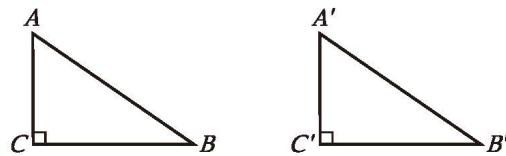

可以发现：斜边和一条直角边分别相等的两个直角三角形全等。请你尝试证明这一结论。

已知：如图 1-27，在 $\triangle ABC$ 和 $\triangle A'B'C'$ 中， $\angle C = \angle C' = 90^{\circ}$ ， $AB = A'B'$ ， $AC = A'C'$ 。

求证： $\triangle ABC \cong \triangle A'B'C'$ 。

证明：在 $\triangle ABC$ 中，

$$
\because \angle C = 90 ^ {\circ}
$$

图1-27

∴ $BC^{2}=AB^{2}-AC^{2}$ （勾股定理）。

同理， $B^{\prime}C^{\prime2}=A^{\prime}B^{\prime2}-A^{\prime}C^{\prime2}$ 。

$$
\because A B = A ^ {\prime} B ^ {\prime}, A C = A ^ {\prime} C ^ {\prime},
$$

$$
\therefore B C = B ^ {\prime} C ^ {\prime} 。
$$

∴ $\triangle ABC \cong \triangle A'B'C'$ (SSS).

定理 斜边和一条直角边分别相等的两个直角三角形全等。

这一定理可以简述为“斜边、直角边”或“HL”。
