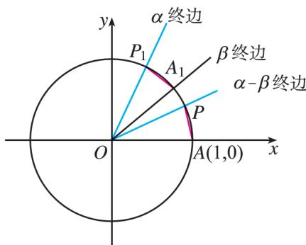

下面探究 $\cos(\alpha-\beta)$ 与角 $\alpha$ ， $\beta$ 的正弦、余弦之间的关系.

不妨令 $\alpha\neq2k\pi+\beta,\ k\in \mathbf{Z}.$

如图 5.5-1，设单位圆与 $x$ 轴的正半轴相交于点 $A(1, 0)$ ，以 $x$ 轴非负半轴为始边作角 $\alpha$ ， $\beta$ ， $\alpha - \beta$ ，它们的终边分别与单位圆相交于点 $P_{1}(\cos \alpha, \sin \alpha)$ ， $A_{1}(\cos \beta, \sin \beta)$ ， $P(\cos (\alpha - \beta), \sin (\alpha - \beta))$ 。

  
图5.5-1

连接 $A_{1}P_{1}$ ， $AP$ 。若把扇形 $OAP$ 绕着点 $O$ 旋转 $\beta$ 角，则点 $A$ ， $P$ 分别与点 $A_{1}$ ， $P_{1}$ 重合。根据圆的旋转对称性（任意一个圆绕着其圆心旋转任意角后都与原来的圆重合）可知， $\widehat{AP}$ 与 $\widehat{A_{1}P_{1}}$ 重合，从而 $\widehat{AP} = \widehat{A_{1}P_{1}}$ ，所以 $AP = A_{1}P_{1}$ 。

根据平面上任意两点 $P_{1}(x_{1},y_{1})$ ， $P_{2}(x_{2},y_{2})$ 间的距离公式 $P_{1}P_{2} = \sqrt{(x_{2} - x_{1})^{2} + (y_{2} - y_{1})^{2}}$ ，得

$$
\begin{array}{l} \left[ \cos (\alpha - \beta) - 1 \right] ^ {2} + \sin^ {2} (\alpha - \beta) \\ = (\cos \alpha - \cos \beta) ^ {2} + (\sin \alpha - \sin \beta) ^ {2}, \end{array}
$$

化简得

$$
\cos (\alpha - \beta) = \cos \alpha \cos \beta + \sin \alpha \sin \beta .
$$

当 $\alpha=2k\pi+\beta(k\in\mathbf{Z})$ 时，容易证明上式仍然成立.

所以，对于任意角 $\alpha$ ， $\beta$ 有

$$
\cos (\alpha - \beta) = \cos \alpha \cos \beta + \sin \alpha \sin \beta . \quad \left(\mathrm{C} _ {(\alpha - \beta)}\right)
$$

此公式给出了任意角 $\alpha$ ， $\beta$ 的正弦、余弦与其差角 $\alpha - \beta$ 的余弦之间的关系，称为差角的余弦公式，简记作 $\mathrm{C}_{(\alpha - \beta)}$ 。
