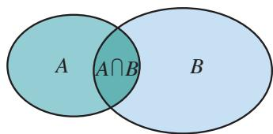

# 交集

一般地，由所有属于集合 A 且属于集合 B 的元素组成的集合，称为集合 A 与 B 的[交集](%E7%9F%A5%E8%AF%86%E7%82%B9-%E4%BA%A4%E9%9B%86.md)（intersection set），记作 $A \cap B$ （读作 “A 交 B”），即

$$
A \cap B = \{x \mid x \in A, \text {且} x \in B \},
$$

  
图1.3-3

可用 Venn 图（图 1.3-3）表示.

这样，在上述问题(1)(2)中， $A \cap B = C$ .
