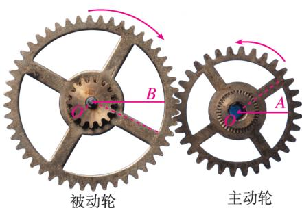
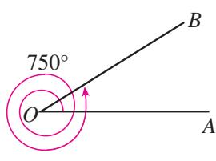
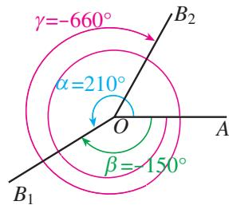
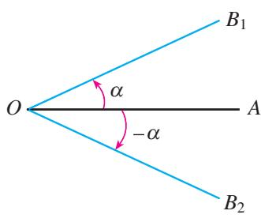
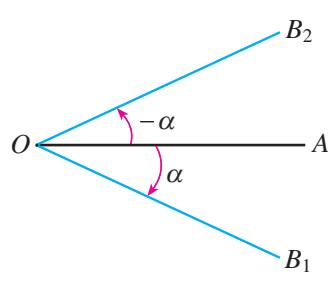
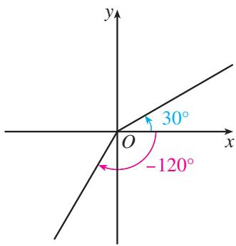

# 任意角与象限角

现实生活中随处可见超出 $0^{\circ} \sim 360^{\circ}$ 范围的角。例如，体操中有“前空翻转体540度”“后空翻转体720度”这样的动作名称，这里不仅有超出 $0^{\circ} \sim 360^{\circ}$ 范围的角，而且旋转的方向也不相同；又如，图5.1-2是两个齿轮旋转的示意图，被动轮随着主动轮的旋转而旋转，而且被动轮与主动轮有相反的旋转方向。这样， $OA$ 绕点 $O$ 旋转所成的角与 $O'B$ 绕点 $O'$ 旋转所成的角就会有不同的方向。因此，要准确地描述这些现象，不仅要知道旋转的度数，还要知道旋转的方向，这就需要对角的概念进行推广。

我们规定，一条射线绕其端点按逆时针方向旋转形成的角叫做正角，按顺时针方向旋转形成的角叫做负角.

  
图5.1-2

为了简单起见，在不引起混淆的前提下，“角 $\alpha$ ”或“ $\angle\alpha$ ”可以简记成“ $\alpha$ ”.

如果一条射线没有做任何旋转，就称它形成了一个零角。这样，零角的始边与终边重合。如果 $\alpha$ 是零角，那么 $\alpha = 0^{\circ}$ 。图5.1-3(1)中的角是一个正角，它等于 $750^{\circ}$ ；图5.1-3(2)中，正角 $\alpha = 210^{\circ}$ ，负角 $\beta = -150^{\circ}$ ， $\gamma = -660^{\circ}$ 。正常情况下，如果以零时为起始位置，那么钟表的时针或分针在旋转时所形成的角总是负角。

  
(1)

  
图5.1-3  
(2)

这样，我们就把角的概念推广到了任意角，包括正角、负角和零角。设角 $\alpha$ 由射线 OA 绕端点 O 旋转而成，角 $\beta$ 由射线 $O'A'$ 绕端点 $O'$ 旋转而成。如果它们的旋转方向相同且旋转量相等，那么就称 $\alpha = \beta$ 。

设 $\alpha, \beta$ 是任意两个角. 我们规定, 把角 $\alpha$ 的终边旋转角 $\beta$ , 这时终边所对应的角是 $\alpha + \beta$ .

类似于实数 $a$ 的相反数是 $-a$ ，我们引入任意角 $\alpha$ 的相反角的概念。如图5.1-4，我们把射线 $OA$ 绕端点 $O$ 按不同方向旋转相同的量所成的两个角叫做互为相反角。角 $\alpha$ 的相反角记为 $-\alpha$ 。于是，像实数减法的“减去一个数等于加上这个数的相反数”一样，我们有

$$
\alpha - \beta = \alpha + (- \beta).
$$

这样，角的减法可以转化为角的加法.

  
(1)

  
图5.1-4  
(2)

  
图5.1-5

我们通常在直角坐标系内讨论角．为了方便，使角的顶点与原点重合，角的始边与 x 轴的非负半轴重合．那么，角的终边在第几象限，就说这个角是第几象限角．例如，图 5.1-5 中的 $30^{\circ}$ 角、 $-120^{\circ}$ 角分别是第一象限角和第三象限角．如果角的终边在坐标轴上，那么就认为这个角不属于任何一个象限．

你能说说在直角坐标系内讨论角的好处吗？

## 本节例题与练习

- [例 1 找出0°~360°内终边相同的角并判定象限](../%E4%B9%A0%E9%A2%98/Q070000008720.md)
- [例 2 写出终边在y轴上的角的集合](../%E4%B9%A0%E9%A2%98/Q070000008721.md)
- [例 3 写出终边在直线y=x上的角的集合并求指定范围内的角](../%E4%B9%A0%E9%A2%98/Q070000008722.md)
- [练习 1](../%E4%B9%A0%E9%A2%98/Q070000008723.md)
- [练习 2](../%E4%B9%A0%E9%A2%98/Q070000008724.md)
- [练习 3](../%E4%B9%A0%E9%A2%98/Q070000008725.md)
- [练习 4](../%E4%B9%A0%E9%A2%98/Q070000008726.md)
- [练习 5](../%E4%B9%A0%E9%A2%98/Q070000008727.md)

## 相关原子

- [正角与负角](../%E6%A6%82%E5%BF%B5%E6%88%96%E5%85%AC%E5%BC%8F/%E6%A6%82%E5%BF%B5-%E6%AD%A3%E8%A7%92%E4%B8%8E%E8%B4%9F%E8%A7%92.md)

## 所属组织

- [5.1.1 任意角](../%E7%9F%A5%E8%AF%86%E4%B8%B2%E8%81%94/%E4%BA%BA%E6%95%99A-%E5%BF%85%E4%BF%AE%E7%AC%AC%E4%B8%80%E5%86%8C/%E7%AC%AC%E4%BA%94%E7%AB%A0%20%E4%B8%89%E8%A7%92%E5%87%BD%E6%95%B0/5.1%20%E4%BB%BB%E6%84%8F%E8%A7%92%E5%92%8C%E5%BC%A7%E5%BA%A6%E5%88%B6/5.1.1%20%E4%BB%BB%E6%84%8F%E8%A7%92.md)

## 相关练习组织（范围关联）

- [5.1.1 任意角](../%E9%A2%98%E5%9E%8B/%E6%8C%89%E7%AB%A0%E8%8A%82%E5%88%86%E7%B1%BB/%E4%BA%BA%E6%95%99A-%E5%BF%85%E4%BF%AE%E7%AC%AC%E4%B8%80%E5%86%8C/%E7%AC%AC%E4%BA%94%E7%AB%A0%20%E4%B8%89%E8%A7%92%E5%87%BD%E6%95%B0/5.1%20%E4%BB%BB%E6%84%8F%E8%A7%92%E5%92%8C%E5%BC%A7%E5%BA%A6%E5%88%B6.md)
