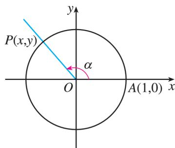

利用直角坐标系和单位圆可以研究圆周运动中点的位置变化，并由此定义任意角的三角函数。

如图 5.2-2，以单位圆的圆心 $O$ 为原点，以射线 $OA$ 为 $x$ 轴的非负半轴，建立直角坐标系，点 $A$ 的坐标为 $(1, 0)$ ，点 $P$ 的坐标为 $(x, y)$ 。射线 $OA$ 从 $x$ 轴的非负半轴开始，绕点 $O$ 按逆时针方向旋转角 $\alpha$ ，终止位置为 $OP$ 。

  
图5.2-2

利用勾股定理可以发现，当 $\alpha=\frac{\pi}{6}$ 时，点 $P$ 的坐标是 $\left(\frac{\sqrt{3}}{2},\frac{1}{2}\right)$ ；当 $\alpha=\frac{\pi}{2}$ 或 $\frac{2\pi}{3}$ 时，点 $P$ 的坐标分别是 $(0,1)$ 和 $\left(-\frac{1}{2},\frac{\sqrt{3}}{2}\right)$ 。它们都是唯一确定的。

一般地，任意给定一个角 $\alpha \in \mathbf{R}$ ，它的终边 $OP$ 与单位圆交点 $P$ 的坐标，无论是横坐标 $x$ 还是纵坐标 $y$ ，都是唯一确定的。所以，点 $P$ 的横坐标 $x$ 、纵坐标 $y$ 都是角 $\alpha$ 的函数。下面给出这些函数的定义。

设 $\alpha$ 是一个任意角， $\alpha \in \mathbf{R}$ ，它的终边 $OP$ 与单位圆相交于点 $P(x, y)$ .

（1）把点 $P$ 的纵坐标 $y$ 叫做 $\alpha$ 的正弦函数（sine function），记作 $\sin \alpha$ ，即

$$
y = \sin \alpha ;
$$

(2) 把点 $P$ 的横坐标 $x$ 叫做 $\alpha$ 的余弦函数（cosine function），记作 $\cos \alpha$ ，即 $x = \cos \alpha$ ；

（3）把点 $P$ 的纵坐标与横坐标的比值 $\frac{y}{x}$ 叫做 $\alpha$ 的正切，记作 $\tan \alpha$ ，即

$$
\frac {y}{x} = \tan \alpha \ (x \neq 0).
$$

可以看出，当 $\alpha = \frac{\pi}{2} + k\pi (k \in \mathbf{Z})$ 时， $\alpha$ 的终边在 $y$ 轴上，这时点 $P$ 的横坐标 $x$ 等于0，所以 $\frac{y}{x} = \tan \alpha$ 无意义。除此之外，对于确定的角 $\alpha$ ， $\frac{y}{x}$ 的值也是唯一确定的。所以， $\frac{y}{x} = \tan \alpha (x \neq 0)$ 也是以角为自变量，以单位圆上点的纵坐标与横坐标的比值为函数值的函数，称为正切函数（tangent function）。

我们将正弦函数、余弦函数和正切函数统称为三角函数（trigonometric function），通常将它们记为：

正弦函数 $y=\sin x,\quad x\in \mathbf{R};$

余弦函数 $y=\cos x,\quad x\in \mathbf{R};$

正切函数 $y = \tan x,\quad x \in \left\{x \mid x \neq \frac{\pi}{2} + k\pi (k \in \mathbf{Z})\right\}$ .
