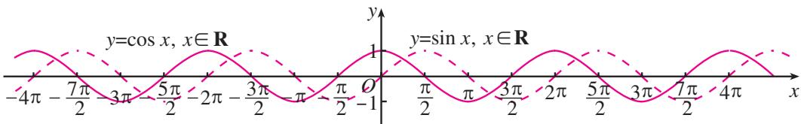

对于函数 $y = \cos x$ ，由诱导公式 $\cos x = \sin \left( x + \frac{\pi}{2} \right)$ 得，

$$
y = \cos x = \sin \left(x + \frac {\pi}{2}\right), x \in \mathbf {R}.
$$

而函数

$$
y = \sin \left(x + \frac {\pi}{2}\right), x \in \mathbf {R}
$$

的图象可以通过正弦函数

$$
y = \sin x, x \in \mathbf {R}
$$

的图象向左平移 $\frac{\pi}{2}$ 个单位长度而得到. 所以, 将正弦函数的图象向左平移 $\frac{\pi}{2}$ 个单位长度, 就得到[余弦函数的图象](../%E6%A6%82%E5%BF%B5%E6%88%96%E5%85%AC%E5%BC%8F/%E6%A6%82%E5%BF%B5-%E4%BD%99%E5%BC%A6%E6%9B%B2%E7%BA%BF.md), 如图5.4-5所示.

  
图5.4-5

余弦函数 $y = \cos x$ ， $x \in \mathbf{R}$ 的图象叫做余弦曲线（cosine curve）。它是与正弦曲线具有相同形状的“波浪起伏”的连续光滑曲线。

类似于用“五点法”画正弦函数简图，画余弦函数 $y = \cos x$ 在区间 $[-\pi, \pi]$ 上的简图时，相应的五个关键点为 $(-\pi, -1)$ 、 $\left(-\frac{\pi}{2}, 0\right)$ 、 $(0, 1)$ 、 $\left(\frac{\pi}{2}, 0\right)$ 、 $(\pi, -1)$ ；在区间 $[0, 2\pi]$ 上的五个关键点为 $(0, 1)$ 、 $\left(\frac{\pi}{2}, 0\right)$ 、 $(\pi, -1)$ 、 $\left(\frac{3\pi}{2}, 0\right)$ 、 $(2\pi, 1)$ 。
