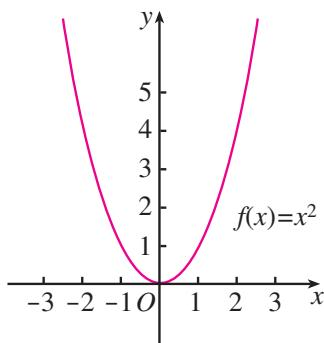
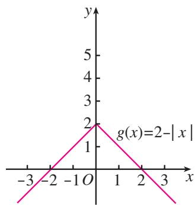
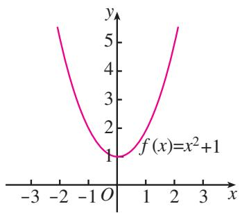
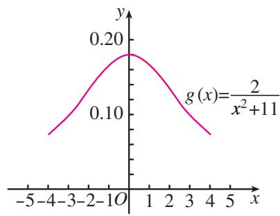

观察函数 $f(x) = x^2$ 和 $g(x) = 2 - |x|$ 的图象（图3.2-6），可以发现，这两个函数的图象都关于 $y$ 轴对称。

  
图3.2-6

为了用符号语言精确地描述“函数图象关于 $y$ 轴对称”这一特征，不妨取自变量的一些特殊值，观察相应函数值的情况，如表 3.2-1。

表3.2-1

<table><tr><td>x</td><td>...</td><td>-3</td><td>-2</td><td>-1</td><td>0</td><td>1</td><td>2</td><td>3</td><td>...</td></tr><tr><td> $f(x)=x^{2}$ </td><td>...</td><td>9</td><td>4</td><td>1</td><td>0</td><td>1</td><td>4</td><td>9</td><td>...</td></tr><tr><td> $g(x)=2-|x|$ </td><td>...</td><td>-1</td><td>0</td><td>1</td><td>2</td><td>1</td><td>0</td><td>-1</td><td>...</td></tr></table>

可以发现，当自变量取一对相反数时，相应的两个函数值相等.

例如，对于函数 $f(x)=x^{2}$ ，有

$$
\begin{array}{l} f (- 3) = 9 = f (3); \\ f (- 2) = 4 = f (2); \\ f (- 1) = 1 = f (1). \end{array}
$$

实际上， $\forall x \in \mathbf{R}$ ，都有 $f(-x) = (-x)^2 = x^2 = f(x)$ ，这时称函数 $f(x) = x^2$ 为偶函数。同样地，对于函数 $g(x) = 2 - |x|$ ， $\forall x \in \mathbf{R}$ ，都有 $g(-x) = 2 - |-x| = 2 - |x| = g(x)$ ，因此 $g(x) = 2 - |x|$ 也是偶函数。

一般地，设函数 $f(x)$ 的定义域为 $D$ ，如果 $\forall x \in D$ ，都有 $-x \in D$ ，且 $f(-x) = f(x)$ ，那么函数 $f(x)$ 就叫做[偶函数](%E7%9F%A5%E8%AF%86%E7%82%B9-%E5%81%B6%E5%87%BD%E6%95%B0.md)（even function）.

例如，函数 $f(x) = x^{2} + 1$ ， $g(x) = \frac{2}{x^2 + 11}$ 都是偶函数，它们的图象分别如图3.2-7(1)(2）所示.

  
(1)

  
(2)  
图3.2-7
