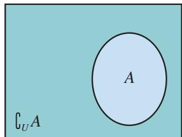

在研究问题时，我们经常需要确定研究对象的范围.

例如，从小学到初中，数的研究范围逐步地由自然数到正分数，再到有理数，引进无理数后，数的研究范围扩充到实数。在高中阶段，数的研究范围将进一步扩充。

在不同范围研究同一个问题，可能有不同的结果。例如方程 $(x - 2)(x^2 - 3) = 0$ 的解集，在有理数范围内只有一个解2，即

$$
\{x \in \mathbf {Q} | (x - 2) \left(x ^ {2} - 3\right) = 0 \} = \{2 \};
$$

在实数范围内有三个解： $2$ ， $\sqrt{3}$ ，一 $\sqrt{3}$ ，即

$$
\{x \in \mathbf {R} | (x - 2) (x ^ {2} - 3) = 0 \} = \{2, \sqrt {3}, - \sqrt {3} \}.
$$

一般地，如果一个集合含有所研究问题中涉及的所有元素，那么就称这个集合为全集（universal set），通常记作 $U$

通常也把给定的集合作为全集.

对于一个集合 A，由全集 U 中不属于集合 A 的所有元素组成的集合称为集合 A 相对于全集 U 的补集（complementary set），简称为集合 A 的补集，记作 $C_{U}A$ ，即

$$
\complement_ {U} A = \{x \mid x \in U, \text {且} x \notin A \},
$$

可用 Venn 图（图 1.3-4）表示.

图1.3-4
