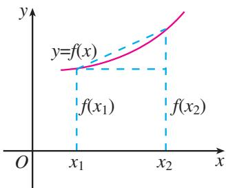
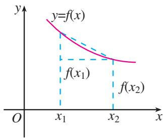

一般地，设函数 $f(x)$ 的定义域为 D，区间 $I \subseteq D$ ：

如果 $\forall x_{1}, x_{2} \in I$ ，当 $x_{1} < x_{2}$ 时，都有 $f(x_{1}) < f(x_{2})$ ，那么就称函数 $f(x)$ 在区间 $I$ 上单调递增（图3.2-3（1））.

特别地，当函数 $f(x)$ 在它的定义域上单调递增时，我们就称它是增函数（increasing function）.

  
(1)

  
(2)  
图3.2-3

如果 $\forall x_{1}, x_{2} \in I$ ，当 $x_{1} < x_{2}$ 时，都有 $f(x_{1}) > f(x_{2})$ ，那么就称函数 $f(x)$ 在区间 $I$ 上单调递减（图3.2-3（2））.

特别地，当函数 $f(x)$ 在它的定义域上单调递减时，我们就称它是减函数（decreasing function）.

如果函数 $y = f(x)$ 在区间 $I$ 上单调递增或单调递减，那么就说函数 $y = f(x)$ 在这一区间具有（严格的）单调性，区间 $I$ 叫做 $y = f(x)$ 的单调区间.
