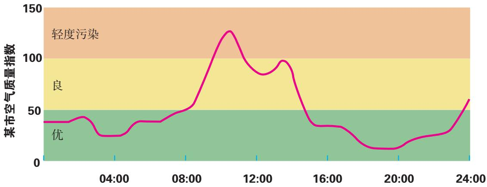

下面通过四个具体实例，用集合与对应语言更精确地刻画变量之间的函数关系。

实例 1：某“复兴号”高速列车加速到 $350\ \mathrm{km/h}$ 后保持匀速运行半小时。这段时间内，列车行进的路程 $s$（单位：$\mathrm{km}$）与运行时间 $t$（单位：$\mathrm{h}$）的对应关系是

$$
s = 350t.	ag{①}
$$

必须注意自变量 $t$ 的变化范围：根据条件不能判断列车以 $350\ \mathrm{km/h}$ 运行半小时后的情况，因此不能仅凭对应关系 $s = 350t$ 断言运行 $1\ \mathrm{h}$ 前进了 $350\ \mathrm{km}$ 。这里， $t$ 的变化范围是数集 $A_{1} = \{t \mid 0 \leqslant t \leqslant 0.5\}$ ， $s$ 的变化范围是数集 $B_{1} = \{s \mid 0 \leqslant s \leqslant 175\}$ 。对于数集 $A_{1}$ 中的任一时刻 $t$ ，按照对应关系①，在数集 $B_{1}$ 中都有唯一确定的路程 $s$ 和它对应。

实例 2：某电气维修公司要求工人每周工作至少 1 天，至多 6 天，工资标准为每人每天 350 元，每周付一次工资。工人每周的工资 $w$（单位：元）是一周工作天数 $d$ 的函数，其对应关系是

$$
w = 350d.	ag{②}
$$

其中， $d$ 的变化范围是数集 $A_{2}=\{1,2,3,4,5,6\}$ ， $w$ 的变化范围是数集 $B_{2}=\{350,700,1050,1400,1750,2100\}$ 。对于数集 $A_{2}$ 中的任一个工作天数 $d$ ，按照对应关系②，在数集 $B_{2}$ 中都有唯一确定的工资 $w$ 与它对应。

实例 3：图 3.1-1 是某市某日的空气质量指数（Air Quality Index，简称 AQI）变化图。

  
图3.1-1

从图 3.1-1 中的曲线可知，时刻 $t$（单位：$\mathrm{h}$）的变化范围是数集 $A_{3} = \{t\mid 0\leqslant t\leqslant 24\}$ ，AQI 的值 $I$ 都在数集 $B_{3} = \{I\mid 0 < I < 150\}$ 中。对于数集 $A_{3}$ 中的任一时刻 $t$ ，按照图 3.1-1 中曲线所给定的对应关系，在数集 $B_{3}$ 中都有唯一确定的 AQI 的值 $I$ 与之对应。因此，这里的 $I$ 是 $t$ 的函数。

实例 4：国际上常用恩格尔系数 $r\left(r=rac{	ext{食物支出金额}}{	ext{总支出金额}}	imes100\%
ight)$ 反映一个地区人民生活质量的高低，表 3.1-1 是我国城镇居民恩格尔系数变化情况。

表 3.1-1 我国城镇居民恩格尔系数变化情况

<table><tr><td>年份 y</td><td>2012</td><td>2013</td><td>2014</td><td>2015</td><td>2016</td><td>2017</td><td>2018</td><td>2019</td><td>2020</td><td>2021</td></tr><tr><td>恩格尔系数 r(%)</td><td>32.0</td><td>30.1</td><td>30.0</td><td>29.7</td><td>29.3</td><td>28.6</td><td>27.7</td><td>27.6</td><td>29.2</td><td>28.6</td></tr></table>

这里，年份 $y$ 的取值范围是数集 $A_{4} = \{2012, 2013, 2014, 2015, 2016, 2017, 2018, 2019, 2020, 2021\}$ ；根据恩格尔系数的定义可知， $r$ 的取值范围是数集 $B_{4} = \{r \mid 0 < r \leqslant 1\}$ 。对于数集 $A_{4}$ 中的任意一个年份 $y$ ，根据表 3.1-1 所给定的对应关系，在数集 $B_{4}$ 中都有唯一确定的恩格尔系数 $r$ 与之对应。所以， $r$ 是 $y$ 的[函数](%E7%9F%A5%E8%AF%86%E7%82%B9-%E5%87%BD%E6%95%B0%E7%9A%84%E6%A6%82%E5%BF%B5.md)。

上述四个实例的共同特征有：

（1）都包含两个非空数集，用 $A, B$ 来表示；

（2）都有一个对应关系；

（3）尽管对应关系的表示方法不同，但它们都有如下特性：对于数集 $A$ 中的任意一个数 $x$ ，按照对应关系，在数集 $B$ 中都有唯一确定的数 $y$ 和它对应。

事实上，除解析式、图象、表格外，还有其他表示对应关系的方法。为了表示方便，我们引进符号 $f$ 统一表示对应关系。

一般地，设 $A$ ， $B$ 是非空的实数集，如果对于集合 $A$ 中的任意一个数 $x$ ，按照某种确定的对应关系 $f$ ，在集合 $B$ 中都有唯一确定的数 $y$ 和它对应，那么就称 $f: A 
ightarrow B$ 为从集合 $A$ 到集合 $B$ 的一个函数（function），记作

$$
y = f (x), x \in A.
$$

其中， $x$ 叫做自变量， $x$ 的取值范围 $A$ 叫做函数的定义域（domain）；与 $x$ 的值相对应的 $y$ 值叫做函数值，函数值的集合 $\{f(x) \mid x \in A\}$ 叫做函数的值域（range）。

显然，值域是集合 $B$ 的子集。在实例 1 与实例 2 中，值域就是 $B_{1}$ 和 $B_{2}$ ；在实例 3 中，值域是数集 $B_{3}$ 的真子集；在实例 4 中，值域 $C_4 = \{0.32, 0.301, 0.3, 0.297, 0.293, 0.286, 0.277, 0.276, 0.292\}$ ，是数集 $B_{4} = \{r \mid 0 < r \leqslant 1\}$ 的真子集。

17 世纪后期，德国数学家莱布尼茨第一次将“function”一词作为专门的数学术语；19 世纪，李善兰首次将 function 翻译成“函数”。

我们所熟悉的一次函数 $y = ax + b (a 
eq 0)$ 的定义域是 $\mathbf{R}$ ，值域也是 $\mathbf{R}$ 。对应关系 $f$ 把 $\mathbf{R}$ 中的任意一个数 $x$ ，对应到 $\mathbf{R}$ 中唯一确定的数 $ax + b (a 
eq 0)$ 。

二次函数 $y = ax^2 + bx + c (a 
eq 0)$ 的定义域是 $\mathbf{R}$ ，值域是 $B$ 。当 $a > 0$ 时， $B = \left\{y \mid y \geqslant rac{4ac - b^2}{4a}
ight\}$ ；当 $a < 0$ 时， $B = \left\{y \mid y \leqslant rac{4ac - b^2}{4a}
ight\}$ 。对应关系 $f$ 把 $\mathbf{R}$ 中的任意一个数 $x$ ，对应到 $B$ 中唯一确定的数 $ax^2 + bx + c (a 
eq 0)$ 。
