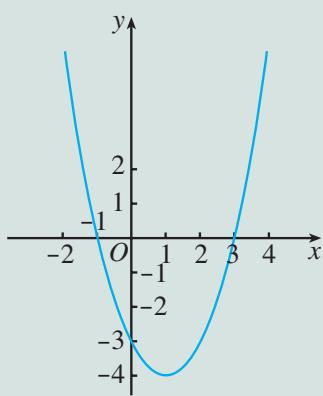

观察二次函数 $f(x) = x^{2} - 2x - 3$ 的图象（图 4.5-1），可以发现，在零点附近，函数图象是连续不断的，并且“穿过” $x$ 轴。

  
图4.5-1

函数在端点 $x = 2$ 和 $x = 4$ 的取值异号，即 $f(2)f(4) < 0$ ，函数 $f(x) = x^2 - 2x - 3$ 在区间 $(2, 4)$ 内有零点 $x = 3$ ，它是方程 $x^2 - 2x - 3 = 0$ 的一个根。同样地， $f(-2)f(0) < 0$ ，函数 $f(x) = x^2 - 2x - 3$ 在 $(-2, 0)$ 内有零点 $x = -1$ ，它是方程 $x^2 - 2x - 3 = 0$ 的另一个根。

一般地，我们有：

[函数零点存在定理](../%E6%A6%82%E5%BF%B5%E6%88%96%E5%85%AC%E5%BC%8F/%E6%A6%82%E5%BF%B5-%E5%87%BD%E6%95%B0%E9%9B%B6%E7%82%B9%E5%AD%98%E5%9C%A8%E5%AE%9A%E7%90%86.md) 如果函数 $y = f(x)$ 在区间 $[a, b]$ 上的图象是一条连续不断的曲线，且有 $f(a)f(b) < 0$ ，那么，函数 $y = f(x)$ 在区间 $(a, b)$ 内至少有一个零点，即存在 $c \in (a, b)$ ，使得 $f(c) = 0$ ，这个 $c$ 也就是方程 $f(x) = 0$ 的解.
