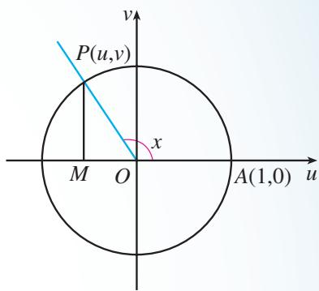

# 利用单位圆的性质研究正弦函数、余弦函数的性质

根据三角函数的定义可知，“单位圆上点的坐标就是三角函数”。因此，单位圆的性质与三角函数的性质有天然的联系，单位圆是研究三角函数性质的好工具。例如，借助单位圆的对称性可以方便地得到诱导公式。借助单位圆研究三角函数的性质体现了数形结合的思想方法，有利于从整体上把握三角函数。

如图1，在直角坐标系 $uOv$ 中，角 $x$ 的顶点与原点重合，始边与 $Ou$ 轴重合，终边与单位圆交于点 $P(\cos x, \sin x)$ 。容易发现，当角 $x$ 的终边绕原点从 $Ou$ 轴的正半轴开始，按照逆时针方向旋转时，点 $P$ 的横坐标按照

$$
1 \rightarrow 0 \rightarrow - 1 \rightarrow 0 \rightarrow 1 \dots
$$

的规律连续地、周而复始地变化；同时，纵坐标按照

  
图1

$$
0 \rightarrow 1 \rightarrow 0 \rightarrow - 1 \rightarrow 0 \dots
$$

的规律连续地、周而复始地变化.  
由上述变化规律，可得余弦函数、正弦函数的各种性质（下述表格中的 $k \in \mathbf{Z}$ ）.  
(1) 周期性  
自变量每增加 $2\pi$ （角 $x$ 的终边旋转一周），余弦函数值、正弦函数值重复出现，所以余弦函数、正弦函数的周期都是 $2\pi$  
(2) 奇偶性  
角 $x$ 、角 $-x$ 与单位圆的交点 $P(\cos x, \sin x)$ 、 $P'(\cos (-x), \sin (-x))$ 关于 $Ou$ 轴对称，所以 $\cos (-x) = \cos x$ ， $\sin (-x) = -\sin x$ ，所以余弦函数为偶函数，正弦函数为奇函数.  
(3) 单调性  
余弦函数的单调性：

<table><tr><td>角x</td><td>2kπ→2kπ+π/2</td><td>2kπ+π/2→2kπ+π</td><td>2kπ+π→2kπ+3π/2</td><td>2kπ+3π/2→2kπ+2π</td></tr><tr><td>P点横坐标的变化</td><td>1→0</td><td>0→-1</td><td>-1→0</td><td>0→1</td></tr><tr><td>cos x的单调性</td><td>单调递减</td><td>单调递减</td><td>单调递增</td><td>单调递增</td></tr></table>

正弦函数的单调性：

<table><tr><td>角x</td><td> $2k\pi \rightarrow 2k\pi + \frac{\pi}{2}$ </td><td> $2k\pi + \frac{\pi}{2} \rightarrow 2k\pi + \pi$ </td><td> $2k\pi + \pi \rightarrow 2k\pi + \frac{3\pi}{2}$ </td><td> $2k\pi + \frac{3\pi}{2} \rightarrow 2k\pi + 2\pi$ </td></tr><tr><td>P点纵坐标的变化</td><td>0→1</td><td>1→0</td><td>0→-1</td><td>-1→0</td></tr><tr><td>sin x的单调性</td><td>单调递增</td><td>单调递减</td><td>单调递减</td><td>单调递增</td></tr></table>

余弦函数的最大值、最小值：

<table><tr><td>角x</td><td>π+2kπ</td><td>2kπ</td></tr><tr><td>P点的横坐标</td><td>-1</td><td>1</td></tr><tr><td>cos x</td><td>最小值</td><td>最大值</td></tr></table>

正弦函数的最大值、最小值：

<table><tr><td>角x</td><td>-π/2+2kπ</td><td>π/2+2kπ</td></tr><tr><td>P点的纵坐标</td><td>-1</td><td>1</td></tr><tr><td>sin x</td><td>最小值</td><td>最大值</td></tr></table>

在后续的学习中我们还可以看到，借助单位圆的性质（主要是对称性），不仅可以得到三角函数的各种性质，而且可以推导各种三角公式.

## 定义摘录（来源原文）

根据三角函数的定义可知，“单位圆上点的坐标就是三角函数”。因此，单位圆的性质与三角函数的性质有天然的联系，单位圆是研究三角函数性质的好工具。
如图1，在直角坐标系 $uOv$ 中，角 $x$ 的顶点与原点重合，始边与 $Ou$ 轴重合，终边与单位圆交于点 $P(\cos x, \sin x)$ 。容易发现，当角 $x$ 的终边绕原点从 $Ou$ 轴的正半轴开始，按照逆时针方向旋转时，点 $P$ 的横坐标按照

## 所属组织

- [探究与发现 利用单位圆的性质研究正弦函数、余弦函数的性质](../%E7%9F%A5%E8%AF%86%E4%B8%B2%E8%81%94/%E4%BA%BA%E6%95%99A-%E5%BF%85%E4%BF%AE%E7%AC%AC%E4%B8%80%E5%86%8C/%E7%AC%AC%E4%BA%94%E7%AB%A0%20%E4%B8%89%E8%A7%92%E5%87%BD%E6%95%B0/5.4%20%E4%B8%89%E8%A7%92%E5%87%BD%E6%95%B0%E7%9A%84%E5%9B%BE%E8%B1%A1%E4%B8%8E%E6%80%A7%E8%B4%A8/%E6%8E%A2%E7%A9%B6%E4%B8%8E%E5%8F%91%E7%8E%B0%20%E5%88%A9%E7%94%A8%E5%8D%95%E4%BD%8D%E5%9C%86%E7%9A%84%E6%80%A7%E8%B4%A8%E7%A0%94%E7%A9%B6%E6%AD%A3%E5%BC%A6%E5%87%BD%E6%95%B0%E3%80%81%E4%BD%99%E5%BC%A6%E5%87%BD%E6%95%B0%E7%9A%84%E6%80%A7%E8%B4%A8.md)

## 相关练习组织（范围关联）

- [5.4 三角函数的图象与性质](../%E9%A2%98%E5%9E%8B/%E6%8C%89%E7%AB%A0%E8%8A%82%E5%88%86%E7%B1%BB/%E4%BA%BA%E6%95%99A-%E5%BF%85%E4%BF%AE%E7%AC%AC%E4%B8%80%E5%86%8C/%E7%AC%AC%E4%BA%94%E7%AB%A0%20%E4%B8%89%E8%A7%92%E5%87%BD%E6%95%B0/5.4%20%E4%B8%89%E8%A7%92%E5%87%BD%E6%95%B0%E7%9A%84%E5%9B%BE%E8%B1%A1%E4%B8%8E%E6%80%A7%E8%B4%A8.md)
