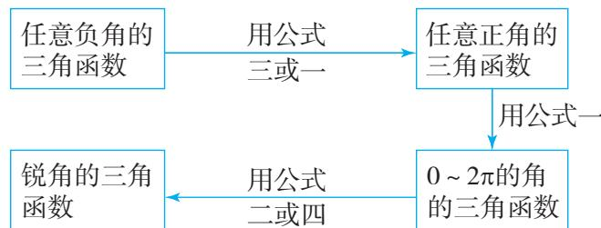

# 利用诱导公式将任意角三角函数化归为锐角三角函数的方法

思考

由例 1，你对公式一～公式四的作用有什么进一步的认识？你能自己归纳一下把任意角的三角函数转化为锐角三角函数的步骤吗？

利用公式一～公式四，可以把任意角的三角函数转化为锐角三角函数，一般可按下面步骤进行：

数学史上，求三角函数值曾经是一个重要而困难的问题。数学家制作了锐角三角函数表，并通过公式一～公式四，按上述步骤解决了问题。现在，我们可以利用计算工具方便地求任意角的三角函数值，所以这些公式的“求值”作用已经不重要了，但它们所体现的三角函数的对称性，在解决三角函数的各种问题中却依然有重要的作用。

## 本节例题与练习

- [习题5.3 复习巩固 第1题](../%E4%B9%A0%E9%A2%98/Q070000008799.md)
- [习题5.3 复习巩固 第2题](../%E4%B9%A0%E9%A2%98/Q070000008800.md)
- [习题5.3 复习巩固 第3题](../%E4%B9%A0%E9%A2%98/Q070000008801.md)
- [习题5.3 复习巩固 第4题](../%E4%B9%A0%E9%A2%98/Q070000008802.md)
- [习题5.3 拓广探索 第10题](../%E4%B9%A0%E9%A2%98/Q070000008808.md)
- [习题5.3 拓广探索 第9题](../%E4%B9%A0%E9%A2%98/Q070000008807.md)
- [习题5.3 综合运用 第5题](../%E4%B9%A0%E9%A2%98/Q070000008803.md)
- [习题5.3 综合运用 第6题](../%E4%B9%A0%E9%A2%98/Q070000008804.md)
- [习题5.3 综合运用 第7题](../%E4%B9%A0%E9%A2%98/Q070000008805.md)
- [习题5.3 综合运用 第8题](../%E4%B9%A0%E9%A2%98/Q070000008806.md)
- [例 1 利用诱导公式求任意角的三角函数值](../%E4%B9%A0%E9%A2%98/Q070000008788.md)
- [例 2 利用诱导公式化简三角函数式](../%E4%B9%A0%E9%A2%98/Q070000008789.md)
- [例 3 利用诱导公式证明 3π/2±α 的三角恒等式](../%E4%B9%A0%E9%A2%98/Q070000008794.md)
- [例 4 综合运用诱导公式化简复杂三角函数式](../%E4%B9%A0%E9%A2%98/Q070000008795.md)
- [例 5 利用互余角关系与诱导公式求值](../%E4%B9%A0%E9%A2%98/Q070000008796.md)
- [练习 1](../%E4%B9%A0%E9%A2%98/Q070000008790.md)
- [练习 1](../%E4%B9%A0%E9%A2%98/Q070000008797.md)
- [练习 2](../%E4%B9%A0%E9%A2%98/Q070000008791.md)
- [练习 2](../%E4%B9%A0%E9%A2%98/Q070000008798.md)
- [练习 3](../%E4%B9%A0%E9%A2%98/Q070000008792.md)
- [练习 4](../%E4%B9%A0%E9%A2%98/Q070000008793.md)

## 所属组织

- [5.3 诱导公式](../%E7%9F%A5%E8%AF%86%E4%B8%B2%E8%81%94/%E4%BA%BA%E6%95%99A-%E5%BF%85%E4%BF%AE%E7%AC%AC%E4%B8%80%E5%86%8C/%E7%AC%AC%E4%BA%94%E7%AB%A0%20%E4%B8%89%E8%A7%92%E5%87%BD%E6%95%B0/5.3%20%E8%AF%B1%E5%AF%BC%E5%85%AC%E5%BC%8F/5.3%20%E8%AF%B1%E5%AF%BC%E5%85%AC%E5%BC%8F.md)

## 相关练习组织（范围关联）

- [5.3 诱导公式](../%E9%A2%98%E5%9E%8B/%E6%8C%89%E7%AB%A0%E8%8A%82%E5%88%86%E7%B1%BB/%E4%BA%BA%E6%95%99A-%E5%BF%85%E4%BF%AE%E7%AC%AC%E4%B8%80%E5%86%8C/%E7%AC%AC%E4%BA%94%E7%AB%A0%20%E4%B8%89%E8%A7%92%E5%87%BD%E6%95%B0/5.3%20%E8%AF%B1%E5%AF%BC%E5%85%AC%E5%BC%8F.md)
