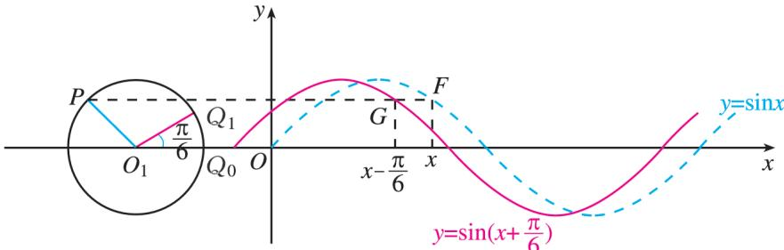
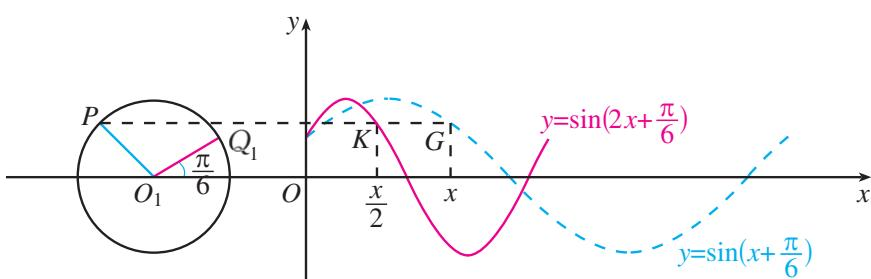
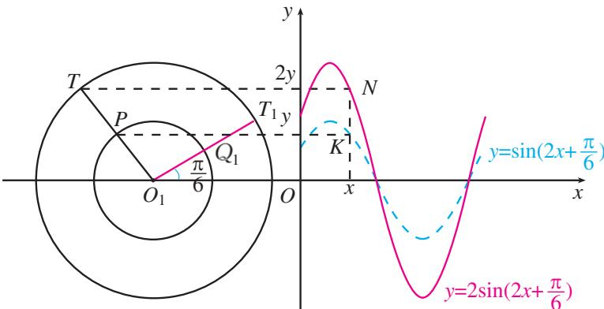
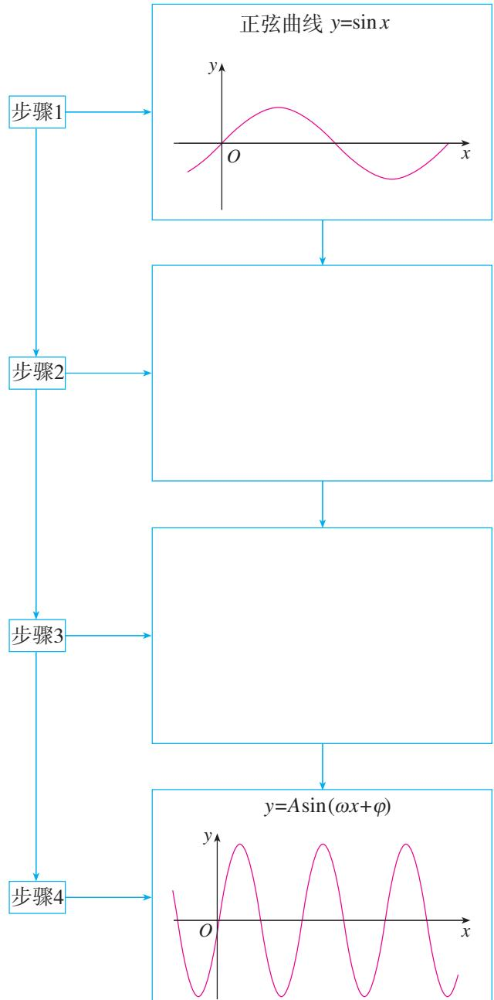

对于形如 $y = A \sin(\omega x + \varphi)$ （其中 $A > 0, \omega > 0$ ）的函数，函数 $y = \sin x$ 是它在 $A=1, \omega=1, \varphi=0$ 时的特殊情形。采用控制变量的方法，依次研究参数 $\varphi$ 、 $\omega$ 、 $A$ 对函数图象的影响，就能把握这个函数的图象与性质。

1. 探索 $\varphi$ 对 $y = \sin(x + \varphi)$ 图象的影响

如图 5.6-4，取 $A=1$ ， $\omega=1$ ，动点 $M$ 在单位圆 $O_{1}$ 上以单位角速度按逆时针方向运动。如果动点 $M$ 以 $Q_{0}$ 为起点（此时 $\varphi=0$ ），经过 $x\ \mathrm{s}$ 后运动到点 $P$ ，那么点 $P$ 的纵坐标 $y$ 就等于 $\sin x$ 。以 $(x, y)$ 为坐标描点，可得正弦函数 $y = \sin x$ 的图象。

  
图5.6-4

在单位圆上使起点 $Q_{0}$ 绕点 $O_{1}$ 旋转 $\frac{\pi}{6}$ 到 $Q_{1}$ ，当起点位于 $Q_{1}$ 时， $\varphi = \frac{\pi}{6}$ ，可得函数 $y = \sin \left(x + \frac{\pi}{6}\right)$ 的图象。

进一步，在单位圆上，设两个动点分别以 $Q_{0}$ ， $Q_{1}$ 为起点同时开始运动。如果以 $Q_{0}$ 为起点的动点到达圆周上点 $P$ 的时间为 $x \mathrm{~s}$ ，那么以 $Q_{1}$ 为起点的动点相继到达点 $P$ 的时间是 $\left(x - \frac{\pi}{6}\right)\mathrm{s}$ 。这个规律反映在图象上就是：如果 $F(x, y)$ 是函数 $y = \sin x$ 图象上的一点，那么 $G\left(x - \frac{\pi}{6}, y\right)$ 就是函数 $y = \sin \left(x + \frac{\pi}{6}\right)$ 图象上的点，如图 5.6-4 所示。这说明，把正弦曲线 $y = \sin x$ 上的所有点向左平移 $\frac{\pi}{6}$ 个单位长度，就得到 $y = \sin \left(x + \frac{\pi}{6}\right)$ 的图象。

一般地，当动点 $M$ 的起点位置 $Q$ 所对应的角为 $\varphi$ 时，对应的函数是 $y=\sin(x+\varphi)$ $(\varphi\neq0)$ ，把正弦曲线上的所有点向左（当 $\varphi>0$ 时）或向右（当 $\varphi<0$ 时）平移 $|\varphi|$ 个单位长度，就得到函数 $y=\sin(x+\varphi)$ 的图象。

2. 探索 $\omega (\omega > 0)$ 对 $y = \sin (\omega x + \varphi)$ 图象的影响

如图 5.6-5，取圆的半径 $A = 1$ ，不妨令 $\varphi = \frac{\pi}{6}$ ，当 $\omega = 1$ 时得到 $y = \sin \left(x + \frac{\pi}{6}\right)$ 的图象。

  
图5.6-5

取 $\omega = 2$ 时，得到函数 $y = \sin \left(2x + \frac{\pi}{6}\right)$ 的图象。在单位圆上，设以 $Q_{1}$ 为起点的动点，当 $\omega = 1$ 时到达点 $P$ 的时间为 $x_{1}\mathrm{s}$ ，当 $\omega = 2$ 时到达点 $P$ 的时间为 $x_{2}\mathrm{s}$ 。因为 $\omega = 2$ 时动点的转速是 $\omega = 1$ 时的 2 倍，所以 $x_{2} = \frac{1}{2} x_{1}$ 。这样，设 $G(x, y)$ 是函数 $y = \sin \left(x + \frac{\pi}{6}\right)$ 图象上的一点，那么 $K\left(\frac{1}{2} x, y\right)$ 就是函数 $y = \sin \left(2x + \frac{\pi}{6}\right)$ 图象上的相应点，如图 5.6-5 所示。这说明，把 $y = \sin \left(x + \frac{\pi}{6}\right)$ 的图象上所有点的横坐标缩短到原来的 $\frac{1}{2}$ （纵坐标不变），就得到 $y = \sin \left(2x + \frac{\pi}{6}\right)$ 的图象。 $y = \sin \left(2x + \frac{\pi}{6}\right)$ 的周期为 $\pi$ ，是 $y = \sin \left(x + \frac{\pi}{6}\right)$ 的周期的 $\frac{1}{2}$ 。

同理，当 $\omega = \frac{1}{2}$ 时，动点的转速是 $\omega = 1$ 时的 $\frac{1}{2}$ ，以 $Q_{1}$ 为起点，到达点 $P$ 的时间是 $\omega = 1$ 时的 2 倍。这样，把 $y = \sin \left(x + \frac{\pi}{6}\right)$ 图象上所有点的横坐标伸长到原来的 2 倍（纵坐标不变），就得到 $y = \sin \left(\frac{1}{2} x + \frac{\pi}{6}\right)$ 的图象。 $y = \sin \left(\frac{1}{2} x + \frac{\pi}{6}\right)$ 的周期为 $4\pi$ ，是 $y = \sin \left(x + \frac{\pi}{6}\right)$ 的周期的 2 倍。

一般地，函数 $y = \sin (\omega x + \varphi)$ 的周期是 $\frac{2\pi}{\omega}$ ，把 $y = \sin (x + \varphi)$ 图象上所有点的横坐标缩短（当 $\omega > 1$ 时）或伸长（当 $0 < \omega < 1$ 时）到原来的 $\frac{1}{\omega}$ 倍（纵坐标不变），就得到 $y = \sin (\omega x + \varphi)$ 的图象。

3. 探索 $A (A > 0)$ 对 $y = A\sin(\omega x + \varphi)$ 图象的影响

不妨令 $\omega=2,\quad\varphi=\frac{\pi}{6}$ 。当 $A=1$ 时，如图 5.6-6，可得 $y=\sin\left(2x+\frac{\pi}{6}\right)$ 的图象。

  
图5.6-6

当 $A=2$ 时，得到函数 $y=2\sin\left(2x+\frac{\pi}{6}\right)$ 的图象。设射线 $O_{1}Q_{1}$ 与以 $O_{1}$ 为圆心、2 为半径的圆交于 $T_{1}$ 。如果单位圆上以 $Q_{1}$ 为起点的动点，以 $\omega = 2$ 的转速经过 $x\ \mathrm{s}$ 到达圆周上点 $P$ ，那么点 $P$ 的纵坐标是 $\sin \left(2x + \frac{\pi}{6}\right)$ ；相应地，点 $T_{1}$ 在以 $O_{1}$ 为圆心、2 为半径的圆上运动到点 $T$ ，点 $T$ 的纵坐标是 $2\sin \left(2x + \frac{\pi}{6}\right)$ 。这样，设 $K(x, y)$ 是函数 $y = \sin \left(2x + \frac{\pi}{6}\right)$ 图象上的一点，那么点 $N(x, 2y)$ 就是函数 $y = 2\sin \left(2x + \frac{\pi}{6}\right)$ 图象上的相应点，如图 5.6-6 所示。这说明，把 $y = \sin \left(2x + \frac{\pi}{6}\right)$ 图象上所有点的纵坐标伸长到原来的 2 倍（横坐标不变），就得到 $y = 2\sin \left(2x + \frac{\pi}{6}\right)$ 的图象。

同理，把 $y = \sin \left(2x + \frac{\pi}{6}\right)$ 图象上所有点的纵坐标缩短到原来的 $\frac{1}{2}$ （横坐标不变），就得到 $y = \frac{1}{2}\sin \left(2x + \frac{\pi}{6}\right)$ 的图象。

一般地，函数 $y=A\sin(\omega x+\varphi)$ 的图象，可以看作是把 $y=\sin(\omega x+\varphi)$ 图象上所有点的纵坐标伸长（当 $A>1$ 时）或缩短（当 $0<A<1$ 时）到原来的 $A$ 倍（横坐标不变）而得到。从而，函数 $y=A\sin(\omega x+\varphi)$ 的值域是 $[-A, A]$ ，最大值是 $A$ ，最小值是 $-A$ 。

4. 由 $y = \sin x$ 图象变换得到 $y = A\sin(\omega x + \varphi)$ 图象的过程

一般地，函数 $y = A\sin (\omega x + \varphi)(A > 0, \omega > 0)$ 的图象，可以用下面的方法得到：先画出函数 $y = \sin x$ 的图象；再把正弦曲线向左（或右）平移 $|\varphi|$ 个单位长度，得到函数 $y = \sin (x + \varphi)$ 的图象；然后把曲线上各点的横坐标变为原来的 $\frac{1}{\omega}$ 倍（纵坐标不变），得到函数 $y = \sin (\omega x + \varphi)$ 的图象；最后把曲线上各点的纵坐标变为原来的 $A$ 倍（横坐标不变），这时的曲线就是函数 $y = A\sin (\omega x + \varphi)$ 的图象。

这一过程的步骤如下：

从上述步骤可以清楚地看到，参数 $A$ ， $\omega$ ， $\varphi$ 是如何对函数图象产生影响的。
