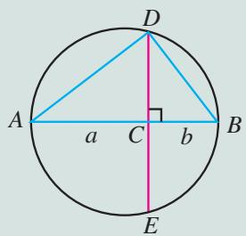

前面我们利用完全平方公式得出了一类重要不等式：

$\forall a, b \in \mathbf{R}$ , 有

$$
a ^ {2} + b ^ {2} \geqslant 2 a b,
$$

当且仅当 $a=b$ 时，等号成立.

特别地，如果 $a > 0$ ， $b > 0$ ，我们用 $\sqrt{a}$ ， $\sqrt{b}$ 分别代替上式中的 $a$ ， $b$ ，可得

$$
\sqrt {a b} \leqslant \frac {a + b}{2},\tag{1}
$$

当且仅当 $a=b$ 时，等号成立.

通常称不等式（1）为[基本不等式](../%E6%A6%82%E5%BF%B5%E6%88%96%E5%85%AC%E5%BC%8F/%E6%A6%82%E5%BF%B5-%E5%9F%BA%E6%9C%AC%E4%B8%8D%E7%AD%89%E5%BC%8F.md)（basic inequality）。其中， $\frac{a + b}{2}$ 叫做正数 $a, b$ 的算术平均数， $\sqrt{ab}$ 叫做正数 $a, b$ 的几何平均数。

基本不等式表明：两个正数的算术平均数不小于它们的几何平均数.

上面通过考察 $a^2 + b^2 \geqslant 2ab$ 的特殊情形获得了基本不等式，也可以直接利用不等式的性质推导出基本不等式（分析法）：

要证

$$
\sqrt {a b} \leqslant \frac {a + b}{2},\tag{①}
$$

只要证

$$
2 \sqrt {a b} \leqslant a + b.\tag{②}
$$

要证②，只要证

$$
2 \sqrt {a b} - a - b \leqslant 0.\tag{③}
$$

要证③，只要证

$$
- (\sqrt {a} - \sqrt {b}) ^ {2} \leqslant 0.\tag{④}
$$

要证④，只要证

$$
(\sqrt {a} - \sqrt {b}) ^ {2} \geqslant 0.\tag{⑤}
$$

显然，⑤成立，当且仅当 $a = b$ 时，⑤中的等号成立.

只要把上述过程倒过来，就能直接推出基本不等式了.

基本不等式的几何解释：在图 2.2-1 中， $AB$ 是圆的直径，点 $C$ 是 $AB$ 上一点， $AC = a$ ， $BC = b$ 。过点 $C$ 作垂直于 $AB$ 的弦 $DE$ ，连接 $AD$ ， $BD$ 。

  
图2.2-1

如图 2.2-1，可证 $\triangle ACD\sim \triangle DCB$ ，因而 $CD = \sqrt{ab}$ ．由于 $CD$ 小于或等于圆的半径，用不等式表示为

$$
\sqrt {a b} \leqslant \frac {a + b}{2}.
$$

显然，当且仅当点 $C$ 与圆心重合，即当 $a=b$ 时，上述不等式的等号成立.
