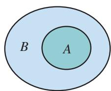

一般地，对于两个集合 A，B，如果集合 A 中任意一个元素都是集合 B 中的元素，就称集合 A 为集合 B 的子集 (subset)，记作

$$
A \subseteq B (\text {或} B \supseteq A),
$$

读作 “A 包含于 B”（或 “B 包含 A”）.

在数学中，我们经常用平面上封闭曲线的内部代表集合，这种图称为Venn图．这样，上述集合 $A$ 与集合 $B$ 的包含关系，可以用图1.2-1表示.

  
图1.2-1

在（3）中，由于“两条边相等的三角形”是等腰三角形，因此，集合 $E$ ， $F$ 都是由所有等腰三角形组成的集合.即集合 $E$ 中任何一个元素都是集合 $F$ 中的元素，同时，集合 $F$ 中任何一个元素也都是集合 $E$ 中的元素．这样，集合 $E$ 的元素与集合 $F$ 的元素是一样的.
