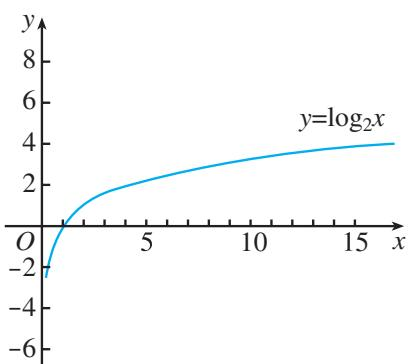
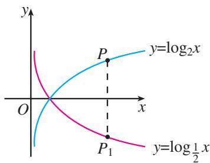
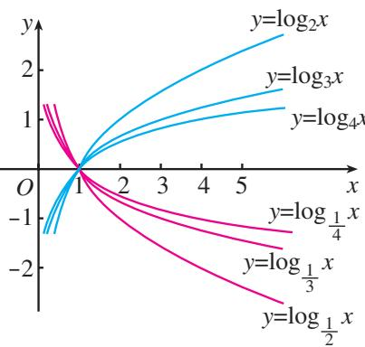
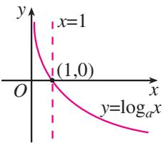
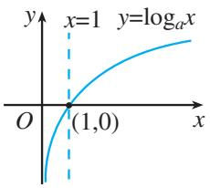

与研究指数函数一样，研究对数函数时首先画出其图象，然后借助图象研究其性质。

先画函数 $y=\log_{2}x$ 的图象。列出 $x$ ， $y$ 的对应值表（表 4.4-1），并用描点法画出函数 $y = \log_2 x$ 的图象（图 4.4-2）。

表4.4-1

<table><tr><td>x</td><td>y</td></tr><tr><td>0.5</td><td>-1</td></tr><tr><td>1</td><td>0</td></tr><tr><td>2</td><td>1</td></tr><tr><td>4</td><td>2</td></tr><tr><td>6</td><td>2.58</td></tr><tr><td>8</td><td>3</td></tr><tr><td>12</td><td>3.58</td></tr><tr><td>16</td><td>4</td></tr></table>

  
图4.4-2

底数互为倒数的两个指数函数的图象关于 $y$ 轴对称，对于底数互为倒数的两个对数函数（如 $y = \log_2 x$ 和 $y = \log_{\frac{1}{2}} x$ ），同样具有对称关系：利用换底公式，可以得到 $y = \log_{\frac{1}{2}} x = -\log_2 x$ 。因为点 $(x, y)$ 与点 $(x, -y)$ 关于 $x$ 轴对称，所以 $y = \log_2 x$ 图象上任意一点 $P(x, y)$ 关于 $x$ 轴的对称点 $P_1(x, -y)$ 都在 $y = \log_{\frac{1}{2}} x$ 的图象上，反之亦然。由此可知，底数互为倒数的两个对数函数的图象关于 $x$ 轴对称。根据这种对称性，就可以利用 $y = \log_2 x$ 的图象画出 $y = \log_{\frac{1}{2}} x$ 的图象（图 4.4-3）。

  
图4.4-3

如图 4.4-4，选取底数 $a(a > 0$ ，且 $a \neq 1)$ 的若干个不同值，在同一直角坐标系内用计算工具画图，发现对数函数 $y = \log_a x$ 的图象按底数 $a$ 的取值，可分为 $0 < a < 1$ 和 $a > 1$ 两种类型。因此，对数函数的性质也可以分 $0 < a < 1$ 和 $a > 1$ 两种情况进行研究。

  
图4.4-4

一般地，[对数函数的图象和性质](%E7%9F%A5%E8%AF%86%E7%82%B9-%E5%AF%B9%E6%95%B0%E5%87%BD%E6%95%B0%E7%9A%84%E5%9B%BE%E8%B1%A1%E5%92%8C%E6%80%A7%E8%B4%A8.md)如表 4.4-2 所示.

表4.4-2

<table><tr><td>项目</td><td>0&lt;a&lt;1</td><td>a&gt;1</td></tr><tr><td>图象</td><td></td><td></td></tr><tr><td>定义域</td><td colspan="2">(0,+∞)</td></tr><tr><td>值域</td><td colspan="2">R</td></tr><tr><td rowspan="2">性质</td><td colspan="2">(1)过定点(1,0),即x=1时,y=0</td></tr><tr><td>(2)减函数</td><td>(2)增函数</td></tr></table>
