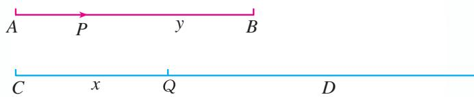

# 对数的发明历史

16、17世纪之交，天文、航海、工程、贸易以及军事快速发展，对大数的运算提出了更高的要求，改进数字计算方法、提高计算速度和准确度成了当务之急。苏格兰数学家纳皮尔（J. Napier，1550—1617）在研究天文学的过程中，经过对运算体系的多年研究，最终找到了简化大数运算的有效工具，于1614年出版了《奇妙的对数定律说明书》，标志着对数的诞生。在这本书中，纳皮尔借助运动学，用几何术语阐述了对数方法。

如图1，假定两点 $P$ ， $Q$ 以相同的初速度运动．点 $Q$ 沿直线 $CD$ 作匀速运动， $CQ = x$ ；点 $P$ 沿线段 $AB$ （长度为 $10^{7}$ 单位）运动，它在任何一点的速度值等于它尚未经过的距离（ $PB = y$ ）。令 $P$ 与 $Q$ 同时分别从 $A$ ， $C$ 出发，那么，定义 $x$ 为 $y$ 的对数.

  
图1

用现在的数学符号来叙述，纳皮尔的对数中， $x$ 与 $y$ 的对应关系就是

$$
y = 1 0 ^ {7} \left(\frac {1}{\mathrm{e}}\right) ^ {\frac {x}{1 0 ^ {7}}}.
$$

其中，e 为自然对数的底。利用对数，纳皮尔制作了 $0^{\circ} \sim 90^{\circ}$ 每隔 $1'$ 的八位三角函数表，但是这种方法不够方便和简捷。

把对数加以改造并使之广泛流传的是纳皮尔的朋友布里格斯（H. Briggs, 1561—1631）。他通过研究《奇妙的对数定律说明书》，感到其中的对数用起来很不方便，于是与纳皮尔商定，使1的对数为0，10的对数为1，这样就得到了现在所用的以10为底的常用对数。由于我们的数系是十进制，因此它在数值计算上具有优越性。1624年，布里格斯出版了《对数算术》，公布了以10为底包含1～20000及90000～100000的14位常用对数表。

根据对数运算原理，人们还发明了对数计算尺。300多年来，对数计算尺一直是科学工作者，特别是工程技术人员必备的计算工具，直到20世纪70年代才让位给电子计算器。尽管作为一种计算工具，对数计算尺、对数表现在都不再重要了，但是，对数的思想方法，即把乘方和乘法运算分别转化为乘法和加法，在今天仍然具有生命力。

从对数发明的过程可以发现，纳皮尔在讨论对数概念时，并没有使用指数与对数的互逆关系，主要是当时还没有明确的指数概念，就连指数符号也是在20多年后的1637年由法国数学家笛卡儿开始使用。直到18世纪，瑞士数学家欧拉才发现指数与对数的互逆关系，并在1770年出版的一部著作中，首先使用 $y = a^{x}$ 来定义 $x = \log_{a}y$ 。他指出，“对数源出于指数”。然而对数的发明先于指数，这成为数学史上的珍闻。

从对数的发明过程可以看到，社会生产、科学技术的需要是数学发展的主要动力。建立对数与指数之间联系的过程表明，使用较好的符号体系和运算规则不仅对数学的发展至关重要，而且可以大大减轻人们的思维负担。

## 所属组织

- [阅读与思考 对数的发明](../%E7%9F%A5%E8%AF%86%E4%B8%B2%E8%81%94/%E4%BA%BA%E6%95%99A-%E5%BF%85%E4%BF%AE%E7%AC%AC%E4%B8%80%E5%86%8C/%E7%AC%AC%E5%9B%9B%E7%AB%A0%20%E6%8C%87%E6%95%B0%E5%87%BD%E6%95%B0%E4%B8%8E%E5%AF%B9%E6%95%B0%E5%87%BD%E6%95%B0/%E9%98%85%E8%AF%BB%E4%B8%8E%E6%80%9D%E8%80%83%20%E5%AF%B9%E6%95%B0%E7%9A%84%E5%8F%91%E6%98%8E.md)

## 相关练习组织（范围关联）

- [第四章 指数函数与对数函数](../%E9%A2%98%E5%9E%8B/%E6%8C%89%E7%AB%A0%E8%8A%82%E5%88%86%E7%B1%BB/%E4%BA%BA%E6%95%99A-%E5%BF%85%E4%BF%AE%E7%AC%AC%E4%B8%80%E5%86%8C/%E7%AC%AC%E5%9B%9B%E7%AB%A0%20%E6%8C%87%E6%95%B0%E5%87%BD%E6%95%B0%E4%B8%8E%E5%AF%B9%E6%95%B0%E5%87%BD%E6%95%B0/%E7%AC%AC%E5%9B%9B%E7%AB%A0%20%E6%8C%87%E6%95%B0%E5%87%BD%E6%95%B0%E4%B8%8E%E5%AF%B9%E6%95%B0%E5%87%BD%E6%95%B0.md)
