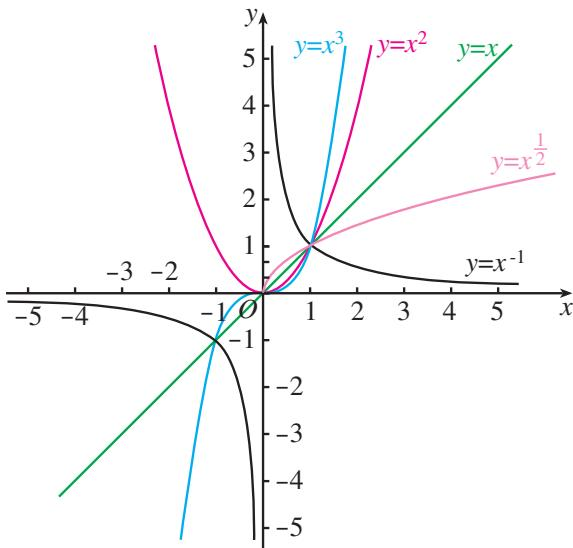

研究常见幂函数 $y = x$ ， $y = x^2$ ， $y = x^3$ ， $y = x^{\frac{1}{2}}$ 和 $y = x^{-1}$ 时，通常可以先根据函数解析式求出函数的定义域，画出函数的图象；再利用图象和解析式，讨论函数的值域、单调性、奇偶性等问题。

在同一坐标系中画出函数 $y = x$ ， $y = x^2$ ， $y = x^3$ ， $y = x^{\frac{1}{2}}$ 和 $y = x^{-1}$ 的图象（图3.3-1）。

  
图3.3-1

观察函数图象并结合函数解析式，可将这五个幂函数的基本性质整理如表3.3-1。

表3.3-1

<table><tr><td>项目</td><td> $y = x$ </td><td> $y = {x}^{2}$ </td><td> $y = {x}^{3}$ </td><td> $y = {x}^{\frac{1}{2}}$ </td><td> $y = {x}^{-1}$ </td></tr><tr><td>定义域</td><td> $\mathbf{R}$ </td><td> $\mathbf{R}$ </td><td> $\mathbf{R}$ </td><td> $[0,+\infty)$ </td><td> $\{x\mid x\neq 0\}$ </td></tr><tr><td>值域</td><td> $\mathbf{R}$ </td><td> $[0,+\infty)$ </td><td> $\mathbf{R}$ </td><td> $[0,+\infty)$ </td><td> $\{y\mid y\neq 0\}$ </td></tr><tr><td>奇偶性</td><td>奇函数</td><td>偶函数</td><td>奇函数</td><td>非奇非偶函数</td><td>奇函数</td></tr><tr><td>单调性</td><td>在 $\mathbf{R}$ 上单调递增</td><td>在 $(-\infty,0]$ 上单调递减，在 $[0,+\infty)$ 上单调递增</td><td>在 $\mathbf{R}$ 上单调递增</td><td>在 $[0,+\infty)$ 上单调递增</td><td>在 $(-\infty,0)$ 和 $(0,+\infty)$ 上分别单调递减</td></tr></table>

通过图3.3-1与表3.3-1，我们得到：

（1）函数 $y = x$ ， $y = x^2$ ， $y = x^3$ ， $y = x^{\frac{1}{2}}$ 和 $y = x^{-1}$ 的图象都通过点（1，1）；

(2) 函数 $y = x$ , $y = x^3$ , $y = x^{-1}$ 是奇函数, 函数 $y = x^2$ 是偶函数;

（3）在区间 $(0, +\infty)$ 上，函数 $y = x$ ， $y = x^{2}$ ， $y = x^{3}$ ， $y = x^{\frac{1}{2}}$ 单调递增，函数 $y = x^{-1}$ 单调递减；

（4）在第一象限内，函数 $y=x^{-1}$ 的图象向上与 $y$ 轴无限接近，向右与 $x$ 轴无限接近.

例 证明幂函数 $f(x)=\sqrt{x}$ 是增函数.

证明：函数的定义域是 $[0, +\infty)$ .

$\forall x_{1}, x_{2}\in[0,+\infty)$ ，且 $x_{1}<x_{2}$ ，有

$$
\begin{array}{r l} f (x _ {1}) - f (x _ {2}) & = \sqrt {x _ {1}} - \sqrt {x _ {2}} \\ & = \frac {(\sqrt {x _ {1}} - \sqrt {x _ {2}}) (\sqrt {x _ {1}} + \sqrt {x _ {2}})}{\sqrt {x _ {1}} + \sqrt {x _ {2}}} \\ & = \frac {x _ {1} - x _ {2}}{\sqrt {x _ {1}} + \sqrt {x _ {2}}}. \end{array}
$$

因为

$$
x _ {1} - x _ {2} <   0, \sqrt {x _ {1}} + \sqrt {x _ {2}} > 0,
$$

所以 $f(x_{1}) < f(x_{2})$ ，即幂函数 $f(x) = \sqrt{x}$ 是增函数.
