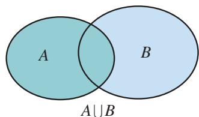

一般地，由所有属于集合 A 或属于集合 B 的元素组成的集合，称为集合 A 与 B 的[并集](%E7%9F%A5%E8%AF%86%E7%82%B9-%E5%B9%B6%E9%9B%86.md)（union set），记作 $A \cup B$ （读作 “A 并 B”），即

  
图1.3-1

$$
A \bigcup B = \{x   |   x \in A  ,   \text {或}   x \in B \}  ,
$$

可用 Venn 图（图 1.3-1）表示.

这样，在问题（1）（2）中，集合 $A$ 与 $B$ 的并集是 $C$ ，即

$$
A \bigcup B = C.
$$
