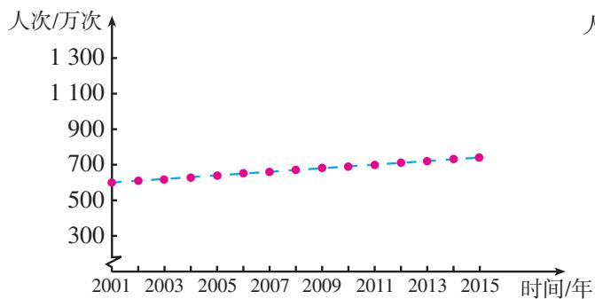
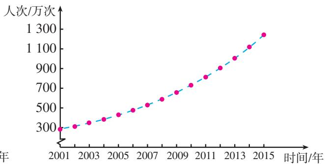

# 指数函数的概念

问题 1 随着中国经济高速增长，人民生活水平不断提高，旅游成了越来越多家庭的重要生活方式。由于旅游人数不断增加，A，B两地景区自2001年起采取了不同的应对措施，A地提高了景区门票价格，而B地则取消了景区门票。表4.2-1给出了A，B两地景区2001年至2015年的游客人次以及逐年增加量。

表4.2-1

<table><tr><td rowspan="2">时间/年</td><td colspan="2">A 地景区</td><td colspan="2">B 地景区</td></tr><tr><td>人次/万次</td><td>年增加量/万次</td><td>人次/万次</td><td>年增加量/万次</td></tr><tr><td>2001</td><td>600</td><td></td><td>278</td><td></td></tr><tr><td>2002</td><td>609</td><td>9</td><td>309</td><td>31</td></tr><tr><td>2003</td><td>620</td><td>11</td><td>344</td><td>35</td></tr><tr><td>2004</td><td>631</td><td>11</td><td>383</td><td>39</td></tr><tr><td>2005</td><td>641</td><td>10</td><td>427</td><td>44</td></tr><tr><td>2006</td><td>650</td><td>9</td><td>475</td><td>48</td></tr><tr><td>2007</td><td>661</td><td>11</td><td>528</td><td>53</td></tr><tr><td>2008</td><td>671</td><td>10</td><td>588</td><td>60</td></tr><tr><td>2009</td><td>681</td><td>10</td><td>655</td><td>67</td></tr><tr><td>2010</td><td>691</td><td>10</td><td>729</td><td>74</td></tr><tr><td>2011</td><td>702</td><td>11</td><td>811</td><td>82</td></tr><tr><td>2012</td><td>711</td><td>9</td><td>903</td><td>92</td></tr><tr><td>2013</td><td>721</td><td>10</td><td>1 005</td><td>102</td></tr><tr><td>2014</td><td>732</td><td>11</td><td>1 118</td><td>113</td></tr><tr><td>2015</td><td>743</td><td>11</td><td>1 244</td><td>126</td></tr></table>

第四章 指数函数与对数函数

比较两地景区游客人次的变化情况，你发现了怎样的变化规律？

为了有利于观察规律，根据表 4.2-1，分别画出 A，B 两地景区采取不同措施后的 15 年游客人次的图象（图 4.2-1 和图 4.2-2）.

  
图4.2-1

为了便于观察，可以先根据表格中的数据描点，然后用光滑的曲线将离散的点连起来.

  
图4.2-2

观察图象和表格，可以发现，A 地景区的游客人次近似于直线上升（线性增长），年增加量大致相等（约为 10 万次）；B 地景区的游客人次则是非线性增长，年增加量越来越大，但从图象和年增加量都难以看出变化规律.

探究

我们知道，年增加量是对相邻两年的游客人次做减法得到的。能否通过对B地景区每年的游客人次做其他运算发现游客人次的变化规律呢？请你试一试。

从 2002 年起，将 B 地景区每年的游客人次除以上一年的游客人次，可以得到

$$
\frac {2 0 0 2 \text {年游客人次}}{2 0 0 1 \text {年游客人次}} = \frac {3 0 9}{2 7 8} \approx 1. 1 1,
$$

$$
\frac {2 0 0 3 \text {年游客人次}}{2 0 0 2 \text {年游客人次}} = \frac {3 4 4}{3 0 9} \approx 1. 1 1,
$$

$$
\frac {2 0 1 5 \text {年游客人次}}{2 0 1 4 \text {年游客人次}} = \frac {1 2 4 4}{1 1 1 8} \approx 1. 1 1.
$$

结果表明，B地景区的游客人次的年增长率都约为 $1.11 - 1 = 0.11$ ，是一个常数.

像这样，增长率为常数的变化方式，我们称为指数增长。因此，B地景区的游客人次近似于指数增长。

显然，从2001年开始，B地景区游客人次的变化规律可以近似描述为：

1年后，游客人次是2001年的 $1.11^{1}$ 倍；

做减法可以得到游客人次的年增加量，做除法可以得到游客人次的年增长率。增加量、增长率是刻画事物变化规律的两个很重要的量。

2年后，游客人次是2001年的 $1.11^{2}$ 倍；

3年后，游客人次是2001年的 $1.11^{3}$ 倍；

●●●●●●

x年后，游客人次是2001年的 $1.11^{x}$ 倍.

如果设经过 $x$ 年后的游客人次为2001年的 $y$ 倍，那么

$$
y = 1. 1 1 ^ {x} (x \in [ 0, + \infty)).\tag{①}
$$

这是一个函数，其中指数 $x$ 是自变量.

问题 2 当生物死亡后，它机体内原有的碳 14 含量会按确定的比率衰减（称为衰减率），大约每经过 5730 年衰减为原来的一半，这个时间称为“半衰期”。按照上述变化规律，生物体内碳 14 含量与死亡年数之间有怎样的关系？

设死亡生物体内碳 14 含量的年衰减率为 p，如果把刚死亡的生物体内碳 14 含量看成 1 个单位，那么

死亡 1 年后，生物体内碳 14 含量为 $(1-p)^{1}$ ;

死亡 2 年后，生物体内碳 14 含量为 $(1-p)^{2}$ ;

死亡 3 年后，生物体内碳 14 含量为 $(1-p)^{3}$ ;

......

死亡 5 730 年后，生物体内碳 14 含量为 $(1-p)^{5\ 730}$ .

根据已知条件， $(1 - p)^{5730} = \frac{1}{2}$ ，从而 $1 - p = \left(\frac{1}{2}\right)^{\frac{1}{5730}}$ ，所以 $p = 1 - \left(\frac{1}{2}\right)^{\frac{1}{5730}}$ 。

设生物死亡年数为 $x$ ，死亡生物体内碳14含量为 $y$ ，那么 $y = (1 - p)^x$ ，即

$$
y = \left(\left(\frac {1}{2}\right) ^ {\frac {1}{5 7 3 0}}\right) ^ {x} (x \in [ 0, + \infty)).\tag{②}
$$

这也是一个函数，指数 $x$ 是自变量。死亡生物体内碳14含量每年都以 $1 - \left(\frac{1}{2}\right)^{\frac{1}{5730}}$ 的衰减率衰减。像这样，衰减率为常数的变化方式，我们称为指数衰减。因此，死亡生物体内碳14含量呈指数衰减。

如果用字母 $a$ 代替上述①②两式中的底数1.11和 $\left(\frac{1}{2}\right)^{\frac{1}{5730}}$ ，那么函数 $y = 1.11^{x}$ 和 $y = \left(\left(\frac{1}{2}\right)^{\frac{1}{5730}}\right)^{x}$ 就可以表示为

$$
y = a ^ {x}
$$

的形式，其中指数 x 是自变量，底数 a 是一个大于 0 且不等于 1 的常量.

一般地，函数 $y = a^{x} (a > 0$ ，且 $a \neq 1$ 叫做[指数函数](%E7%9F%A5%E8%AF%86%E7%82%B9-%E6%8C%87%E6%95%B0%E5%87%BD%E6%95%B0%E7%9A%84%E6%A6%82%E5%BF%B5.md)（exponential function），其中指数 $x$ 是自变量，定义域是 R.
