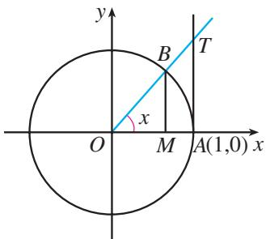
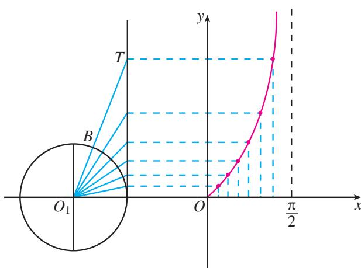
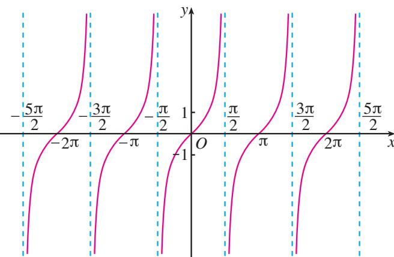

利用正切函数的周期性和奇偶性，可以先考察函数 $y = \tan x, x \in \left[0, \frac{\pi}{2}\right)$ 的图象与性质，然后再根据奇偶性、周期性进行拓展。

1. 函数 $y = \tan x, x \in \left[0, \frac{\pi}{2}\right)$ 的图象

如图 5.4-9，设 $x \in \left[0, \frac{\pi}{2}\right)$ ，在直角坐标系中画出角 $x$ 的终边与单位圆的交点 $B(x_{0}, y_{0})$ 。过点 $B$ 作 $x$ 轴的垂线，垂足为 $M$ ；过点 $A(1, 0)$ 作 $x$ 轴的垂线与角 $x$ 的终边交于点 $T$ ，则

$$
\tan x = \frac {y _ {0}}{x _ {0}} = \frac {M B}{O M} = \frac {A T}{O A} = A T.
$$

由此可见，当 $x \in \left[0, \frac{\pi}{2}\right)$ 时，线段 $AT$ 的长度就是相应角 $x$ 的正切值。我们可以利用线段 $AT$ 画出函数 $y = \tan x, x \in \left[0, \frac{\pi}{2}\right)$ 的图象，如图 5.4-10 所示。

  
图5.4-9

  
图5.4-10

观察图 5.4-10 可知，当 $x \in \left[0, \frac{\pi}{2}\right)$ 时，随着 $x$ 的增大，线段 $AT$ 的长度也在增大，而且当 $x$ 趋向于 $\frac{\pi}{2}$ 时， $AT$ 的长度趋向于无穷大。相应地，函数 $y=\tan x,\quad x\in\left[0,\frac{\pi}{2}\right)$ 的图象从左向右呈不断上升趋势，且向右上方无限逼近直线 $x=\frac{\pi}{2}$ 。

2. 正切曲线及其特征

借助以上结论，根据正切函数是奇函数，只要画 $y = \tan x, x \in \left[0, \frac{\pi}{2}\right)$ 的图象关于原点的对称图形，就可得到 $y = \tan x, x \in \left(-\frac{\pi}{2}, 0\right]$ 的图象；根据正切函数的周期性，只要把函数 $y = \tan x, x \in \left(-\frac{\pi}{2}, \frac{\pi}{2}\right)$ 的图象向左、右平移，每次平移 $\pi$ 个单位，就可得到正切函数

$$
y = \tan x, \quad x \in \mathbf {R}, \ x \neq \frac {\pi}{2} + k \pi , \ k \in \mathbf {Z}
$$

的图象，我们把它叫做正切曲线（tangent curve）（图 5.4-11）。

  
图5.4-11

从图 5.4-11 可以看出，正切曲线是由被与 $y$ 轴平行的一系列直线 $x = \frac{\pi}{2} + k\pi, k \in \mathbf{Z}$ 所隔开的无穷多支形状相同的曲线组成的。

3. 单调性与值域

观察正切曲线可知，正切函数在区间 $\left(-\frac{\pi}{2}, \frac{\pi}{2}\right)$ 上单调递增。由正切函数的周期性可得，

正切函数在每一个区间 $\left(-\frac{\pi}{2} + k\pi, \frac{\pi}{2} + k\pi\right) (k \in \mathbf{Z})$ 上都单调递增。

当 $x \in \left(-\frac{\pi}{2}, \frac{\pi}{2}\right)$ 时， $\tan x$ 在 $(-\infty, +\infty)$ 内可取到任意实数值，但没有最大值、最小值。因此，正切函数的值域是实数集 $\mathbf{R}$ 。
